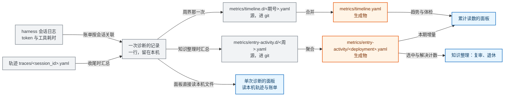
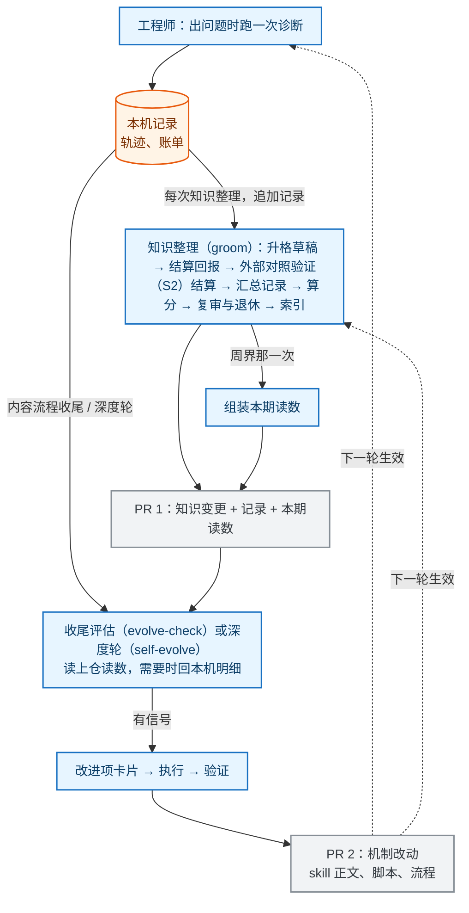
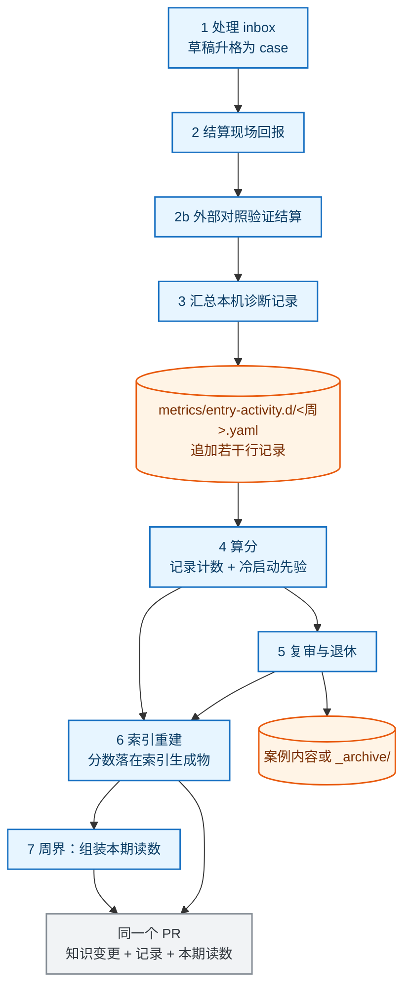

# 一次诊断记录什么、怎么上仓

诊断在本机跑，记录也留在本机；只有汇总后的读数会提交进仓库，下文把这件事叫上仓。本文说明一次诊断产出哪些文件与字段、这些记录怎么攒成可以提交的形式、以及在多人、多 worktree、多次回报的条件下怎么不出冲突。

读者是要改轨迹字段、上仓脚本、面板或知识整理流程的人。前置有三件：诊断六步各写什么，见 [diagnosis-trace.md](../../skills/diagnose/references/diagnosis-trace.md)；指标怎么算，见 [metrics.md](../guide/metrics.md)；机制层怎么演化，见 [rsi-mechanism.md](rsi-mechanism.md)。只想拿到一次诊断结论的工程师不必读。

取舍与被否决的方案在 [ADR-0011](../adr/0011-diagnosis-observability-data-plane.md)。

## 1 解决什么问题

这套记录要回答五个问题。

1. 一次诊断产出什么数据、什么产物、记哪些字段。
2. 本机跑了十次诊断，怎么变成仓库里的一份读数。
3. 观测数据与案例库、先验库是否解耦，加观测要不要动知识条目。
4. 多人提 PR 时，同一条案例的读数变化会不会撞车，改动面有多大。
5. 工程师回报「解决 / 没解决」时，读数能不能跟着准确更新。

设计时（2026-09）有五个缺口，每条都能在本机复算；它们就是本文要闭合的东西，落地结果见第 5 节。保留这五条是为了让后来的人知道这套机制为什么长这样：

1. 轨迹里有事件，但没有脚本把它汇总成一次诊断的成本与用到的知识（当时的缺口记在 `scripts/trace_entry_activity.py` 的头注里）。
2. 仓库里的汇总只到条目级一处：期文件的 `metrics.reference_detail`（某条先验被引用几次），案例侧没有对应数据。
3. 有十个指标有产出、也在字段白名单里，8 期期文件一次都没写过（复算：见 3.6 的说明；白名单在 `scripts/verify_metrics.py:40-60`）。
4. 归因比读错了键，恒为 0。读端只读 `verdict`，规范也要求写 `verdict`（`skills/diagnose/references/diagnosis-procedure.md:331`），而生产端实际写的是 `attribution_kind`。复算：`python3 scripts/component_tally.py --json` 统计归因事件的两种键；当前主检出的轨迹里 7 条归因事件中 4 条写 `attribution_kind`、3 条两个键都没有。
5. 三期现场快照的反馈捕获都是 0（`metrics/timeline.d/` 的三条 live 期），误诊率与归因比因此没有分母。

本文不解决四件事。诊断流程内部的执行规则在 `skills/diagnose/` 正文里。检索不上向量库（见 [ADR-0002](../adr/0002-retrieval-no-rag-lightweight-index.md)）。判据数值（阈值与可解读性下限）只有人能改。读数不做跨部署合并。

## 2 最小可执行模型

记录分三层，只有后两层进仓库。

| 层 | 内容 | 键 | 谁写 | 进 git |
|---|---|---|---|---|
| 一次诊断 | 这次诊断的路由、行为、成本、结局、碰到的知识条目（下文叫触达） | `session_id` | 收尾时由脚本从轨迹与会话日志汇总 | 否，含客户现场信息 |
| 条目使用记录（下文简称记录层） | 某个案例或先验在一期内的使用增量 | 条目 id 与运行号 | 知识整理时由脚本追加 | 是 |
| 期 | 一个部署在一期内的全部读数 | 期号（一期一个文件） | 组装脚本产出，维护者复核分母 | 是 |



图 1　一次诊断的记录与上仓（类型：数据流图；范围：从本机记录到面板与知识整理，省略结构侧与评测侧指标）

图例：灰色是本机记录与源文件，橙色是生成物，蓝色是消费方。图里「知识整理时汇总」是一个动作，不是第四层记录。

单次诊断的面板读本机记录，摊开这一次：走对了没有、成本落在哪一步、哪些动作没有推进。累计读数的面板读生成物，合并多期：被用得最多的案例与先验、最花成本的过程动作、正在变差的读数。两份读数都不手写。

## 3 完整机制

### 3.1 一次诊断产出什么

一次诊断在本地留下四样东西，第五样是本设计要补的。

| 产物 | 路径 | 内容 |
|---|---|---|
| 轨迹 | `traces/<session_id>.yaml` | 顶层字段加事件列表，每步一条 |
| 报告 | `traces/<session_id>.report.md` | 人读结论，与轨迹同目录 |
| 证据原件 | `traces/evidence/<session_id>/` | 工程师贴回的日志、截图 |
| 会话账单 | DSH 会话日志 | 提供方用量与工具耗时，按 `session_id` 关联 |
| 诊断记录（待补） | 本机派生，不落轨迹 | 上面四样汇总成一行，供汇总脚本读 |

其余本地件（源码缓存、上游文档缓存、回放产物、调研物料等）的路径见 [git-workflow.md](../guide/git-workflow.md) 的目录归属表，本文不重复。

诊断记录落在 `metrics/entry-activity.local/<session_id>.yaml`（gitignored、锚主检出）。它与轨迹的分工：轨迹是过程记录、由诊断按流程写；这一份是**派生**的、由收尾脚本写，含逐次工具调用明细与 token 账单——命令摘要与文件路径含现场信息，所以只留本机，不上仓（上仓的是聚合后的分布）。面板读它。

会话日志按 `session_id` 关联。轨迹的 `session_id` 是诊断自己起的名字（如 `2026-09-16-12430-dsv4pro-mc2`），harness 侧的会话号是另一套；轨迹顶层可选写 `harness_session` 给出后者。关联不上时那次会话的成本与工具分布**缺席**（字段留空、在输出里说明），不补估值。

这一行的字段如下。明细留本机，上仓只放聚合值；标「待接」的需要新增汇总代码。

| 字段 | 明细（本机，每会话） | 上仓形态 | 来源 | 状态 |
|---|---|---|---|---|
| `session_id` | 会话号 | 只做关联键 | 轨迹顶层 | 现成 |
| `window` | 起止时间 | 会话时长分布 | `created_at`、`updated_at` | 现成 |
| `detected` | 框架、平台、类别 | 按类别的会话数 | 轨迹顶层 | 现成 |
| `route` | 路由到的命名空间、候选数量、加载条数、命中案例 | 路由准确率与漏检类别（定义见 3.6）；候选数量的上限在 `docs/adr/0004-capacity-governance.md` 的候选上限参数（`soft_cap`），`metrics/gates.yaml` 只放读入成本与反馈捕获的线 | `triage`、`load_index`、`load_full`、`hit` | 现成 |
| `steps` | 步骤序列与各动作次数 | 各动作次数分布、步数中位数与 P90 | 事件计数 | 现成 |
| `tool_calls` | 每次工具调用一条：工具名、耗时、成功与否、命令摘要（上仓后写成 `kind: tool` 的记录行） | 生成物里的 `tools` 段：按工具的次数、耗时中位数与 P90、失败与超时数 | 会话日志，按 `session_id` 关联；轨迹里可选写 `harness_session` 给出 harness 侧会话号，不写就拿 `session_id` 试 | 已落地 |
| `touched` | 触达的案例 id 与先验 id，各带触达方式 | 条目使用记录 | `hit`、`load_full`、`reference_lookup`、`excluded_cases` | 现成 |
| `outcome` | 最终状态、是否给出 fix | 反馈捕获的分母、误诊率的分母 | 顶层 `status`、`resolved_at` | 现成 |
| `feedback` | 现场回报：案例 id、结果、确认日期 | 反馈捕获、误诊率 | 顶层 `feedback`（`skills/diagnose/references/diagnosis-trace.md` 的反馈闭环词表） | 现成 |
| `outcome.fix_emitted` | 是否给出了 fix | 沉淀漏斗的一格 | 顶层 `outcome.fix_emitted`，字段说明在 `diagnosis_state.yaml.example`；现有轨迹里不一定写，缺了就按「本次没记」显示 | 现成 |
| `sedimented` | 沉淀状态与案例 id | 面板的沉淀漏斗（诊断数 → 沉淀数 → 转正数） | 顶层 `sedimented` | 现成 |
| `cost.tokens` | 未缓存输入、缓存读、缓存写、输出 | 会话成本中位数与 P90、按动作占比 | 会话日志按 `(turn, step)` 去重、定稿优先 | 已落地 |
| `cost.index_read_tok` | 一次诊断读进来的 token 账，四个分项 | 命名空间 × 类别格子（下文简称格子）的读入成本 | `scripts/index_read_cost.py` 按视图现算；按会话归属取**这次会话实际读了哪些面** | 已落地 |
| `strength` | 结论强度档（与 3.6 的指标强度不是一回事） | 强度分布 | 见下表 | 已落地 |

字段取值如下表。枚举值照原样写，改中文读者对不上数据。

| 字段 | 类型 | 取值 | 说明 |
|---|---|---|---|
| `strength` | 枚举 | `upstream-fix-merged`、`upstream-official-doc`、`upstream-maintainer-confirmed`、`engineer-report`、`investigation`，以及本文新增的 `self-report` | 结论靠什么证据站住。命中案例时取该案例的 `verification.source`；无案例、靠源码分析或现场推理得出结论取 `investigation`；来源会话自证解决取 `self-report`（「自证」指来源会话自己回报的那个判断）（这一档是本文新增的，现有四处出处都还没有它）。前五档的来源与判据见 `examples/sample-case.yaml` 的 `verification` 块、`skills/knowledge-groom/SKILL.md` 的冷启动先验表、`skills/to-postmortem/SKILL.md` 的档位定义、`docs/mechanism/execution.md` 的通道表 |
| `route.routed` | 字符串 | 命名空间，如 `inference/vllm-ascend` | 路由判定结果，空表示没判出来 |
| `route.hit_case` | 字符串或空 | 案例 id | 阶段一命中的案例，与最终沉淀的案例可以不同 |
| `touched.cases` | 列表 | 案例 id | 含命中、被加载、被排除三种触达方式 |
| `touched.references` | 列表 | 先验词条 id | 来自 `reference_lookup` |
| `outcome.status` | 枚举 | `in_progress`、`resolved`、`escalated`、`archived`、`unknown` | 词表在 `trace-status.yaml:16-53`。`abandoned` 不在这里，它是顶层 `stop_reason` 的取值 |
| `feedback.outcome` | 枚举 | `pending`、`resolved`、`not_resolved`、`partial` | 现场回报结果，`pending` 表示还没回报。`feedback` 与 `outcome` 同为顶层字段，不是 `outcome` 的子键 |
| `sedimented.state` | 枚举 | `none`、`submitted`、`knowledge`、`archived` | 未沉淀、草稿待审、已进知识库、转历史资料兜底检索（Tier 3） |
| `tool_calls[].tool` | 字符串 | 工具名，如 `Grep`、`Read`、`Bash` | harness 侧的工具标识 |
| `tool_calls[].ms` | 整数 | 毫秒 | 单次调用耗时 |
| `tool_calls[].ok` | 布尔 | `true` / `false` | 失败或超时记 `false`，原因写 `error` |
| `cost.tokens` | 映射 | `uncached`、`cache_read`、`cache_write`、`out` | 四类 token 数，按 `(turn, step)` 去重后统计 |

条目使用记录里的计数各自只回答一个问题，口径如下。

| 计数 | 含义 | 什么事件算一次 |
|---|---|---|
| `selected` | 这个条目进了候选集 | 案例出现在 `considered_candidates`、`load_index` 或 `load_full` 的候选里；`hit` 与 `quickly_check` 事件里点名的 case 也计（能走到命中或验证，说明它进过候选集） |
| `loaded` | 读了它的正文 | `load_full` 的 `candidates` 含它，或 `quickly_check` 事件点了它（`quickly_check` 在阶段二的全文之上做验证） |
| `resolved` | 用它解决了问题 | 轨迹里出现 `{action: feedback, case, outcome: resolved}` 事件。结算脚本只认事件（`settle()` 只收 `action: feedback` 且 outcome 在词表内的事件）；顶层的 `feedback` 字段是当前状态，不是结算输入 |
| `misdiagnosed` | 用了它但没解决 | 同上的事件里 `outcome` 是 `not_resolved` 或 `partial` |
| `self_resolved` | 来源会话自己回报解决（自证） | 来源会话的 resolve，与 `resolved` 分开计；与 `self-report` 是同一件事的记录侧计数 |
| `lookups` | 查了一条先验 | 一次 `reference_lookup` 事件 |
| `hit` / `miss` / `skipped` | 查到 / 查了没命中 / 没查并写了理由 | `reference_lookup.outcome` 的三种取值 |
| `excluded` | 候选被排除 | 出现在 `excluded_cases` 或 `miss` 的 `excluded_cases` 里 |
| `purpose` | 为什么查这条先验 | `reference_lookup.purpose`：`collect`、`signature`、`background`、`fix`、`procedure` |

工具调用按次记，不合成一个总耗时。一次诊断里的工具调用几十次，单次耗时从几十毫秒到几万毫秒都有，失败与重试也各占一部分。要判「哪个工具该设硬超时」「失败集中在哪一步」「哪些调用读了却没被引用」，只用总耗时答不了。

生成物 `tools` 段的 `p50_ms` / `p90_ms` 是**按调用次数加权的各运行分位均值**：跨运行的分位数无法从各运行的分位数精确合成，这里给的是量级读数（强度按 3.6 记「代理」），逐次与逐运行的精确值只在本机明细里。次数、失败数与超时数是计数，仍按「确定性」读。

```yaml
tool_calls:
  - {step: 5, tool: Grep, ms: 1820, ok: true,  args: "hidden in should be|smaller|lora"}
  - {step: 5, tool: Read, ms: 240,  ok: true,  file: references/tools/msprobe-compare.yaml}
  - {step: 6, tool: Bash, ms: 9200, ok: false, args: "gh api repos/vllm-project/vllm-ascend/issues/12430", error: timeout}
```

明细不上仓，原因是命令原文与文件路径含现场信息。上仓的是按工具聚合后的分布（形态见 3.3 生成物样例里的 `tools` 段）。

明细不上仓不等于演进看不到它们。演进信号的读法分两层。第一层看仓库里的读数：哪些条目被选中却长期不解决、哪类漏检集中、哪个动作的成本占比在涨。第二层回本机明细：要判断某一类问题为什么贵、探索策略该改哪一处时，读本地记录里的步骤、工具调用与源码检索过程，这些细节只在产生它的那台机器上。

两层都能定位到具体对象：上仓读数带部署、期号与运行号，本机记录带 `session_id` 与 `kb_rev`。跨机要复现细节时走交接包（[handoff.md](../guide/handoff.md)）。

一条真实轨迹折出来的样子（取自 `traces/2026-09-16-12430-dsv4pro-mc2.yaml`，`cost` 段为待接字段，未填数值）。

```yaml
session_id: 2026-09-16-12430-dsv4pro-mc2
window: {start: '2026-09-16T16:00:00+08:00', end: '2026-09-16T18:20:00+08:00'}
detected: {framework: vllm-ascend, platform: A2-910B, category: interrupt}
route:
  routed: inference/vllm-ascend
  hit_case: VLLM-ASC-9005          # 检索命中的是 9005
steps: {count: 32, reference_lookup: 7, report: 6, attribution: 4, quickly_check: 3, ...}
touched:
  cases: [VLLM-ASC-9005, VLLM-ASC-12430, VLLM-ASC-12461, VLLM-ASC-7635, VLLM-ASC-9887, VLLM-ASC-13688, VLLM-ASC-10944]
  references: [cann-runtime-error-codes, cann-hdk, ascend-moe-comm-triage, aicore-error-fault-patterns, operator-exec-fault-patterns]
outcome: {status: resolved, fix_emitted: true}
feedback: {case: VLLM-ASC-12430, outcome: resolved, confirmed_at: '2026-09-16'}
sedimented: {state: knowledge, case_id: VLLM-ASC-12430}
cost: {tokens: {uncached: -, cache_read: -, cache_write: -, out: -}, index_read_tok: -}
tool_calls:                        # 逐次，见上表
strength: self-report              # 来源会话自证，取值见本节字段取值表
```

改汇总脚本时要处理两件事。检索命中的案例（9005）与最终沉淀的案例（12430）不是同一个，两个 id 各算一次触达。被排除的五个案例（`excluded_cases`）也算触达，它们是「检索到但被排除」，与「命中」分开计数。

### 3.2 什么时候汇总、谁触发

三个动作、两个 PR 流，顺序固定。



图 2　三个触发点与两个 PR 流（类型：数据流图；范围：诊断、知识整理、机制演进三条时间线）

图例：蓝色是动作，橙色是本机记录，灰色是 PR。实线传数据，虚线是下一轮生效。

诊断只在本机留记录，不进仓库。知识面的动作都在同一次知识整理里，一次运行追加一次记录，不重写已经写下的内容；本期读数只在周界那一次组装，一周一期。机制面的动作走另一条线：收尾评估（`evolve-check`）在内容流程收尾时自动跑，深度轮（`self-evolve`）在人要求做深度轮时跑。两者都先读上仓读数，要定位原因时回本机明细；有信号才产改进项卡片（`proposals/ideas/` 下的 EV 卡），卡攒批进一个 PR。

三类动作的边界如下。判据强度、失败代价与节律都不同，因此不合并。

| | 知识整理（groom） | 收尾评估（evolve-check） | 深度轮（self-evolve） |
|---|---|---|---|
| 触发 | 维护者每周跑，一天多次也行 | 知识整理收尾自动跑 | 人显式要求 |
| 做什么 | 按规则处理：升格、结算、汇总、算分、复审与退休、索引与本期读数 | 读本轮数据对照触发条件表，判断有没有机制面信号 | 跨轮聚合观察，提出并执行机制改动 |
| 判据 | 规则与记录，不需要假设 | 触发条件表（`skills/evolve-check/SKILL.md`） | 假设加前后对照与判据 |
| 产出 | 案例变更 + 条目使用记录 + 本期读数 | 有信号才产改进项卡片，不直接改机制 | 卡片执行、验证、攒批 |
| 进哪个 PR | PR 1：知识变更 | 攒批后 PR 2：机制改动 | 同 PR 2 |
| 并行度 | 一个主 agent 顺序跑完，不并行，因为改的是同一批文件 | 轻量，同会话或另起都行 | 卡片之间可并行，撞同一批文件的串行；合入判断留给人 |

不合并的理由有三条：判据不同（照规则处理 vs 提出假设并验证）、失败代价不同（知识错了能软退休与 revert，机制错了影响之后每一次诊断）、节律不同（每周必做 vs 有信号才做）。

因此不在知识整理里跑实验：未验证的机制改动会混进知识 PR。两个 PR 也不合并：模板、评审人与回退粒度都不同。

一次知识整理内部的顺序如下。本文的步骤编号自成一套，与 `skills/knowledge-groom/SKILL.md` 正文的编号不同名也不同数；那边的「软退休」对应本文第 5 步「复审与退休」。



图 3　一次知识整理内部的顺序（类型：数据流图；范围：八个步骤与每步写的文件）

图例：蓝色是步骤，橙色是被写的文件，灰色是最终 PR。这张图只画一次运行内部的写点，不含运行之间的先后（那在 5.2 的迁移阶段里）。

| 步骤 | 做什么 | 入口 | 写哪里 |
|---|---|---|---|
| 1 处理 inbox | 草稿升格为 case | `knowledge-groom` 的 intake 步骤 | `knowledge/<ns>/…yaml` |
| 2 结算现场回报 | 把 `feedback` 事件折成计数（只收 `action: feedback` 事件） | `scripts/settle_trace_feedback.py --apply` | 追加进条目使用记录（`kind: case` 行，只写 `resolved` / `misdiagnosed` / `self_resolved`；**不改案例文件**）|
| 2b 外部对照验证（S2）结算 | 把回放结果折成外部验证记录 | `scripts/settle_s2_feedback.py --apply` | 案例的 `validation_record` |
| 3 汇总本机记录 | 按 id 折算本次增量与工具分布 | `scripts/trace_entry_activity.py` | 追加进条目使用记录（`kind: case` 的触达三态 / `kind: ref` / `kind: tool`）+ 本机明细 |
| 4 算分 | 读记录计数与冷启动先验（条目还没有现场记录时用的初始分），算出每个条目的分数 | 新增 `scripts/score_entries.py` | 不落盘，作为第 5、6 步的输入 |
| 5 复审与退休 | 按记录与分数改内容或存续 | `knowledge-groom` 的复审步骤 | 案例文件或 `_archive/` |
| 6 索引重建 | 重建索引、算好的分数写进生成物，顺带出容量表 | `scripts/index_read_cost.py`、`scripts/build_index.py` | `knowledge/_index*` 生成物 |
| 7 组装本期读数 | 只做本期读数，周界那一次 | `scripts/metrics_snapshot.py` | `metrics/timeline.d/<期号>.yaml`（随后跑 `scripts/build_timeline.py` 重建聚合）|

「降置信」不是单独一步。分数由第 4 步算出来，低分就是降置信的结果；第 5 步做的是内容层的事：复审、合并、退休、补样例。

### 3.3 记录与生成物

条目使用记录与本期读数分开放，因为粒度不同：前者每次运行都增长，后者按周看趋势。`metrics/` 下有五份文件，两份是源、两份是生成物、一份是判据：期文件的源 `metrics/timeline.d/`、生成物 `metrics/timeline.yaml` 与判据 `metrics/gates.yaml`，条目使用记录的源 `metrics/entry-activity.d/` 与生成物 `metrics/entry-activity/`。

| 文件 | 角色 | 谁写 | 进 git | 谁读 |
|---|---|---|---|---|
| `metrics/entry-activity.d/<周>.yaml` | 源：条目使用记录，一周一个文件，每次运行追加若干行 | 汇总与结算脚本 | 是 | 聚合脚本 |
| `metrics/timeline.d/<期号>.yaml` | 源：本期读数，一周一期 | 组装脚本产出，维护者复核分母 | 是 | 聚合脚本 |
| `metrics/entry-activity/<deployment>.yaml` | 生成物：本部署按 id 汇总，一个部署一份 | `scripts/build_entry_activity.py` | 是 | 面板、知识整理 |
| `metrics/timeline.yaml` | 生成物：全部期文件合成一条时间线 | `scripts/build_timeline.py` | 是 | 面板、体检器、演进看板 |
| `metrics/gates.yaml` | 判据数值，不是指标 | 人 | 是 | 体检器（`scripts/metrics_health.py`） |

记录必须一行一条。`merge=union` 是行级合并：嵌套结构里两人在同一处各插一段，会拼出非法 YAML。这条教训仓库里已经记过（`.gitattributes` 里对 `knowledge/_index.yaml` 为什么不配 union 的注释）。所以源文件压成一行一条自包含的记录，每行带 `run`、`kind` 与 `id`：

```yaml
# metrics/entry-activity.d/2026-W42.yaml（一周一个文件，每次知识整理追加若干行）
- {run: 2026-10-16-0920, deployment: local-a2, checkout: a1b2c3d, kb_rev: 2a931ee, sessions: 3, kind: case, id: VLLM-ASC-12430, selected: 3, loaded: 2, resolved: 0, misdiagnosed: 0, self_resolved: 0, excluded: 0}
- {run: 2026-10-16-0920, deployment: local-a2, checkout: a1b2c3d, kb_rev: 2a931ee, sessions: 3, kind: ref,  id: cann-runtime-error-codes, lookups: 6, hit: 5, miss: 1, skipped: 0, purpose: {signature: 3, background: 2, fix: 1}}
- {run: 2026-10-16-0920, deployment: local-a2, checkout: a1b2c3d, kb_rev: 2a931ee, kind: tool, id: grep, calls: 41, p50_ms: 900, p90_ms: 9200, errors: 2, timeouts: 1}
- {run: 2026-10-16-0920, deployment: local-a2, checkout: a1b2c3d, kb_rev: 2a931ee, sessions: 3, kind: case, id: VLLM-ASC-7635, selected: 1, loaded: 0, resolved: 0, misdiagnosed: 0, self_resolved: 0, excluded: 1}
- {run: 2026-10-16-1215, deployment: local-a2, checkout: a1b2c3d, kb_rev: 2a931ee, sessions: 1, kind: case, id: VLLM-ASC-12430, selected: 0, loaded: 0, resolved: 1, misdiagnosed: 0, self_resolved: 0, excluded: 0}
- {run: 2026-10-17-1005, deployment: local-a2, checkout: a1b2c3d, kb_rev: 2a931ee, sessions: 2, kind: case, id: VLLM-ASC-12430, selected: 2, loaded: 1, resolved: 0, misdiagnosed: 0, self_resolved: 0, excluded: 0}
- {run: 2026-10-17-1005, deployment: local-a2, checkout: a1b2c3d, kb_rev: 2a931ee, kind: tool, id: read, calls: 12, p50_ms: 130, p90_ms: 400, errors: 0, timeouts: 0}
- {run: baseline-2026-10-18, deployment: local-a2, kind: baseline, id: VLLM-ASC-9005, resolved: 4, misdiagnosed: 1, self_resolved: 0, last_hit: '2026-W39', note: '搬自 confidence 块，2026-10-18'}   # 迁移期搬运的历史累计值
```

**一个 `run` = 一次脚本运行**，不是一次知识整理：汇总（第 3 步）与结算（第 2 步）各印自己的时间戳，所以同一个 case 在同一轮整理里可能有两行、字段互补（上例里 `2026-10-16-0920` 写触达、`2026-10-16-1215` 写解决）。聚合按 id 求和，不按行取最后一条；行的唯一键 `(run, kind, id)` 由校验脚本判重。`run` 与期号无关：记录在每次运行写，期文件在周界那一次的第 7 步才写。唯一的例外是搬运行，它的 `run` 写 `baseline-<日期>`（见 5.2）。`deployment` 是部署标识，脚本取环境变量 `ASCEND_SLEUTH_DEPLOYMENT`，缺省取主检出的目录名。同一周的多次运行共用一个文件，各写各的行。

**计数键全部写出（含 0）**：行是自包含的，缺键与 0 两种写法要求读端各判一次，而判错的那一次是静默的（少写一个键会被读成「这轮没查过」而不是「这轮查了 0 次」）。唯一的例外是 `purpose`：它是五键的小映射，只写非零项。

读端读的是生成物，一个部署一份（`metrics/entry-activity/<deployment>.yaml`），文件内按 id 汇总，并保留每个 id 最近几次运行的结果，供面板显示本期增量与「连续未解决」：

样例里每条行都带 `week`：`run` 与它所在的周文件可以不同（跨周界那一次运行），所以周必须写出来，不能由读端按 `run` 推。

```yaml
# metrics/entry-activity/local-a2.yaml（生成物，面板与知识整理只读它）
covered: {deployment: local-a2, runs: 3, weeks: ['2026-W42'], checkouts: [a1b2c3d]}   # runs = 样例里不同 run 的个数（不是行数）
cases:
  VLLM-ASC-12430:
    totals: {selected: 5, loaded: 3, resolved: 1, misdiagnosed: 0}
    last_hit: '2026-W42'                                     # 由最近一次 resolved 或 misdiagnosed 的周推出
    by_week: {2026-W42: {selected: 5, loaded: 3, resolved: 1, misdiagnosed: 0}}
    recent: [{run: 2026-10-16-0920, week: 2026-W42, resolved: 1, misdiagnosed: 0}, {run: 2026-10-17-1005, week: 2026-W42, resolved: 0, misdiagnosed: 0}]
  VLLM-ASC-7635:
    totals: {selected: 1, loaded: 0, resolved: 0, misdiagnosed: 0, excluded: 1}
    by_week: {2026-W42: {selected: 1, loaded: 0, resolved: 0, misdiagnosed: 0, excluded: 1}}
  VLLM-ASC-9005:
    totals: {resolved: 4, misdiagnosed: 1, self_resolved: 0, baseline: true}   # 只有搬运行，计数来自 3.3 的 baseline 行
    last_hit: '2026-W39'                                     # 搬运行自带，汇总时透传
    by_week: {}                                              # 搬运行不计入本期增量
    recent: []
references:
  cann-runtime-error-codes:
    totals: {lookups: 6, hit: 5, miss: 1, skipped: 0, purpose: {signature: 3, background: 2, fix: 1}}
    by_week: {2026-W42: {lookups: 6, hit: 5, miss: 1, skipped: 0, purpose: {signature: 3, background: 2, fix: 1}}}
    recent: [{run: 2026-10-16-0920, week: 2026-W42, lookups: 6, hit: 5, miss: 1}]
tools:
  Grep: {calls: 41, p50_ms: 900, p90_ms: 9200, errors: 2, timeouts: 1}
  Read: {calls: 12, p50_ms: 130, p90_ms: 400, errors: 0, timeouts: 0}
cold: {cases: 96}                     # 库总量 − 被非 baseline 行覆盖的案例条目数；baseline 只补累计，不算活动
cold_never_looked_up: [ref-a, ref-b]  # 本部署记录里从未出现过 lookups 行的先验
```

一天跑一次甚至多次知识整理时，每次运行往 `metrics/entry-activity.d/<周>.yaml` 追加若干行，不改已经写下的行；一周七次运行就是同一个文件里的七组行。读端按 id 求和，一个 id 在本周被选中几次就是各行之和。本期读数不跟着每次运行写进期文件：它一周一期，在周界那一次由第 7 步组装，维护者复核分母后写进 `metrics/timeline.d/<期号>.yaml`。理由是趋势要的是周粒度，日粒度里每次运行只有一两次诊断，比例读数全是 0/1 与 1/1，噪声盖过信号；而分母复核是人每周做一次的动作，不该跟着运行次数翻倍。

多人同时跑时，各人往自己那一周的源文件里加行，不编辑别人写过的行。两人同周各自追加时两侧的行都保留（3.3 开头那条 `merge=union` 已加进 `.gitattributes`），读端按 id 求和，行序不影响结果。

每一行都有 `run`、`kind`、`id` 三个键，去重与汇总都用这个三元组：`kind` 是 `case`、`ref`、`tool` 或 `baseline`，`id` 是条目 id 或工具名。同一行被重复保留只算一次，重复的 `(run, kind, id)` 在汇总时报出来。一次运行本来就有多行同 `run`，那不是重复。

两份生成物进 git、也进 PR，但它们由脚本重建，人不手改，`--check` 与源比对（要接进 CI，见 5.2）。生成物存在的理由有三条。读端只有一个入口，面板与体检器不必知道源分了几个文件、怎么追加。源可以换形状（这次就把条目使用记录从期文件里的一个段换成了独立的追加文件族，读端没改）。合并时重跑一次重建命令就够，不需要人工判断留哪一份。这套写法仓库里已有先例：`metrics/timeline.d/*` 合成 `timeline.yaml`，`knowledge/*.yaml` 合成 `_index.yaml`。

读数的部署边界：记录里带 `deployment`，汇总按它分组，一个部署出一份生成物，两个部署各自重建、互不覆盖；面板只读本部署那一份。因此 union 只解决同部署的并发，两份部署的计数不会被加成一条排行。期文件本身不带部署名，读数按部署分家靠各自的仓拷贝（见 `docs/guide/git-workflow.md` 的目录归属表）；`deployment` 只出现在记录与生成物里。

`deployment` 由脚本取。优先级是环境变量 `ASCEND_SLEUTH_DEPLOYMENT`，其次是主检出的目录名（`scripts/exec_log_path.py:93` 的 `main_checkout()`）。同一克隆的所有 worktree 得到同一个值。不取当前 worktree 的目录名：本项目要求改动走 worktree，那样会把同一部署拆成多条排行。

### 3.4 与知识库解耦

观测数据写 `metrics/` 下的记录文件；知识条目只写内容与存续，不写计数、也不写分数。分数是派生值，只出现在索引生成物里。案例里原有的 `confidence` 块整体迁出：计数（含自证）进记录，分数进索引。`last_hit` 平时不单独存，由记录里最近一次 `resolved` 或 `misdiagnosed` 运行所处的周推出（自证的那次解决不计入，与结算脚本的现有行为一致）；搬运行例外，它自带 `last_hit`，汇总时透传进生成物，面板的「最后」列读这个值。

| 数据 | 写在哪 | 写入方（知识整理里的步骤） | 何时写 |
|---|---|---|---|
| 被选中、被加载、检索三态、被排除 | `metrics/entry-activity.d/<周>.yaml` 的追加行 | 3 汇总 | 每次运行 |
| 现场确认解决、自证解决 | 同一份记录 | 2 结算 | 每次运行，按游标（已结算位置的记录）只结算新事件 |
| 外部验证记录 | 案例的 `validation_record` | 2b 外部对照验证（S2）结算 | 每次运行 |
| 排序分数 | `knowledge/_index.yaml` 与 `knowledge/_index/*.list` 生成物 | 6 索引重建（第 4 步算出来） | 随知识变更 |
| 基线条目的 `last_hit` | 生成物里该条目的 `last_hit` 字段 | 3 汇总（从搬运行透传） | 搬运时 |
| 案例内容与存续 | `knowledge/` 下的案例文件或 `_archive/` | 5 复审与退休 | 每周一次，只改有信号的条目 |
| 人工覆盖分数 | 案例的可选字段 `score_override` | 人，两人复核 | 罕见 |

三条规则。

1. 计数只进记录。案例文件里不再有 `hits`、`misdiagnoses`、`last_hit`、`self_resolved`；`last_hit` 由记录推出，不需要单独存。
2. 分数是派生值，不落案例。输入是记录里的计数与案例的冷启动先验，算出来的分数写进索引生成物。冷启动先验取自案例的 `verification`（内容被外部验证的强度）与 `investigation_quality`（调查质量）；后者的示例见 `examples/sample-case.yaml:21-23`，字段定义见 `docs/spec/case-schema.md` 的必需字段表。案例文件因此只为内容层的决定而改，不因观测而改。
3. 人工覆盖优先于算分，走显式字段。`score_override` 写 `{score, reason, by}`，按高风险改动的两人复核走。第 4 步算完后用覆盖值替换该条目的分数，第 5 步的退休判断用替换后的值。条目退休或改 id 时覆盖随条目失效，重新启用要重写。

索引构建因此多了一条对使用记录的依赖。**缺记录的条目**（这个 id 在记录里没有任何结局计数）分数退回它的冷启动先验值；构建脚本与索引头注按**模式**写明这一次的分数来源（有记录 / 退回先验 / 两者并存），体检器（`scripts/metrics_health.py`）把「记录缺失或过期」报成一项待处理。

「过期」由体检器按当天日期判（`metrics/gates.yaml` 的 `entry_activity_stale_days`，超过两个周批周期），**它不改变索引里的分数**。理由：索引是提交进 git 的生成物，CI 逐字节比它与重建结果；按当天日期衰减分数，会让索引在没有任何知识变更的日子里变红，而那条红的成因与内容无关。所以两件事分开：体检器说「记录旧了、该汇总了」，索引只按「这个条目有没有记录」决定退不退回先验。

**算分读仓里全部部署的记录生成物**（按 id 求和），面板的条目使用排行仍按部署分家。理由同上：索引是全仓共享的生成物、会在 CI 重建并与提交的那份逐字节比，按本机部署取值会让同一份索引在不同检出算出不同分数。这个退化的代价可测：阶段一排序的主键是字面量命中与 token 交集，分数只用于并列时的排序（破平）。要对照退化前后的名次，用 `python3 scripts/rank_candidates.py --write-baseline` 与 `--compare-baseline`（`--eval` 是同一份索引内的排序键对照，不能做前后对比）。

落地前这三件事都写在案例的 `confidence` 块里：计数与 `last_hit` 跟着结算走（结算一次就改一次知识文件，并与记录重复定义同一个量）；分数由知识整理的 agent 判断重算（「按时间衰减」没有公式也没有脚本，结算脚本写回该块时还会连带重写它、值取自原值）；人工覆盖没有专门字段。这三处在本次落地中都已消除：全库案例不再有 `confidence` 块，分数由 `scripts/score_entries.py` 算，人工覆盖走 `score_override`。

记录里的键取条目自己的 `id` 字段，不取文件名：先验侧两者常不一致，案例侧目前一致但没有门保证。两库的 id 目前互不重复，同样是实测结果。因此记录用 `kind` 区分 `case` 与 `ref`（生成物里再分成 `cases` 与 `references` 两段），并加一条门：全库 id 唯一，案例侧文件名与 id 一致。

id 本身可读。案例侧是 `VLLM-ASC-12430` 这类短标识，先验侧是 `cann-runtime-error-codes` 这类英文短语，面板一行放得下；个别长的行内截断，悬停给全名。

### 3.5 反馈联动

回报只改一处，不存在两处读数对不上的问题。

1. 工程师回报时，轨迹记一条 `feedback{case, outcome, confirmed_at}`。渠道是续接时的追问，不改诊断流程。
2. 知识整理收尾跑 `settle_trace_feedback.py --apply`。它按 `.settle-state.json` 的游标，把事件折进当期记录里对应 id 的行，累加 `resolved`、`misdiagnosed`、`self_resolved` 三个计数。
3. 同一次整理里算分并重建索引，分数落在索引生成物里，案例文件不动。
4. 记录与索引都在 git 里，反馈照样入库；改变下次排序的是第 3 步。


图 4　一次回报的去向（类型：数据流图；范围：从回报到下次排序，不含跨机与迟到回报的处置）

图例：蓝色是动作与下游消费，橙色是记录。回报只写记录一处，分数由记录派生。

准确性靠三点：事件按哈希结算一次，重跑不重复计数。回报迟到的，跟着它实际落盘的那一周走，不回填历史期：表现为该条目下一周才出现解决计数。跨机器时记录按部署分组，另一台的回报由那一台的游标处理，两边不合并、各自算分。

案例 id 查不到时报错并计入清理清单，不改写历史。样例里还有一个边界情况：本次命中 9005，最终沉淀成 12430，回报落在 12430 上。记录按事件里的 id 各记一行：9005 记被选中，12430 记被选中与解决。

### 3.6 指标清单

指标要留下来，先答出五个问题，答不出来的删掉。面板上现有约三十个指标标签（`dsh-plugins/ascend-panel/panel-client.js` 的 `METRIC_LABELS`）。其中只有三个有决定在读：`scripts/metrics_health.py`、`scripts/evolution_health.py`，以及 `skills/self-evolve/SKILL.md` 的漂移判读。下表每行都写出「读它的人、决定」，那是本设计要求达到的样子，不是现状：现状是其余标签只在面板上占位。

五个问题是：谁读它；他据此做什么决定；读数为坏时下一步做什么；分子分母各是什么、覆盖哪些会话与哪份检出；这个数怎么来的。

最后一问的答案只有四种，写进数据里，不写在注释里：脚本或账单直接产出的是 `确定性`；用可计算的量代替真量的标 `代理`（例如用展开量之差代表无效探索，或跨运行的分位用各运行分位的加权均值代表）；agent 自己记下来的标 `自报`；只有现场能给的是 `人工`。

强度档的名册住在 `metrics/gates.yaml` 的 `metric_strength` 段（一处定义），由 `scripts/build_timeline.py` 写进生成的 `metrics/timeline.yaml` 供面板标注，`scripts/verify_metrics.py --check` 强制「期文件里出现的每个指标都声明了强度档」——新指标漏声明会报红，而不是安静地没有强度。

| 指标 | 读它的人、决定 | 读数为坏时的下一步 | 分母与覆盖 | 强度（这个数怎么来的） | 现状 |
|---|---|---|---|---|---|
| 路由准确率 | 维护者每周整理时，改 triage 词法与命名空间归属 | 看漏检类别，补路由词或挪分类 | 已判定路由的会话 | 确定性 | 已落地 |
| 候选召回、命中位次 | 维护者，补案例或改排序键 | 看漏检样本落在哪个格子 | 有预期答案的回放样本 | 确定性 | 已落地 |
| 兜底使用与挽救 | 维护者，判是覆盖缺口还是要新先验 | 缺口补案例，流程问题改正文 | 全部诊断会话 | 确定性 | 已落地 |
| 先验读取三态与消费点 | 词条作者，该查没查改流程、查了没用改词条 | 按三态分流 | 走先验读取步骤的会话 | 确定性 | 已落地（生成物的 `references` 段） |
| 漏检类别 | 维护者，补词法或挪类别 | 按类别补 triage 词 | 未路由命中的会话 | 确定性 | 蓝图：字段已有产出，指标无落点 |
| 步数与动作分布 | skill 维护者，改哪一步的正文 | 出现最多又不推进的动作优先改 | 全部诊断会话 | 确定性 | 已落地 |
| 分步成本 | 维护者，裁最贵的步骤 | 定位最贵步骤，看能否合并或跳过 | 有会话日志的会话 | 确定性 | 已落地（本机明细的 `cost` 段） |
| 工具耗时与失败分布 | 维护者，判哪个工具该设硬超时、哪种调用总失败 | 定位最贵或最常失败的调用形态 | 该工具的调用次数 | 次数与失败数确定性；跨运行分位是加权均值（代理） | 已落地（生成物的 `tools` 段） |
| 一次诊断的读入账 | 维护者，治超预算的读路径 | 按四个分项定位该治哪条 | 全部诊断会话 | 确定性 | 已落地（本机明细的 `cost.index_read_tok`） |
| 停止原因 | 维护者，判断该不该停在这里 | 未记录的会话先补记录 | 全部诊断会话 | 确定性 | 已落地（本机明细的 `outcome.stop_reason`） |
| 无效探索 | 维护者，换探索策略 | 在历史决策树上离线打分，见下段 | 历史决策树，同策略对照 | 代理 | 蓝图：缺打分代码 |
| 词表合规 | 维护者，补词表或改记法 | 违规事件逐条看 | 全部事件 | 确定性 | 已落地 |
| 反馈捕获 | 维护者，判学习环有没有输入 | 为 0 时误诊率、归因比标不可解读 | 给出结论的会话 | 确定性 | 已落地 |
| 现场解决计数 | 排序与退休，降置信或退休 | 连续两次未解决转人工 | 已回报的会话 | 人工 | 已落地（生成物的 `cases` 段，`totals` / `by_week` / `recent`） |
| 外部对照闭环 | 维护者，确认内容是否正确 | 没有上游 issue 或 PR 关联的案例标不可对照 | 有上游关联的案例 | 确定性 | 已落地（案例的 `upstream` 锚点 + `scripts/verify_upstream_outcomes.py`） |
| 归因比 | 维护者，误诊修复前先读 | 先补归因事件再修 | 已归因的误诊 | 自报 | 已落地（期文件；读端两种键都收，此前只读 `verdict` 导致恒为 0） |
| 结论强度分布 | 维护者与面板读者，判哪些结论不能当依据 | 弱强度结论不得升格 | 给出结论的会话 | 自报（这里指指标来源，与 3.1 的 `strength` 档不是同一个概念） | 已落地（本机明细的 `strength`） |
| 条目使用增量 | 知识整理，退休、降置信、合并、补样例 | 高选中低解决时复审该条 | 该条目的当期被选中数，覆盖本部署 | 确定性 | 已落地（`scripts/trace_entry_activity.py` + `scripts/build_entry_activity.py`） |
| 长期零选中条目 | 知识整理，决定补词面还是不动 | 复查症状词面与标签 | 全库案例条目 | 确定性 | 已落地（生成物的 `cold` 与 `cold_never_looked_up`） |
| 格子读入成本 | 维护者，拆分、瘦身、按平台切 | 看格子的实读 token | 无分母，绝对量 | 确定性 | 已落地 |
| 草稿校验通过率 | 维护者，草稿质量门 | 补齐草稿缺的节 | 待审草稿 | 确定性 | 已落地 |
| 相似条目对 | 知识整理，合并压缩 | 逐对判 | 整理流程检出的对数 | 代理 | 蓝图：缺相似度检出 |
| 改进项积压 | 维护者，超限量即停产新项 | 先补合入指针 | 无分母，绝对量 | 确定性 | 已落地 |
| 预测实测三态 | 评审者，判卡可不可信 | 补跑判据或补预期 | 卡片数 | 确定性 | 已落地 |
| 采纳与拒绝比 | 维护者，判系统有没有拒绝路径 | 拒绝为 0 时质疑采纳记录 | 终态卡片 | 确定性 | 已落地 |

「现状」一列只取两个值：`已落地`与`蓝图`，取 `skills/doc-standards/SKILL.md:58` 固定的三个节内状态标签（已落地 / 蓝图 / 已否决）里的前两个。蓝图后面跟一句缺什么。

本设计落地后仍标蓝图的只有三行：漏检类别与漏检会话（字段在轨迹里已有产出，但它们在**期文件**里仍没有落点——使用记录不承载这一面）、无效探索（打分代码的闸门未满足，见下段）、相似条目对（缺相似度检出）。像先验三态、停止原因、工具耗时、现场解决计数这些行，落点从「期文件的 `metrics` 段」改成了「使用记录与本机明细」，因此不再需要往期文件的白名单里加字段。

表的「现状」列是行级判断，「8 期没写过」是字段级事实，两者可以同时成立：停止原因这一行的轨迹字段已经开始记，而它的两个指标字段从未进过期文件。

其中「有产出、在字段白名单里、8 期没写过」的十项是：漏检类别、漏检会话、先验三态、先验消费点、停止原因分布、停止原因未记录、同批并发标记、候选全集事件、字段违规明细、字段违规总数。每一项都在 `scripts/verify_metrics.py` 的白名单里，也由 `scripts/trace_metrics.py` 产出。**其中先验三态与先验消费点这一族已另有落点**（使用记录的 `kind: ref` 行，见 3.3），不必再往期文件里补；其余几项仍在等一个读端，属于漏检类别的同一件事。

复算：

```bash
python3 - <<'EOF'
import glob, yaml, importlib.util
spec = importlib.util.spec_from_file_location('vm', 'scripts/verify_metrics.py')
vm = importlib.util.module_from_spec(spec); spec.loader.exec_module(vm)
written = set()
for f in glob.glob('metrics/timeline.d/*.yaml'):
    written |= set((yaml.safe_load(open(f, encoding='utf-8')).get('metrics') or {}))
print('白名单', len(vm.LIVE_FIELDS), '从没写过', sorted(vm.LIVE_FIELDS - written))
EOF
```

同一个量只允许一处定义。加新指标前先看它是表里哪一行的另一个说法，是同一个就改那一行，不新增一行。

「无效探索」是表里需要新算法的指标，分两半做。可以离线重算的一半是探索策略本身：展开几个候选、按什么顺序、哪些同批并行、在哪里停。原料是轨迹顶层的 `stop_reason` 与事件里的 `parallel_group`、`considered_candidates`。读数是同一棵历史决策树上，两种策略到达命中各需要展开多少。另一半只能在线判断，即哪个假设被哪条证据推翻，记在事件或 `reason` 里，不参与上面那个差值。打分代码等闸门（判据阈值）满足：任一部署的轨迹到 30 条且反馈捕获率大于 0（[ADR-0009](../adr/0009-counterfactual-replay-exploration-policy.md) 的重评条件，当前不满足）。

### 3.7 面板

面板是给人做判断用的，所以每一块都要能落到一个动作上。带数字的版式示意只有一份，在 [panel-observability-demo.html](../diagrams/panel-observability-demo.html)；下面写每块必须给出什么，不重复那份数字。

单次诊断的面板展开一张卡，补齐五块。

| 块 | 必须给出什么 |
|---|---|
| 结论 | 会话号、最终状态、结论强度档、根因一句话、命中的案例与分数、沉淀到哪个案例、回报状态 |
| 各步 | 步骤名、每步的成本占比、同批并行的分组、返工标记 |
| 检索 | 展开多少条、排除多少条、命中哪一条；被排除的 id；先验的命中 / 未命中 / 未查，以及消费点分布 |
| 成本 | 四类 token、工具总耗时与最慢那一次、一次诊断的读入账（按四个分项：类视图指 `knowledge/_index/<ns>__<category>.list`、兜底视图指 `knowledge/_index/<ns>.list`、先验层、阶段二候选全文） |
| 本次没记 | 明确列出哪些字段这次没有数据，例如停止原因、分步工具耗时；读数有值但读端算不出来的（如归因比读错键）不在这里，归入不可解读 |

累计读数的面板首屏先答四个问题：覆盖了哪些会话、哪个读数不可解读、哪些条目在变差、本期该做什么。

| 块 | 必须给出什么 |
|---|---|
| 覆盖 | 部署、期号、覆盖的会话数与期数 |
| 不可解读 | 哪些读数因为缺少分母读不了，缺的是哪个分母；样本不足的按「小样本」标出 |
| 需处理 | 有几项待处理，判据评估到哪一步 |
| 条目使用 | 本期增量与跨期累计两张榜；每条显示 id、条目标题与计数；累计榜另有「最后」一列：案例行读生成物里的 `last_hit`（由最近一次 `resolved` 或 `misdiagnosed` 运行的周推出，搬运行则透传它自带的值），先验行读 `references.<id>.recent` 里最近一次运行所处的周；来自搬运基线行的条目在累计榜上标「基线」，其计数取自搬运行、不计入本期增量 |
| 长期零选中 | 本期与跨期都没有被选中的案例条目数（与 3.3 的 `cold` 不是同一个集合：`cold` 按有没有非 baseline 记录行算，这里按有没有被选中算），以及「不据此退休」这一条 |
| 过程动作成本 | 按动作的成本占比 |
| 变差的读数 | 每条给出读数、阈值或对照，以及一条动作 |
| 本期该做 | 三到五条，每条对应上面的一个动作 |

排行每行显示 `id`（等宽）+ 条目标题 + 计数；累计榜再给「最后」一列。id 是记录的键，点一行回到条目本体。每张卡右上角带 3.6 的五个问题（指标强度写在那里，与卡首的结论强度不是一回事），展开可见。

没有数据的格子写「本次没记」，不写 0；缺分母的读数写「不可解读」，不写 0。

## 4 边界与失败模式

下面这些情形都要有确定行为。共同口径是：能报出来的就报出来，不改写历史数据。

| 情形 | 行为 |
|---|---|
| 反馈捕获为 0 | 误诊率、归因比（面板上的指标名是「误诊归因比」）标不可解读，不写 0；面板写明是没数据，不是零问题 |
| 某个指标本期没有数据 | 不写该键，面板显示本期未采集 |
| 某一周没有记录文件 | 该周不参与累计，聚合脚本报出缺哪几周，不按 0 计 |
| 某个 id 在知识库里查不到 | 报出该 id 与所在的运行，不计入排行，列入清理清单 |
| 记录文件被手改 | 改动无法用重建命令修（重建只把错值搬进生成物）。处置：删掉被改的那些行，用同一批本机记录重跑该 `run` 的汇总 |
| 某行的 `run` 落在文件名之外的周 | `--check` 报出并按文件名归周。`run` 是本机时间戳（搬运行是 `baseline-<日期>`，按同一规则归周），跨周界那次运行可能要人工确认写在哪一周 |
| 跨时区部署 | 记录按写入机器的本地 ISO 周归周。不同时区的两台可能在同一天落进不同周文件，这是预期行为：汇总按 `deployment` 分组，不跨部署合并 |
| 面板读不到生成物 | 显示缺哪个生成物与重建命令，不回退到原始记录自行求和 |
| 在 worktree 里跑整理 | 路径不退化：`main_checkout()` 把共享件锚回主检出（`scripts/exec_log_path.py:93`，输出里标出「主检出（同一克隆共享侧）」），在 worktree 里也能读到主检出的 `traces/` |
| 没有 git 环境 | 路径退回检出内并在输出里标出，不产出空指标 |
| 两个 worktree 同时写一期 | 期号冲突按现有后缀机制处理，不同期落在不同文件 |
| 结论强度由来源会话自证或 agent 判定 | 强度档写进数据，面板标明「自证」，不与确定性读数同权 |

## 5 现状

### 5.1 已落地

- 轨迹、报告、证据的写入与词表校验：`skills/diagnose/references/diagnosis-trace.md`。
- 一次诊断的汇总与本机明细：`scripts/trace_entry_activity.py`、`metrics/entry-activity.local/<session_id>.yaml`。
- 条目使用记录的源与生成物：`metrics/entry-activity.d/<周>.yaml`、`scripts/build_entry_activity.py`、`metrics/entry-activity/<部署>.yaml`。
- 记录的门：`scripts/verify_entry_activity.py`（行形状 / `(run, kind, id)` 唯一 / id 能在知识库里查到 / `run` 与文件名归周一致 / 生成物与部署名一致），接在 CI 的 `metrics-validation` job 上。
- `.gitattributes` 的 `merge=union`：`metrics/entry-activity.d/*.yaml`。
- 现场回报结算（只写记录，不写案例）与幂等游标：`scripts/settle_trace_feedback.py`、`.settle-state.json`。
- 历史累计值的搬运：`scripts/migrate_confidence_baseline.py`（`kind: baseline` 行），`confidence` 块已从全库案例删除。
- 算分：`scripts/score_entries.py`（记录计数 + 冷启动先验 + 可选 `score_override`）；分数只落在 `knowledge/_index.yaml` 与 `knowledge/_index/*.list`。
- 索引的分数来源披露：`scripts/build_index.py` 的头注（按模式写）与 `scripts/metrics_health.py` 的「记录层」面。
- 三块组装与每周一次的指标产出：`scripts/metrics_snapshot.py`、`scripts/metrics_health.py`，算法见 [metrics.md](../guide/metrics.md)。
- 期文件与生成物分离、期号命名与撞号后缀、字段白名单：`scripts/build_timeline.py`、`scripts/verify_metrics.py`。
- 指标强度档：`metrics/gates.yaml` 的 `metric_strength` 段（名册），写进生成的 `metrics/timeline.yaml` 供面板标注，`scripts/verify_metrics.py --check` 强制覆盖。
- 一次诊断读入账的四个分项与格子读入成本线：`scripts/index_read_cost.py`、`metrics/gates.yaml`。
- 外部对照查证：`scripts/verify_upstream_outcomes.py`（读案例的 `upstream` 锚点，结局写 `validation_record`）。
- 会话账单：`node scripts/session_cost.mjs --all`（`--decompress` 供汇总脚本借用解压）。
- 本地件路径解析：`scripts/exec_log_path.py`、`python3 scripts/shared_dir.py`（`entry-activity-local` 已登记）。

### 5.2 蓝图

`confidence` 的迁移计划分三个阶段（加记录与新聚合 / 切换算分与读端 / 删除旧字段），落地时一次做完：全库 168 条案例的 `confidence` 块已删，历史累计值搬成 3 行 `kind: baseline`（只有计数非零或带 `last_hit` 的条目才需要搬运行）。搬运规则保留在这里，供以后遇到同类字段时参照：

搬运累计计数要一行特殊记录。`confidence` 里的 `hits` 与 `misdiagnoses` 是生命周期累计值，而记录是「一次运行一行」，两者不同量纲。搬运时写 `kind: baseline` 的行（`run: baseline-<日期>`，日期取搬运当天，因此归周与其它行同规则）。它用与其它行相同的计数名：`resolved`、`misdiagnosed`、`self_resolved`，另带 `last_hit`（这一项只有 baseline 行会带，格式从原来的日期改为 ISO 周）与来源说明。聚合把 baseline 算进 `totals`，但不计入 `by_week`、本期增量，也不算作「有活动」（`cold` 因此按非 baseline 行统计），否则排行、本期增量与长期零选中的判断会被这份人造基线污染。

仍标蓝图的只有三项：

| 蓝图项 | 缺什么 | 确认方式 |
|---|---|---|
| 漏检类别与漏检会话的落点 | 字段在轨迹里已有产出（`scripts/trace_metrics.py`），但**期文件**里 8 期一次都没写过；使用记录不承载这一面 | 补进期文件的字段白名单并在组装里写入，或按 3.6 的五个问题判定这一项该不该留 |
| 相似条目对的检出 | 缺相似度检出代码 | 检出对数进整理流程摘要，逐对判 |
| 无效探索的离线打分 | 缺打分代码，闸门见 3.6（任一部署轨迹到 30 条且反馈捕获率大于 0） | 闸门满足后另行起卡；现在面板上这一项显示缺打分代码 |

### 5.3 已否决

以下每一条的理由与代价见 [ADR-0011](../adr/0011-diagnosis-observability-data-plane.md)。

1. 把条目使用增量直接写进案例文件、不建记录。
2. 把计数继续留在案例文件里，只把记录当副本。
3. 按条目一个文件。
4. 做成仓根状态文件。
5. 把使用记录放进期文件的 `metrics` 段。
6. 把排序分数继续留在案例文件里。
7. 把排序分数放进一个按 id 的独立文件。
8. 保留知识整理里由 agent 判断算分。
9. 每次诊断的指标单独开一个 PR。
10. 只保留周期节律。
11. 只保留事件驱动。
12. 把语义与机械两半合成一个「无效探索次数」。
13. 让 agent 自动判定现场结局。
14. 在面板里自行求和期文件。
15. 把 `.s2-replay/` 收进主检出的共享路径表。
16. 把检索的查询串、topK 与分数写进轨迹。
17. 把 token 与耗时写进轨迹事件。
18. 给案例加状态字段表达生命周期。
19. 把诊断标签扩成多个人工枚举。

## 6 代码与文档入口

| 用途 | 入口 |
|---|---|
| 轨迹字段与事件词表 | `skills/diagnose/references/diagnosis-trace.md:5-15`、`diagnosis_state.yaml.example`、`trace-status.yaml:16-53` |
| 诊断记录的汇总与本机明细 | `scripts/trace_entry_activity.py`、`metrics/entry-activity.local/<session_id>.yaml` |
| 记录与生成物 | `metrics/entry-activity.d/<周>.yaml`、`scripts/build_entry_activity.py`、`metrics/entry-activity/<deployment>.yaml`、`scripts/verify_entry_activity.py` |
| 期文件组装、体检与判据 | `scripts/metrics_snapshot.py`、`scripts/metrics_health.py`、`scripts/verify_metrics.py`、`metrics/gates.yaml` |
| 期文件与生成物重建 | `scripts/build_timeline.py` |
| 一次诊断读入账 | `scripts/index_read_cost.py`（四个分项） |
| 算分与索引 | `scripts/score_entries.py`、`scripts/build_index.py` |
| 历史累计值的搬运 | `scripts/migrate_confidence_baseline.py` |
| 外部对照查证 | `scripts/verify_upstream_outcomes.py` |
| 反馈与验证结算 | `scripts/settle_trace_feedback.py`、`scripts/settle_s2_feedback.py` |
| 会话账单 | `scripts/session_cost.mjs` |
| 本地件路径解析 | `scripts/exec_log_path.py:93`（`main_checkout`）、`scripts/shared_dir.py` |
| 面板 | `dsh-plugins/ascend-panel/README.md`、`dsh-plugins/ev-panel/README.md` |
| 路径归属 | `docs/guide/git-workflow.md:61-68` 的目录归属表 |
| 演进消费点 | `skills/evolve-check/SKILL.md`、`skills/self-evolve/SKILL.md`、`skills/knowledge-groom/SKILL.md` |

## 7 外部参考

适用性判断与全表见 [rsi-mechanism.md](rsi-mechanism.md) 第 12 节。与本文直接相关的三条：

- Dream-RSI（arXiv 2609.14858）：历史树离线重放、策略须可重算；把历史抽象成洞见注入提示词不如不注入。3.6 只做机械化一半的依据。
- Library Drift（arXiv 2605.19576）：不维护的知识库会漂移到注入反而更差，过早退休同样有害。累计面板不把零选中读成没用的依据。
- Falsifiable Release Gates（arXiv 2607.13070）：不能报错的检查与没有检查在观测上无法区分。每个读数要求写出坏时下一步的依据。
