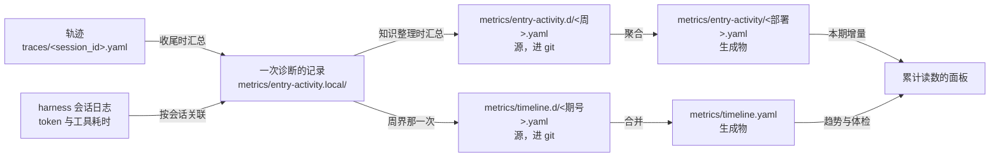

# 一次诊断记录什么、怎么上仓

诊断在本机跑，记录也留在本机；只有汇总后的读数会提交进仓库，下文把这件事叫上仓。本文说明一次诊断产出哪些文件与字段、这些记录怎么攒成可以提交的形式，以及在多人、多 worktree、多次回报的条件下怎么不出冲突。

读者是要改轨迹字段、上仓脚本、面板或知识整理流程的人。前置有三件：诊断六步各写什么，见 [diagnosis-trace.md](../../skills/diagnose/references/diagnosis-trace.md)；指标怎么算，见 [metrics.md](../guide/metrics.md)；机制怎么演化，见 [rsi-mechanism.md](rsi-mechanism.md)。只想拿到一次诊断结论的工程师不必读。

取舍与被否决的方案在 [ADR-0011](../adr/0011-diagnosis-observability-data-plane.md)。

范围：一次诊断的产物与字段、汇总触发点、记录与生成物、与知识库的解耦、反馈联动、指标清单、面板。不含诊断流程内部的执行规则（`skills/diagnose/`）、记录契约的通用字段（[records.md](records.md)）、评估集的构建（[evaluation.md](evaluation.md)）。

## 1 解决什么问题

这套记录回答五个问题：一次诊断产出什么数据与产物；本机跑了十次诊断怎么变成仓库里的一份读数；观测数据与案例库、先验库是否解耦；多人提 PR 时同一条案例的读数变化会不会撞车；工程师回报「解决」或「没解决」时读数能不能跟着更新。

设计时有五个缺口，每条都能在本机复算：轨迹里有事件但没有脚本汇总成一次诊断的成本与用到的知识；汇总只到条目级一处；十个指标有产出、在字段白名单里，8 期期文件一次都没写过；归因比读错键（读端只读 `verdict`，生产端写 `attribution_kind`），恒为 0；三期现场快照的反馈捕获都是 0，误诊率与归因比因此没有分母。保留它们是为了让后来的人知道这套机制为什么长这样。

本文不解决四件事：诊断流程内部的执行规则在 `skills/diagnose/` 正文里；检索不上向量库（[ADR-0002](../adr/0002-retrieval-no-rag-lightweight-index.md)）；判据数值（阈值与可解读性下限）只有人能改；读数不做跨部署合并。

## 2 最小可执行模型

记录分三层，只有后两层进仓库：

| 层 | 内容 | 键 | 谁写 | 进 git |
|---|---|---|---|---|
| 一次诊断 | 这次诊断的路由、行为、成本、结局、碰到的知识条目（下文叫触达），以及逐次工具调用与账单 | `session_id` | 收尾时由脚本从轨迹与会话日志汇总 | 否，含客户现场信息 |
| 条目使用记录 | 某个案例或先验在一期内的使用增量 | 条目 id 与运行号 | 知识整理时由脚本追加 | 是 |
| 期 | 一个部署在一期内的全部读数 | 期号，一期一个文件 | 组装脚本产出，维护者复核分母 | 是 |



图例：每个节点标了它的数据与归属；「知识整理时汇总」是一个动作，不是第四层记录。

这张图里值得注意的地方：一次诊断的记录是派生出来的，不落轨迹；条目使用记录与本期读数分两种粒度写——前者每次运行增长，后者按周看趋势。

## 3 完整机制

### 3.1 一次诊断产出什么

一次诊断在本地留下四样东西，第五样是本设计要补的：

| 产物 | 路径 | 内容 |
|---|---|---|
| 轨迹 | `traces/<session_id>.yaml` | 顶层字段加事件列表，每步一条 |
| 报告 | `traces/<session_id>.report.md` | 人读结论，与轨迹同目录 |
| 证据原件 | `traces/evidence/<session_id>/` | 工程师贴回的日志、截图 |
| 会话账单 | DSH 会话日志 | 提供方用量与工具耗时，按 `session_id` 关联 |
| 诊断记录 | `metrics/entry-activity.local/<session_id>.yaml` | 前四样汇总成一行，供汇总脚本读 |

诊断记录是**派生**的，由收尾脚本写，含逐次工具调用明细与 token 账单；命令摘要与文件路径含现场信息，所以只留本机，上仓的是聚合后的分布。面板读它。

会话日志按 `session_id` 关联。轨迹的 `session_id` 是诊断自己起的名字，harness 侧的会话号是另一套；轨迹顶层可选写 `harness_session` 给出后者。关联不上时那次会话的成本与工具分布**缺席**（字段留空并在输出里说明），不补估值。

关联上也不等于「这条账单就是这一单的」：会话日志记的是整条会话。同一段对话里先后做两单诊断时，两单会拿到同一份会话累计，读起来像「两次诊断一样贵」。所以单次成本另切一个窗口（`cost.window`）：`created_at` → `ended_at`；没写 `ended_at` 就退到 `updated_at`，并标 `bound_to: updated_at`。窗口外的调用单独计数。窗口边界来自轨迹里手写的两个时间，因此它是**下限**；`cost.tokens` 保留本会话累计，只作对照。

明细是旧格式（没有 `cost.window`）时，面板在展开那一单时调 `trace_entry_activity.py --local-only` 重建一次：只写 `metrics/entry-activity.local/`，不写周增量行、不动游标。周增量行仍只由周批的 `--apply` 写。

字段如下。明细留本机，上仓只放聚合值。

| 字段 | 明细（本机，每会话） | 上仓形态 | 来源 |
|---|---|---|---|
| `session_id` | 会话号 | 只做关联键 | 轨迹顶层 |
| `window` | 起止时间 | 会话时长分布 | `created_at`、`updated_at` |
| `detected` | 框架、平台、类别 | 按类别的会话数 | 轨迹顶层 |
| `route` | 路由到的命名空间、候选数量、加载条数、命中案例 | 路由准确率与漏检类别；候选上限在 `docs/adr/0004-capacity-governance.md` 的 `soft_cap` | `triage`、`load_index`、`load_full`、`hit` |
| `steps` | 步骤序列与各动作次数 | 各动作次数分布、步数中位数与 P90 | 事件计数 |
| `tool_calls` | 每次工具调用一条：工具名、耗时、成功与否、命令摘要 | 生成物里的 `tools` 段：次数、耗时中位数与 P90、失败与超时数 | 会话日志，按 `session_id` 关联 |
| `touched` | 触达的案例 id 与先验 id，各带触达方式 | 条目使用记录 | `hit`、`load_full`、`reference_lookup`、`excluded_cases` |
| `outcome` | 最终状态、是否给出 fix | 反馈捕获与误诊率的分母 | 顶层 `status`、`resolved_at`、`outcome.fix_emitted` |
| `feedback` | 现场回报：案例 id、结果、确认日期 | 反馈捕获、误诊率 | 顶层 `feedback` |
| `sedimented` | 沉淀状态与案例 id（只记 case 位置） | 面板的沉淀漏斗（诊断数 → 沉淀数 → 转正数） | 顶层 `sedimented` |
| `sediment_candidates` | 结构化沉淀候选（case / reference / triage）与进度 | 「这单能沉淀什么」与「产出了哪些先验词条」 | 顶层 `sediment_candidates` |
| `cost.tokens` | 未缓存输入、缓存读、缓存写、输出，本会话累计 | 会话成本中位数与 P90、按动作占比 | 会话日志按 `(turn, step)` 去重、定稿优先 |
| `cost.window` | 窗口内调用次数、耗时、四类 token，加窗口外调用数与超过 10 分钟的长调用 | 单次诊断成本（跨会话比较哪类问题贵） | 轨迹的 `created_at` 与 `ended_at` 切窗口 |
| `cost.step_cost` | 每个诊断步的调用次数、耗时、token 与按工具拆开的分项 | 维护者裁最贵的步骤 | 轨迹事件的 `ts` 切窗口；没有 `ts` 时整段为空 |
| `cost.index_read_tok` | 一次诊断读进来的 token 账，四个分项 | 命名空间 × 类别格子的读入成本 | `scripts/index_read_cost.py` 按视图现算 |
| `strength` | 结论强度档 | 强度分布 | 见下表 |

枚举值照原样写，改中文读者对不上数据。

| 字段 | 取值 | 说明 |
|---|---|---|
| `strength` | `upstream-fix-merged`、`upstream-official-doc`、`upstream-maintainer-confirmed`、`engineer-report`、`investigation`、`self-report` | 结论靠什么证据站住。命中案例时取该案例的 `verification.source`；靠源码分析或现场推理取 `investigation`；来源会话自证解决取 `self-report` |
| `outcome.status` | `in_progress`、`resolved`、`escalated`、`archived`、`unknown` | `resolved` 表示诊断已收尾，不表示 fix 在用户环境生效；后者只看 `feedback.outcome` |
| `feedback.outcome` | `pending`、`resolved`、`not_resolved`、`partial` | `pending` 表示还没回报 |
| `sedimented.state` | `none`、`submitted`、`knowledge`、`archived` | 只记 case 的位置；先验词条的产出另记 |
| `sediment_candidates[].status` | `proposed`、`drafted`、`produced` | `produced` 只用于 reference，必须带 `ref_id` |

条目使用记录里的计数各自只回答一个问题：

| 计数 | 含义 | 什么事件算一次 |
|---|---|---|
| `selected` | 这个条目进了候选集 | 案例出现在 `considered_candidates`、`load_index` 或 `load_full` 的候选里；`hit` 与 `quickly_check` 点名的也计 |
| `loaded` | 读了它的正文 | `load_full` 的 `candidates` 含它，或 `quickly_check` 点了它 |
| `resolved` | 用它解决了问题 | 出现 `{action: feedback, case, outcome: resolved}` 事件；顶层 `feedback` 字段是当前状态，不是结算输入 |
| `misdiagnosed` | 用了它但没解决 | 同上的事件里 `outcome` 是 `not_resolved` 或 `partial` |
| `self_resolved` | 来源会话自己回报解决（自证） | 与 `resolved` 分开计 |
| `lookups` | 查了一条先验 | 一次 `reference_lookup` 事件 |
| `hit` / `miss` / `skipped` | 查到 / 查了没命中 / 没查并写了理由 | `reference_lookup.outcome` 的三种取值 |
| `excluded` | 候选被排除 | 出现在 `excluded_cases` 或 `miss` 的 `excluded_cases` 里 |
| `purpose` | 为什么查这条先验 | `reference_lookup.purpose`：`collect`、`signature`、`background`、`fix`、`procedure` |

工具调用按次记，不合成一个总耗时。一次诊断的工具调用几十次，单次耗时从几十毫秒到几万毫秒都有，失败与重试也各占一部分；要判「哪个工具该设硬超时」「失败集中在哪一步」「哪些调用读了却没被引用」，总耗时答不了。

生成物 `tools` 段的 `p50_ms` / `p90_ms` 是按调用次数加权的各运行分位均值：跨运行的分位数无法从各运行的分位数精确合成，这里给的是量级读数，逐次与逐运行的精确值只在本机明细里。次数、失败数与超时数是计数，仍按确定性读。

轨迹里另记四类给面板详情用的字段，只在本机、不进聚合、也不上仓：现场环境与故障时间线、故障过程（日志）、上游与查证、追加式修订记录。定义见 `skills/diagnose/references/diagnosis-trace.md`；写入口是 `scripts/trace_transition.py --field content`。

### 3.2 什么时候汇总、谁触发

三个动作、两个 PR 流，顺序固定。诊断只在本机留记录，不进仓库；知识面的动作都在同一次知识整理里，一次运行追加一次记录，不重写已经写下的内容；本期读数只在周界那一次组装，一周一期。

|  | 知识整理（groom） | 收尾评估（evolve-check） | 深度轮（self-evolve） |
|---|---|---|---|
| 触发 | 维护者每周跑，一天多次也行 | 知识整理收尾自动跑 | 人显式要求 |
| 做什么 | 按规则处理：升格、结算、汇总、算分、复审与退休、索引与本期读数（判据是规则与记录，不需要假设） | 读本轮数据对照触发条件表，判断有没有机制面信号 | 跨轮聚合观察，提出并执行机制改动（判据是假设加前后对照） |
| 产出 | 案例变更、条目使用记录与本期读数 | 只写信号台账，不直接改机制 | 分诊候选；RSI 只有显式选择后才执行 |
| 进哪个 PR | PR 1：知识变更 | 不直接进 PR | PR 2：确定性修复 / RSI accept / 高风险改动 |
| 并行度 | 一个主 agent 顺序跑完，改的是同一批文件 | 轻量，同会话或另起都行 | 卡之间可并行，撞同一批文件的串行 |

不合并的理由有三条：判据不同、失败代价不同（知识错了能退休与 revert，机制错了影响之后每一次诊断）、节律不同。因此不在知识整理里跑实验，两个 PR 也不合并——模板、评审人与回退粒度都不同。

一次知识整理内部的顺序固定为七步（处理 inbox、结算现场回报、外部对照结算、汇总本机记录、算分、复审与退休、索引重建、周界组装本期读数）。第 3 步写条目使用记录，第 6 步写索引生成物，第 7 步写期文件；每步的入口与产物见 [operations.md](operations.md) 3.5。

### 3.3 记录与生成物

条目使用记录与本期读数分开放，因为粒度不同。`metrics/` 下有五份文件，两份是源、两份是生成物、一份是判据：

| 文件 | 角色 | 谁写 | 进 git | 谁读 |
|---|---|---|---|---|
| `metrics/entry-activity.d/<周>.yaml` | 源：条目使用记录，一周一个文件，每次运行追加若干行 | 汇总与结算脚本 | 是 | 聚合脚本 |
| `metrics/timeline.d/<期号>.yaml` | 源：本期读数，一周一期 | 组装脚本产出，维护者复核分母 | 是 | 聚合脚本 |
| `metrics/entry-activity/<deployment>.yaml` | 生成物：本部署按 id 汇总 | `scripts/build_entry_activity.py` | 是 | 面板、知识整理 |
| `metrics/timeline.yaml` | 生成物：全部期文件合成一条时间线 | `scripts/build_timeline.py` | 是 | 面板、体检器、演进看板 |
| `metrics/gates.yaml` | 判据数值，不是指标 | 人 | 是 | 体检器（`scripts/metrics_health.py`） |

记录必须一行一条。`merge=union` 是行级合并：嵌套结构里两人在同一处各插一段，会拼出非法 YAML。所以源文件压成一行一条自包含的记录，每行带 `run`、`kind` 与 `id`：

```yaml
- {run: 2026-10-16-0920, deployment: local-a2, kind: case, id: VLLM-ASC-12430, selected: 3, loaded: 2, resolved: 0, misdiagnosed: 0, self_resolved: 0, excluded: 0}
- {run: 2026-10-16-0920, deployment: local-a2, kind: ref,  id: cann-runtime-error-codes, lookups: 6, hit: 5, miss: 1, skipped: 0, purpose: {signature: 3, background: 2, fix: 1}}
- {run: 2026-10-16-0920, deployment: local-a2, kind: tool, id: grep, calls: 41, p50_ms: 900, p90_ms: 9200, errors: 2, timeouts: 1}
```

**一个 `run` = 一次脚本运行**，不是一次知识整理：汇总与结算各印自己的时间戳，所以同一个 case 在同一轮整理里可能有两行、字段互补。聚合按 id 求和，不按行取最后一条；行的唯一键 `(run, kind, id)` 由校验脚本判重。`run` 与期号无关：记录在每次运行写，期文件在周界那一次的第 7 步才写。唯一的例外是搬运行，它的 `run` 写 `baseline-<日期>`。

**计数键全部写出（含 0）**：行是自包含的，缺键与 0 两种写法要求读端各判一次，而判错的那一次是静默的。唯一的例外是 `purpose`：它是五键的小映射，只写非零项。

读端读的是生成物，一个部署一份，文件内按 id 汇总，并保留每个 id 最近几次运行的结果，供面板显示本期增量与「连续未解决」。每条行都带 `week`：`run` 与它所在的周文件可以不同（跨周界那一次运行），所以周必须写出来，不能由读端按 `run` 推。

两份生成物进 git、也进 PR，但由脚本重建，人不手改。理由有三条：读端只有一个入口，不必知道源分了几个文件；源可以换形状而不改读端；合并时重跑一次重建命令就够。

读数的部署边界：记录里带 `deployment`，汇总按它分组，一个部署出一份生成物，两个部署各自重建、互不覆盖；面板只读本部署那一份。`deployment` 优先取环境变量 `ASCEND_SLEUTH_DEPLOYMENT`，其次取主检出的目录名；同一克隆的所有 worktree 得到同一个值，不取当前 worktree 的目录名。

### 3.4 与知识库解耦

观测数据写 `metrics/` 下的记录文件；知识条目只写内容与存续，不写计数、也不写分数。分数是派生值，只出现在索引生成物里。案例里原有的 `confidence` 块整体迁出：计数进记录，分数进索引。`last_hit` 平时不单独存，由记录里最近一次 `resolved` 或 `misdiagnosed` 运行所处的周推出；搬运行例外，它自带 `last_hit`，汇总时透传。

| 数据 | 写在哪 | 写入方 | 何时写 |
|---|---|---|---|
| 被选中、被加载、检索三态、被排除 | `metrics/entry-activity.d/<周>.yaml` 的追加行 | 汇总 | 每次运行 |
| 现场确认解决、自证解决 | 同一份记录 | 结算 | 每次运行，按游标只结算新事件 |
| 外部验证记录 | 案例的 `validation_record` | 外部对照结算 | 每次运行 |
| 排序分数 | `knowledge/_index.yaml` 与 `knowledge/_index/*.list` 生成物 | 索引重建 | 随知识变更 |
| 基线条目的 `last_hit` | 生成物里该条目的字段 | 汇总（从搬运行透传） | 搬运时 |
| 案例内容与存续 | `knowledge/` 下的案例文件或 `_archive/` | 复审与退休 | 每周一次，只改有信号的条目 |
| 人工覆盖分数 | 案例的可选字段 `score_override` | 人，两人复核 | 罕见 |

三条规则：

1. 计数只进记录。案例文件里不再有 `hits`、`misdiagnoses`、`last_hit`、`self_resolved`。
2. 分数是派生值，不落案例。输入是记录里的计数与案例的冷启动先验，算出来的分数写进索引生成物。案例文件因此只为内容层的决定而改，不因观测而改。
3. 人工覆盖优先于算分，走显式字段。`score_override` 写 `{score, reason, by}`，按高风险改动的两人复核走；条目退休或改 id 时覆盖失效，重新启用要重写。

索引构建因此多了一条对使用记录的依赖。**缺记录的条目**分数退回它的冷启动先验值；构建脚本与索引头注按模式写明分数来源，体检器把「记录缺失或过期」报成待处理。「过期」由体检器按当天日期判（`entry_activity_stale_days`），它不改变索引里的分数：索引是生成物，按日期衰减会让它在没有知识变更的日子里变红。

算分读仓里全部部署的记录生成物（按 id 求和），面板的条目使用排行仍按部署分家。理由同上：索引是全仓共享的生成物，按本机部署取值会让同一份索引在不同检出算出不同分数。记录里的键取条目自己的 `id` 字段，不取文件名；记录用 `kind` 区分 `case` 与 `ref`，并加一条检查：全库 id 唯一，案例侧文件名与 id 一致。

### 3.5 反馈联动

回报只改一处，不存在两处读数对不上的问题。

1. 工程师回报时，轨迹记一条 `feedback{case, outcome, confirmed_at}`。渠道是续接时的追问，不改诊断流程。
2. 知识整理收尾跑 `settle_trace_feedback.py --apply`。它按 `.settle-state.json` 的游标，把事件折进当期记录里对应 id 的行，累加 `resolved`、`misdiagnosed`、`self_resolved` 三个计数。
3. 同一次整理里算分；索引生成物由主干 job 在合入后重建，案例文件不动。
4. 记录与索引都在 git 里，反馈照样入库；改变下次排序的是第 3 步。

准确性靠三点：事件按哈希结算一次，重跑不重复计数；回报迟到的跟着它实际写入的那一周走，不回填历史期；跨机器时记录按部署分组，另一台的回报由那一台的游标处理，两边不合并、各自算分。

案例 id 查不到时报错并计入清理清单，不改写历史。一次诊断命中 9005、最终沉淀成 12430 时，记录按事件里的 id 各记一行：9005 记被选中，12430 记被选中与解决。

### 3.6 指标清单

指标要留下来，先答出五个问题，答不出来的删掉：谁读它；据此做什么决定；读数为坏时下一步做什么；分子分母各是什么、覆盖哪些会话与哪份检出；这个数怎么来的。

最后一问的答案只有四种，写进数据里，不写在注释里：脚本或账单直接产出的是确定性；用可计算的量代替真量的标代理；agent 自己记下来的标自报；只有现场能给的标人工。强度档的名册住在 `metrics/gates.yaml` 的 `metric_strength` 段，由 `scripts/build_timeline.py` 写进生成的 `metrics/timeline.yaml` 供面板标注，`scripts/verify_metrics.py --check` 强制「期文件里出现的每个指标都声明了强度档」。

| 指标 | 读它的人、决定 | 读数为坏时的下一步 | 分母与覆盖 | 强度 | 现状 |
|---|---|---|---|---|---|
| 路由准确率、候选召回与命中位次 | 维护者，改 triage 词法、补案例或改排序键 | 看漏检类别与漏检样本落在哪个格子 | 已判定路由的会话、有预期答案的回放样本 | 确定性 | 已落地 |
| 降级路径使用与挽救、先验读取三态 | 维护者与词条作者，判是覆盖缺口还是要新先验 | 缺口补案例，流程问题改正文；按三态分流 | 全部诊断会话、走先验读取步骤的会话 | 确定性 | 已落地 |
| 漏检类别 | 维护者，补词法或挪类别 | 按类别补 triage 词 | 未路由命中的会话 | 确定性 | 蓝图：字段已有产出，指标无位置 |
| 步数、分步成本与单次诊断成本 | skill 维护者与维护者，改哪一步、裁最贵的步骤、比较哪类问题贵 | 出现最多又不推进的动作优先改；定位最贵步骤看能否合并或跳过 | 全部诊断会话、有会话日志且轨迹带 `ts` 的会话 | 确定性（单次成本是下限） | 已落地 |
| 工具耗时与失败分布 | 维护者，判哪个工具该设硬超时 | 定位最贵或最常失败的调用形态 | 该工具的调用次数 | 次数与失败数确定性，跨运行分位是代理 | 已落地 |
| 一次诊断的读入账 | 维护者，治超预算的读路径 | 按四个分项定位该治哪条 | 全部诊断会话 | 确定性 | 已落地 |
| 停止原因 | 维护者，判断该不该停在这里 | 未记录的会话先补记录 | 全部诊断会话 | 确定性 | 已落地 |
| 无效探索 | 维护者，换探索策略 | 在历史决策树上离线打分 | 历史决策树，同策略对照 | 代理 | 蓝图：缺打分代码 |
| 词表合规、反馈捕获 | 维护者，补词表或判学习环有没有输入 | 违规事件逐条看；为 0 时误诊率、归因比标不可解读 | 全部事件、给出结论的会话 | 确定性 | 已落地 |
| 现场解决计数 | 排序与退休，降置信或退休 | 连续两次未解决转人工 | 已回报的会话 | 人工 | 已落地 |
| 外部对照结果 | 维护者，确认内容是否正确 | 没有上游 issue 或 PR 关联的案例标不可对照 | 有上游关联的案例 | 确定性 | 已落地 |
| 归因比 | 维护者，误诊修复前先读 | 先补归因事件再修 | 已归因的误诊 | 自报 | 已落地（读端两种键都收） |
| 结论强度分布 | 维护者与面板读者，判哪些结论不能当依据 | 弱强度结论不得升格 | 给出结论的会话 | 自报 | 已落地 |
| 条目使用增量与长期零选中 | 知识整理，退休、降置信、合并、补样例 | 高选中低解决时复审该条；零选中时复查词面 | 当期被选中数与全库条目 | 确定性 | 已落地 |
| 格子读入成本 | 维护者，拆分、瘦身、按平台切 | 看格子的实读 token | 无分母，绝对量 | 确定性 | 已落地 |
| 草稿校验通过率 | 维护者，草稿质量检查 | 补齐草稿缺的节 | 待审草稿 | 确定性 | 已落地 |
| 相似条目对 | 知识整理，合并压缩 | 逐对判 | 整理流程检出的对数 | 代理 | 蓝图：缺相似度检出 |
| 改进项积压 | 维护者，超限量即停产新项 | 先补合入点 | 无分母，绝对量 | 确定性 | 已落地 |
| 预测实测三态、采纳与拒绝比 | 评审者与维护者，判卡可不可信、系统有没有拒绝路径 | 补跑判据或补预期；拒绝为 0 时质疑采纳记录 | 卡片数与终态卡片 | 确定性 | 已落地 |

「现状」一列只取两个值：已落地与蓝图。落地后仍标蓝图的只有三行：漏检类别（字段在轨迹里已有产出，但期文件里没有位置）、无效探索（打分代码的检查条件未满足）、相似条目对（缺相似度检出）。

同一个量只允许一处定义。加新指标前先看它是表里哪一行的另一个说法，是同一个就改那一行，不新增一行。

### 3.7 面板

面板是给人做判断用的，所以每一块都要能落到一个动作上。带数字的版式示意只有一份，在 [panel-observability-demo.html](../diagrams/panel-observability-demo.html)；下面写每块必须给出什么。

单次诊断那一侧是**一张表加行内展开**：收起态一行读完（状态、会话、平台与类别、步与动作、每步耗时小条、工具耗时、token），展开态顶部是三张图（六步耗时柱、检索漏斗、token 堆叠条）；轨迹默认只铺 3 步，其余折进「展开剩余」。「本次没记」清单收成一个「数据缺口 N 项」标记；会话按一行一条排，点开一行就地展开，最上面是横贯整行的指标带，左侧是正文，右侧是操作栏。

单次诊断的展开要补齐五块：

| 块 | 必须给出什么 |
|---|---|
| 结论 | 会话号、最终状态、结论强度档、根因一句话、命中的案例与分数、沉淀到哪个案例、回报状态 |
| 各步 | 步骤名、每步的成本占比、同批并行的分组、返工标记 |
| 检索 | 展开多少条、排除多少条、命中哪一条；被排除的 id；先验的命中、未命中、未查，以及消费点分布 |
| 成本 | 四类 token、工具总耗时与最慢那一次、一次诊断的读入账（类视图、命名空间备用视图、先验层、阶段二候选全文四个分项） |
| 本次没记 | 明确列出哪些字段这次没有数据；读数有值但读端算不出来的归入不可解读 |

累计读数的面板首屏先答四个问题：覆盖了哪些会话、哪个读数不可解读、哪些条目在变差、本期该做什么。

| 块 | 必须给出什么 |
|---|---|
| 覆盖 | 部署、期号、覆盖的会话数与期数 |
| 不可解读 | 哪些读数因为缺少分母读不了，缺的是哪个分母；样本不足的按「小样本」标出 |
| 需处理 | 有几项待处理，判据评估到哪一步 |
| 条目使用 | 本期增量与跨期累计两张榜；每条显示 id、条目标题与计数；累计榜另有「最后」一列 |
| 长期零选中 | 本期与跨期都没有被选中的案例条目数，以及「不据此退休」这一条；过程动作成本按动作占比给 |
| 变差的读数 | 每条给出读数、阈值或对照，以及一条动作 |
| 本期该做 | 三到五条，每条对应上面的一个动作 |

没有数据的格子写「本次没记」，不写 0；缺分母的读数写「不可解读」，不写 0。

## 4 边界与失败模式

| 情形 | 行为 |
|---|---|
| 反馈捕获为 0 | 误诊率、归因比标不可解读，不写 0；面板写明是没数据，不是零问题 |
| 某个指标本期没有数据 | 不写该键，面板显示本期未采集 |
| 某一周没有记录文件 | 该周不参与累计，聚合脚本报出缺哪几周，不按 0 计 |
| 某个 id 在知识库里查不到 | 报出该 id 与所在的运行，不计入排行，列入清理清单 |
| 记录文件被手改、或某行的 `run` 落在文件名之外的周 | 手改：删掉被改的行，用同一批本机记录重跑该 `run` 的汇总；`run` 越界：`--check` 报出并按文件名归周 |
| 跨时区部署、面板读不到生成物 | 按写入机器的本地 ISO 周归周、按 `deployment` 分组；读不到时显示缺哪个生成物与重建命令，不回退自行求和 |
| 在 worktree 里跑整理、没有 git 环境 | 共享件锚回主检出；没有 git 时路径退回检出内并标出，不产出空指标 |
| 两个 worktree 同时写一期 | 期号冲突按现有后缀机制处理，不同期落在不同文件 |
| 结论由来源会话自证或 agent 判定 | 强度档写进数据，面板标明「自证」，不与确定性读数同权 |
| 观察窗没有回报 | 标存疑加提醒人；正式降级状态是待实现设计（[records.md](records.md)） |

## 5 现状

### 5.1 已落地

- 轨迹、报告、证据的写入与词表校验：`skills/diagnose/references/diagnosis-trace.md`。
- 一次诊断的汇总与本机明细、条目使用记录的源与生成物：`scripts/trace_entry_activity.py`、`metrics/entry-activity.local/<session_id>.yaml`、`metrics/entry-activity.d/<周>.yaml`、`scripts/build_entry_activity.py`、`metrics/entry-activity/<部署>.yaml`。
- 记录的门：`scripts/verify_entry_activity.py`，接在 CI 的 `metrics-validation` job 上；`.gitattributes` 对源文件配 `merge=union`。
- 现场回报结算（只写记录，不写案例）与幂等游标：`scripts/settle_trace_feedback.py`、`.settle-state.json`。
- 历史累计值的搬运：`scripts/migrate_confidence_baseline.py`，`confidence` 块已从全库案例删除。
- 算分与索引：`scripts/score_entries.py`；分数只落在 `knowledge/_index.yaml` 与 `knowledge/_index/*.list`。
- 期文件组装、体检、字段白名单与生成物重建：`scripts/metrics_snapshot.py`、`scripts/metrics_health.py`、`scripts/build_timeline.py`、`scripts/verify_metrics.py`。
- 指标强度档、读入账与外部对照：`metrics/gates.yaml` 的 `metric_strength` 段、`scripts/index_read_cost.py`、`scripts/verify_upstream_outcomes.py`。
- 会话账单与本地件路径：`node scripts/session_cost.mjs --all`、`scripts/exec_log_path.py`、`python3 scripts/shared_dir.py`。

### 5.2 蓝图

仍标蓝图的有三项：

| 蓝图项 | 缺什么 | 确认方式 |
|---|---|---|
| 漏检类别与漏检会话的位置 | 字段在轨迹里已有产出（`scripts/trace_metrics.py`），但期文件里没有位置；使用记录不承载这一面 | 补进期文件字段白名单并在组装里写入，或按 3.6 的五个问题判定该不该留 |
| 相似条目对的检出、无效探索的离线打分 | 缺相似度检出代码；缺打分代码（检查条件见 3.6） | 检出对数进整理摘要逐对判；检查条件满足后另行起卡 |

`confidence` 的迁移计划分三个阶段（加记录与新聚合、切换算分与读端、删除旧字段），落地时一次做完。搬运规则保留在这里，供以后遇到同类字段时参照：累计计数要一行特殊记录，`kind: baseline`，`run: baseline-<日期>`，用与其他行相同的计数名，另带 `last_hit`。聚合把 baseline 算进 `totals`，但不计入 `by_week`、本期增量，也不算作「有活动」。

### 5.3 已否决

理由与代价见 [ADR-0011](../adr/0011-diagnosis-observability-data-plane.md)。按主题归成四组：

- **记录与分数放错位置**：把条目使用增量直接写进案例文件、把计数留在案例文件里当副本、按条目一个文件、做成仓根状态文件、把使用记录放进期文件的 `metrics` 段；把排序分数留在案例文件或按 id 的独立文件、保留由 agent 判断算分。
- **节律与聚合做错**：每次诊断的指标单独开一个 PR；只保留周期节律或只保留事件驱动；在面板里自行求和期文件；把语义与机械两半合成一个「无效探索次数」。
- **数据面越界**：让 agent 自动判定现场结局；把 `.s2-replay/` 收进共享路径表；把检索的查询串、topK 与分数写进轨迹；把 token 与耗时写进轨迹事件；给案例加状态字段；把诊断标签扩成多个人工枚举。

## 6 代码与文档入口

| 用途 | 入口 |
|---|---|
| 轨迹字段与事件词表 | `skills/diagnose/references/diagnosis-trace.md`、`diagnosis_state.yaml.example`、`trace-status.yaml` 的 `status` 段 |
| 诊断记录的汇总与本机明细 | `scripts/trace_entry_activity.py`、`metrics/entry-activity.local/<session_id>.yaml` |
| 记录与生成物 | `metrics/entry-activity.d/<周>.yaml`、`scripts/build_entry_activity.py`、`metrics/entry-activity/<deployment>.yaml`、`scripts/verify_entry_activity.py` |
| 期文件组装、体检、重建与判据 | `scripts/metrics_snapshot.py`、`scripts/metrics_health.py`、`scripts/verify_metrics.py`、`scripts/build_timeline.py`、`metrics/gates.yaml` |
| 一次诊断读入账 | `scripts/index_read_cost.py`（四个分项） |
| 算分与索引 | `scripts/score_entries.py`、`scripts/build_index.py` |
| 搬运、查证与结算 | `scripts/migrate_confidence_baseline.py`、`scripts/verify_upstream_outcomes.py`、`scripts/settle_trace_feedback.py`、`scripts/settle_s2_feedback.py` |
| 沉淀清点（哪些单有料还没沉淀） | `scripts/sediment_batch.py`（只读清点加回写 `sedimented.state`） |
| 会话账单与本地件路径 | `scripts/session_cost.mjs`、`scripts/exec_log_path.py` 的 `main_checkout`、`scripts/shared_dir.py` |
| 面板 | `dsh-plugins/ascend-panel/README.md`、`dsh-plugins/ev-panel/README.md` |
| 路径归属 | [git-workflow.md](../guide/git-workflow.md) 的目录归属表 |
| 演进消费点 | `skills/evolve-check/SKILL.md`、`skills/self-evolve/SKILL.md`、`skills/knowledge-groom/SKILL.md` |

## 7 外部参考

适用性判断与全表见 [rsi-mechanism.md](rsi-mechanism.md)。与本文直接相关的三条：

- Dream-RSI（arXiv 2609.14858）：历史树离线重放、策略须可重算；把历史抽象成洞见注入提示词不如不注入。3.6 只做机械化那一半的依据。
- Library Drift（arXiv 2605.19576）：不维护的知识库会漂移到注入反而更差，过早退休同样有害。累计面板不把零选中读成没用的依据。
- Falsifiable Release Gates（arXiv 2607.13070）：不能报错的检查与没有检查在观测上无法区分。每个读数要求写出坏时下一步的依据。
