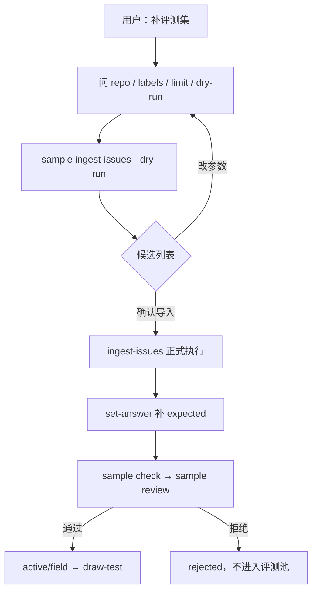

# 评估：对象、评估集与判定

评估要回答一件事：一次改动是否让诊断、沉淀或提炼变好了，凭什么这么说。答案是同一批样本上的改前、改后对照，加上一条能复现的命令。

读者是要改判据、扩样本、改 rubric，或要查一次判定怎么出来的人。前置是 [rsi-mechanism.md](rsi-mechanism.md)（机制入口）与 [records.md](records.md)（样本、执行、结论的字段）。只想知道系统整体在做什么的人不必读本文。

范围：评估对象、评估集的构建与分层、rubric、判定、成本、版本，以及评估台（`scripts/eval_arena.py`）的池与结论。不含记录的存储与接口（[records.md](records.md)）、运行节奏（[operations.md](operations.md)）、诊断侧的字段（[diagnosis-observability.md](diagnosis-observability.md)）。

本文不写会过期的数字。样本条数、已吸收条数、已评分条数由 `python3 scripts/eval_arena.py --stats` 的「N/M 条已评分」与 `held_out_skipped` 现算；issue 回放校准集的条数与强度分布读 `eval/s2/vllm-ascend.yaml`。

## 1 解决什么问题

评估最容易被两种做法带偏：拿同一批样本写改动又拿它判定改动；用一次点估计的涨跌当结论。前者让评估失去独立性，后者让反复复用同一个池的判定累积假接受。

本设计用四件事挡住这两条：样本按用途分层，答案可见性按角色分配；判定用配对检验并按复用次数收紧；成本与质量分开记账，不压成一个总分；每条结论带版本，跨版本不混算。

明确不解决现场有效性：fix 在用户环境里是否解决，只能靠工程师回报，评估证明不了。非诊断样本的好坏由 rubric 判，不进命中率的分母。

## 2 最小可执行模型

一次评估只需要四样东西：一个样本、一次执行、一条结论、一组版本。

- 样本（sample）：一个被评估的对象，带对象类型、维护方式（core 或 field）、用途与答案。
- 执行（run）：在某一组版本下对这个样本做一次评估，记指标、成本与轨迹。
- 结论（conclusion）：比较基线与候选之后得到的判断：接受、证据不足、拒绝、无法判定。
- 版本（versions）：让一次执行与一次结论可复现的坐标。

命令链只有三条：`--build-pool` 从校准集派生池，`--stats` 出分与逐条判决向量，`--gate` 做配对比较并写影响记录。读完本节就该知道池分几类、判定池与回归池怎么分；后面每一节不引入本节没出现过的构件名。

## 3 完整机制

### 3.1 评估对象

一个样本先分对象类型，再分用途。对象类型决定评分器与判定方法。

| 对象类型 | 评估对象 | 主指标 | 测量 | 判定 |
|---|---|---|---|---|
| diagnosis | 历史 issue 回放 | 命中或根因（二选一作主指标）；修复、安全作约束 | 自动加人工 | 配对检验 |
| case | 一条知识沉淀 | 来源、完整、具体、去重、可检索 | 人工 rubric | 双标加裁决，rubric 差值 |
| reference | 一条先验词条 | 事实、来源、范围、可复用、不过度概括 | 人工 rubric | 双标加裁决，rubric 差值 |
| trace | 一条真实工作轨迹 | 证据链、流程步骤、工具使用、追问与纠偏、成本 | 人工 rubric 加自动 | rubric 差值或计数 |

第一版实现诊断；知识、先验、过程三类对象的字段、rubric 与评分器同期定义，落地按阶段推进。评估对象在协议里全覆盖，不把「未实现」写成「不做」。

### 3.2 评估集与用途

评估池是候选样本的总和。对象类型与用途正交：同一个 case 可以进评估、反馈或测试。按用途分层之后，评估集用于比较，测试集用于最终判定，其余按用途进入反馈、回归、交叉验证与规模集。

| 集合 | 用途 | 答案可见性 | 能不能决定合入 | 刷新 |
|---|---|---|---|---|
| 评估集 | 比较基线与候选 | 对起草与归因隐藏 | 能 | 吸收后转回归；测试集固定 |
| 反馈集 | 找原因、写改动 | 对归因与起草开放 | 不能 | 随新 issue 增长 |
| 测试集 | 最终判定 | 只在最终判定时使用 | 能，但不参与改动 | 从 core 评估集按哈希抽；池变重划 |
| 回归集 | 原来能对的不能变错 | 用于检查 | 不能，但必须全过 | 吸收样本与构造样本 |
| 交叉验证集 | 同签名、非来源的 issue | 只用于知识验证 | 不能 | 按签名补充 |
| 规模集 | 大日志的成本 | 用于预算 | 只判成本 | 按来源补充 |

评估集固定不变；反馈集可以增长；测试集从 core 评估集里按样本 id 的 SHA-256 排序取前 4 条，划出后固定；field 不做测试集；回归集包含已经吸收的样本与构造样本；交叉验证集只验证知识是否被外部撞上；规模集只测成本。已经沉淀成知识条目的源 issue 重放属于自洽样本，只作读数，不算外部验证。

### 3.3 来源、候选与分层

没有来源的对象不进池。诊断样本的结论来自 issue 结论、维护者结论或已确认的修复；case 与 reference 的评分来自 rubric；trace 的评分来自证据链与工具使用。

| 对象类型 | 来源 | 必填 |
|---|---|---|
| diagnosis | 新关闭 issue、已确认 trace、规模日志 | 现象、结论、来源 |
| case | case 草稿、已入库 case、PR 变更 | 来源 issue 或 trace、rubric |
| reference | reference 草稿或已入库词条、官方文档、issue | 来源、rubric |
| trace | 本地 trace、回放 trace | 脱敏、结论或反馈、rubric |

候选按对象类型分开检查：诊断要有来源、有答案、输入里有可诊断信号、按来源分组去重，答案已进知识库的转回归；case 与 reference 要有 rubric、不与已有条目重复、namespace 或适用范围正确、至少一位维护者复核；trace 要已脱敏、有确认的结论或反馈、有 rubric、不是重复 trace。去重按来源分组，测试集按组切分，避免同一问题换一种措辞后同时进入评估与测试。

#### 3.3.1 从 GitHub issue 补诊断候选

维护者缺 field 评估样本时，走 `/skill:eval-ingest` 或底层命令；先从上游 closed issue 建候选：

```bash
python3 scripts/evolve.py sample ingest-issues --repo vllm-project/vllm-ascend \
  --labels triaged --min-comments 3 --limit 20 --state ingest-state.json --dry-run
```

- 元数据由 `fetch_issues.py` 拉取，只有 number/title/comments/closed_at/labels，不含 body；硬过滤复用 `issue_filter.py`（排除 PR 与已处理编号、label 池、评论数、标题规则，并按 label 优先级/已解决/评论数排序）。
- 只对过滤后的候选单条取首帖 body；样本 `input` 只有 title 与 body，正文少于 20 字符的候选跳过。评论和 issue 里的 resolution 不写进 `input`，也不自动当答案。
- 源通过 `IssueSource` Protocol 接入：`github` 与 `local` 是当前两个实现，GitCode 等新增源只实现 `list_issues`/`fetch_issue` 并登记 registry；state 以 `source_id` 分区，不复制过滤/去重/入库管线。
- 候选统一是 `diagnosis/field/evaluation`，`expected` 留空；`source` 为 `github/<repo>#<n>`，重复来源跳过。
- `--dry-run` 只打印候选，不写样本库、不更新 state。正式运行成功后把实际创建的编号原子追加到 state 的 `processed`；失败不标，重复运行不会重复导入。
- 评测样本的 `processed` 写在 state 的 `<source_id>/evaluation` 命名空间，和 case 沉淀的 `<source_id>` 分开；同一条 issue 可同时用于 case 和评测，不互相吃掉。默认 state 跟随当前检出，样本库/`run`/`brief` 仍锚主检出；显式 `--root` 才把两者都落到本地运行件。这样 worktree 里产出的 state 能随分支提交，候选不会在 worktree 清理时丢。
- 维护者用 `sample set-answer --id ... --expected '<json>'` 补答案，再走 `sample check`、`sample review`。ingest 不自动把候选转 active；非诊断或无答案的候选留给 review 拒收。
- `--quality-file` 接受 agent 产出的 issue 质量/答案 JSON：分数低于 0.6 或答案占位直接跳过；通过时把 answer/namespace/category 写进 expected，仍不自动 active。


- holdout 隔离是硬检查：`ingest-issues`、`import-s2`、`sample new/review/promote` 会按 `eval/holdout.yaml` 的 fixture issue 号拒绝或跳过；holdout 样本不进入候选池、不参与演进。`source_id`、`list_issues`、`fetch_issue`。GitHub 是默认实现；`local` 读本地 JSON/YAML 导出（含 body），用 `--source local --cache <path>`。新增 GitCode 等源只实现这个 Protocol 并登记进 `registry.py`，过滤、建候选、state 仍走同一条管线；`source_id` 是 state 分区键，也是候选 `source` 的前缀。

诊断标注由 agent 预标、维护者抽检，抽检覆盖每周新增样本的两成或两条，取大。case 与 reference 先做 10–20 条双标与裁决，再定 rubric 阈值。trace 先全审 10 条，再抽检。自动标注只做提名，不能直接当答案。

维护方式分两层，判定时分开报告，不混算：

| origin | 来源 | 规模 | 刷新 | 用途 |
|---|---|---|---|---|
| core | 公开 issue、构造样例 | 回归 30–50；测试集 4 | 季度重评 | 回归、最终判定 |
| field | 内部 issue、本地 trace | 评估 9/26/46 | 每周补样 | 目标比较、反馈 |

总判定样本 = core 测试集 4 + field 评估集 9/26/46，即 13/30/50；13 = 9 + 4，30 = 26 + 4，50 = 46 + 4。core 回归集单独算，不进这个总数。

`stratum` 是 case 子类型，不等于 `object_type`：它来自样本 `expected.namespace/category`，例如 `inference/vllm-ascend/interrupt`、`training/verl/precision`；可选加 `fault_class`（hardware / software / coupled / unknown）。`samples.strata` 配每层 test 目标；`split-test` 按目标层抽，目标之和不能超过 test 总数，剩余名额再从其他样本补。`run`/`brief` 按 stratum 报 field 评估、core test 与缺口。issue label 不是类型真值；维护者补 `expected` 后才产生 stratum。

### 3.4 规模与刷新

评估池的下限由判定要支撑几轮反推。终判子集至少 4 条；评估侧要支撑 \(K\) 次判定，每次需要的最小独家命中数为 \(b^*(k)\)：

$$
N_{\text{pool}} = 4 + \sum_{k=0}^{K-1} b^*(k), \qquad
b^*(k) = \min\{b : 2^{-b} \le \alpha/(k+1)\}.
$$

取 \(\alpha=0.10\)、\(c=0\)，\(b^*(k)\) 为 4、5、5、6、6……，所以 \(K=2\) 时总判定下限 13 条，\(K=5\) 时 30 条。13/30 是必要下限，不是功效保证：一个 case 回放算一个样本，配对检验的有效样本数是目标失败族内不一致的对数，重复运行与多个指标不增加独立样本。

按失败族分层采样：改动只影响少数 case 时，整体池会把效果稀释。先拿 10–15 条目标样本估不一致率，再按 80% 功效算目标样本量。模拟显示 9 条 field 评估样本对大效果约两成把握，26 条约六成；30 条总判定的一次宽效果约 66%，同一池复用一次降到 51%；50 条可支撑两次宽效果（88%/79%），目标族约 76%。目标族要到 80% 功效约需 56 条，窄效果约需 145 条。13 条只做流程冒烟，不能标 validated。

这套公式只适用于 diagnosis 的二元主指标。case、reference、trace 的池子按 rubric 校准定：先 10 条双标，稳定后扩到 20 条，不使用这个 K 公式。

刷新规则：样本答案进知识库时转回归；每次判定前重算吸收状态，不重算就拒判；测试集一旦划出就固定，池内容变了才重划；保留测试集只整套替换，不单独改；反馈集随新 issue 增长；总判定不低于 13 条（field 评估至少 9 条，core 测试集 4 条）。

补充样本按固定流程走，不让用户额外写提示词：诊断结束、case 沉淀、issue 关闭或导入、groom 改 case 四个触发点都调用 `python3 scripts/evolve.py sample new`，候选生成、查重与状态转换在 `samples` 一处。候选可以缺答案，`review` 前必须补。

候选与 field 样本放本地运行件，不进公开仓；core 样本放 tracked `eval/core/samples/`，通过 PR 入库。`sample export-core --id <id>` 把本地 active/core 样本写进该目录并移除本地副本；`SampleStore` 同时读本地队列与 `eval/core/samples/`，同一 id 两边都有会报重复。

已闭环案例也可以直接回流：走过 sleuth 的用 `sample new --from trace --trace <path>`；没走 sleuth 的先走 `to-postmortem` 产出 case YAML，再用 `sample new --from postmortem --case <path>`。先跑 `--dry-run` 看完整性。

状态有 `ready`、`needs_answer`（缺根因与修复）、`needs_sanitize`、`needs_source`、`non_diagnostic`、`duplicate`、`absorbed`、`stale`。

来源信息（`provenance`）记触发点、trace/report 引用、时间、`kb_rev`、是否脱敏、脱敏项、置信度与抽取方式。`sample status` 现算完整性；`sample set-answer --resolution` 补根因与修复，`--sanitized true` 确认可共享，之后去掉 `--dry-run` 写入本地队列。

查重同时看本地队列、`eval/s2`、`eval/holdout.yaml` 与 `knowledge/`（按来源 issue 号，不按 case 前缀）；重复只提示，不静默丢弃。

复核清单固定为六项：来源可追、输入已脱敏、expected 或 rubric 完整、对象类型与 origin 正确、无重复、未吸收。任一项不过就退回。

### 3.5 评分与判定

评分与判定是两件事：诊断对象用指标比较，其余三类先用 rubric 打分，再比较打分结果。

三类对象用各自的 rubric，量表统一为 0–2 分一项：

| 对象 | 维度 | 测量 |
|---|---|---|
| case | 来源可追、症状→根因→修复完整、具体可复用、不重复、可检索 | 人工 rubric，0–2 分一项 |
| reference | 事实准确、来源、适用范围、可复用、不过度概括 | 人工 rubric，0–2 分一项 |
| trace | 证据链、流程步骤、工具使用、追问与纠偏、成本 | 人工 rubric 加自动，0–2 分一项，成本另记 |

任一维度 0 分即退回；总分阈值写在 `sleuth.config.yaml 的 evolution.policy`。rubric 由两位评审各评一遍，分歧由维护者裁决；双标 10–20 条，一致率到 0.7 再扩池。诊断对象的维度另有一套：路由、命中、根因、修复、安全、成本、追问负担、覆盖，各自带测量方式与判定角色。

主指标每次改动只选一个，事前定好。角色只有四种：主指标、约束指标（不能比改前差超过预设容差）、硬约束（安全、回归、测试集，不通过直接拒绝）、次要指标与读数（成本、追问负担、覆盖）。

改前与改后各跑同一批评估样本。诊断的二元主指标只数方向不一致的样本：候选独家命中 \(b\) 条，基线独家命中 \(c\) 条。精确配对检验：

$$
p = \Pr\left[\mathrm{Bin}(b+c, 0.5) \ge b\right], \qquad
\alpha_{\text{eff}} = \frac{\alpha}{k+1},
$$

\(k\) 是同一评估池（同名加同内容哈希）被反复使用的次数，门槛随复用收紧。默认 \(\alpha=0.10\)。主指标换成连续值时改用配对差值或置信区间，不套这个公式。

\(\Delta Q\) 是主指标在候选与基线之间的差值（候选减基线，越高越好）；「有证据」在诊断上指 \(p \le \alpha_{\text{eff}}\)，在 rubric 或计数对象上指配对差值或置信区间达到预设方向。成本用候选与基线的比值 \(C = \text{cost}_c / \text{cost}_b\)；一次只选一个主成本维度。\(B\) 是允许的成本上升预算，\(\epsilon\) 是成本下降的最小幅度，\(\delta\) 是主指标允许的非劣容差，默认 0；安全与修复相关维度不允许放宽。

$$
\text{accept} \iff G \land
\left[
(\Delta Q > 0 \text{ 且有证据} \land C \le 1+B)
\lor
(\Delta Q \ge -\delta \land C \le 1-\epsilon)
\right].
$$

\(G\) 表示回归、测试集、约束指标与硬约束全部通过。两条路径分别对应「主指标变好、成本在预算内」与「主指标不降、成本明显下降」。成本为 `null` 时质量路径跳过成本条件，只看成本的路径不成立；主指标变差时无论成本多低都拒绝；证据不足记 `insufficient`。

结论有四个取值：

| 结论 | 条件 | 后续 |
|---|---|---|
| `accept` | 主指标变好且有证据、G 通过，有成本时成本在预算内；或主指标非劣、成本明显下降、G 通过 | 合入或进入审核 |
| `insufficient` | 主指标不差，但证据不够；或成本缺失导致无法判断只看成本的情况 | 补样本、扩池、重跑；可回退时可暂留 |
| `reject` | 主指标变差、约束或硬约束不通过、或成本超预算且主指标没有提升 | 回滚或关闭 |
| `unknown` | 数据不全、版本不一致、评审不可用 | 记待办，不猜 |

接受是评估结果，合入由授权等级决定（[rsi-mechanism.md](rsi-mechanism.md)）。效率类改动把主指标换成成本指标：主指标变好、质量非劣、G 通过即接受。

v1 已能按策略直接判一次二元配对：`python3 scripts/evolve.py judge --b <候选独家命中> --c <基线独家命中> --n <配对样本数>`，可选带成本；阈值读 `sleuth.config.yaml 的 evolution.policy`，加 `--record` 时结论追加进 `.s2-replay/evolve/conclusions.jsonl`。

judge 本身也要校准：同一批样本让两个独立评分员各打 0/1，跑 `python3 scripts/evolve.py judge-calibration --a A.json --b B.json`。默认门槛 raw ≥ 0.8、Cohen's κ ≥ 0.6；不过门槛的 judge 只能提名，不能单独支撑 accept。

### 3.6 成本与版本

成本是次要指标，参与预算与只看成本的接受，不单独决定主指标的胜负。成本是向量，至少记 tokens、工具调用（知识、源码、网页、命令分开）、工具耗时、交互轮次、纠偏次数、墙钟与人工时间；按常规、复杂与大日志、跨机场景切片，复杂场景单独定预算。

tokens 分 uncached、cache_read、cache_write、out、billed 五类，并记 `cost_source`（provider / normalized / estimate）与 `cache_accounting`（reliable / unreliable / unknown）。provider 可信时 billed 作预算、uncached + out 作模型工作量读数；内部模型的缓存计数不可信时 billed 不作判定，用 uncached + out 归一化，cache_read 只作读数；两项都不可信时成本只作读数，效率类改动改用轮次、工具调用或耗时。token 差小于 20% 记噪声；工具调用与轮次是整数，绝对变化至少 1 且配对样本数不少于 10 才判。

回放成本与现场诊断成本是两个总体：回放用于评估，现场只作读数，不能拿现场成本替代回放成本。case 与 reference 的成本主要是人工评审时间；trace 的成本同时包含工具调用与评审。

版本是执行与结论的共同坐标：协议、策略、基线知识库、候选知识库、候选改动、模型，六个字段的取值与一致性要求见 [records.md](records.md) 3.4。跨版本不混算：协议改了旧结论不可比；候选知识库与基线的差异必须等于候选补丁（`git diff base..candidate`）。

### 3.7 评估台：从池到结论

评估台把回放结果配成对、给出结论，并记下这次判定。它作用在检索与路由层的改动上，也就是 triage 分支文本、quickly_check、case 内容与排序这一层。

池从已跟踪的 issue 回放校准集机械重建，一条命令派生，不依赖某次会话留下的本地文件：

- 候选来自 ingest 状态里已处理的 issue，去掉答案已进知识库的。
- 筛选规则：issue 处于 closed 且 `state_reason=completed`；内容是实体缺陷或用法问题，排除文档类、营销类与 not_planned；标题带流程或文档类前缀的硬拒。
- `--build-pool` 按吸收状态拆出两条池：判定池 `pool-val.yaml`（只留未吸收样本）与回归池 `pool-val-absorbed.yaml`。吸收判据是 case 实名：`knowledge/` 下存在 `VLLM-ASC-<issue>.yaml`。

吸收状态在运行期重判。两条池文件各记一个 `absorption_rev`：把本池参与判定的每一行按「id:该行答案是否已在库里」排序拼接后取 sha256 前 12 位。`--stats` 每次重算并写进 stats；`--gate` 在判定时刻按 stats 记下的逐行样本 id 再算一遍，对不上就拒绝出结论。指纹只覆盖本池的行，不用整库 case 实名集合：后者会把任何一条与样本无关的新 case 也算成池过期，而沉淀是本仓常态。

`--gate` 的结论有三种，与结论记录的四个取值不是同一套：

- `accept`：无回归加方向性提升，且 \(p \le \alpha_{\text{eff}}\)；
- `weak_accept`：无回归且有提升，但证据不足，或缺逐条判决向量；改动可以留，但不能据此把卡判 validated；
- `reject`：有回归、无提升，或基线与候选的池哈希不同。

`--gate` 的退出码是数据约定，不是命令成败：0 表示结论成立且已写影响记录（三种结论都算成立）；1 表示读文件失败或池结构错；2 表示用法或输入问题（缺参、把回归池当判定池）；3 表示池已不新鲜，结论作废、影响记录不写。

评分有三个分母规则，都是实测得出的：

1. 路由率的分母只算有真值的条目。池条目可能只有 resolution、没有 `expected_ns`；把这类算进路由率会造出不存在的失败。
2. 非诊断样本不进命中率。issue 正文里没有可判别的现象，任何诊断都不可能有结论；判据由人读校准集那一行的输入下，代码不按正文长度猜。
3. 重放版本只告警不拒判。一批结果跨若干次 `git pull` 才跑完时，跨版本混算的分数前后不可比；`--stats` 收 `kb_rev` 写进 `replay_revs`，混版本打印警告，`--gate` 记进影响记录。

命中低是设计的结果：issue 回放池从未沉淀的 closed issue 里选样，池本身就是用来暴露覆盖缺口的，不命中即库里没有这条知识，走补 case 候选。它不是已有 case 的外部验证通道。

issue 回放未命中有三种解释：路由错、缺 case、内容错。它只看到没命中，区分不了三者，因此只能产出检索层候选（查路由、查覆盖缺口），不能据此判定 case 内容错。命中但结论不符不是未命中，它有区分力：说明被命中的那条 case 内容或判别力有问题，是复审的合法证据。

交叉验证样本是另一类：与某条 case 的来源 issue 不同、但错误签名与该 case 对得上的 issue。它只收已关闭且有维护者结论的条目；结算前先查该 case 正文有没有引用这个 issue 号，引用了就记 `self_consistent`，不计为外部验证。

评估台只做回放对照与配对比较，不替代人闸：高风险的 dual 级改动结论为 `accept` 之后，仍按 `kb/high-risk` 双签送人审。它的无回归范围只到本池（影响记录里记 `no_regression_scope: arena-pool-only`）；golden 全量无回归是另一步，由 `scripts/replay_golden.py` 逐条跑，要模型，不在 `--gate` 内。

`--self-test` 用合成样本复现三种结论，CI 跑它（`kb-checks` 的 `arena-gate-rule`）；判据写坏、只会判 `accept` 时 CI 就红。

### 3.8 算法适配器与 RSI stage

实验记录有两种来源：`baseline` 是对照臂，只记录 seed/包络，不产生候选；agent 可以用 `experiment propose --draft <json>` 为任意 target 提交结构化提案（target、改动、预期、风险、回滚），由 target 的评估器决定后续验证。`--draft` 只做结构校验，不代表 target-specific 改动一定可执行。

RSI 存储层分三层：`store.models` 定义事件模型，`store.ports.Backend` 定义 append/read 端口，`store.local` / `store.memory` 是默认与测试实现，`store.service.RSIStore` 只依赖端口。默认本地 `.s2-replay/evolve/rsi-events.jsonl`；路径与后端在 `sleuth.config.yaml` 的 `evolution.store`，或用 `SLEUTH_RSI_STORE_BACKEND`、`SLEUTH_RSI_STORE_PATH` 覆盖。新增远端后端只需实现 `Backend` 并注册，不改 flow/renderer。`store verify` 检查事件 id、proposal/experiment 关联、结论/rollout 孤儿、时区和 trace 是否存在；真实数据当前报 6 条 experiment 无 conclusion、10 条 decision 和 54 条 rollout 孤儿、18 条 trace 缺失。`.s2-replay/evolve/rsi-events.jsonl` 是权威追加流，一条 experiment 事件内嵌 proposal、conclusion、experiment 与 rollout 摘要；conclusions/experiments/proposals 保留为投影，按 experiment_id 或 proposal_id 可查 history。`experiment show` 同时返回 history。

`agent_adapter --agent dsh` 只指 dsh CLI headless，不是 DSH Desktop；Desktop 本身是 agent，提案/实验应在会话内用 subagent 编排，不需要启动 Desktop 子进程。Claude/Codex 只有在 CLI 是标准做法时才走外部命令；它们的提案仍写回同一个 ProposalPort/RSIStore。

提案引擎在 `scripts/evolve/proposal_engine.py`：`Proposal` 统一表示 target、artifact、分数、反馈与来源；`ProposalEngine` 负责校验、评分、候选池、搜索策略和归档；`ProposalArchive` 写 `.s2-replay/evolve/proposals.jsonl`。策略有 `best`、`pareto`、`gepa`；GEPA 是 `GepaPolicy`（Pareto）+ 反思 proposer 的组合，不是引擎本身。`ProposalEngine` 的选择层直接复用 `selectors`，旧的 `agent_gepa.py` 状态机只是 skill 兼容 adapter，不再有第二套 Pareto 选择。`experiment search --scenario` 用已产出的候选做校验、评分、策略选择和归档；真实生成仍由 agent 走 `experiment request` → `--draft`。真实 pilot 轨迹可以用 `python3 scripts/validate_rsi_replay.py --pilot <pilot-dir>` 重放；两个真实 pilot 可以用 `python3 scripts/validate_rsi_gepa.py --pilot A --pilot B` 跑一次 GEPA 选择报告；`validate_rsi_full_flow.py --pilot --sample [--exploratory]` 用真实候选轨迹走完整 flow：copy 到临时目录，重跑 collect/decide，输出每个 stage 的 evidence/partial/fail、agent heuristic 可用性和 GEPA 候选池缺口。`experiment flow --card EV-YYYY-NNN` 可把行为面实验绑定到 EV 卡；内容面实验不产卡。`experiment flow --exploratory` 是明确标注的降级验收：允许 usage 约束 insufficient、允许 rsi-events 记录 exploratory accept，但不得当作生产通过；`--dry-run` 只准备 candidate/pilot tasks 和隔离 worktree，不跑 runner/judge；`experiment flow` 把带 `candidate` 的提案接进 pilot：prepare → 外部 runner → judge → gate → archive；没有 candidate 的提案会被拒绝。candidate apply 前做 target-specific 结构检查：knowledge YAML 必须可解析且有 id，tooling `.py` 必须可编译，harness 的 Python/YAML/JSON 必须可解析，scheduler.yaml 还必须带 scheduler 键；坏内容不会写入工作区。`brief` 现在也读 proposals archive 和 experiments，并在事件流有数据时优先用事件流，显示 events/提案数/实验数和最后一条状态。flow 判定时把提案编号写进 Conclusion（`proposal` 字段），`readback --proposal <id>` 可以先按提案回读判定；投影没有时回退到 experiment/decision 事件。`--measure` 只接受带 card 的结论，避免把 None 传给 ev_measure。DSH adapter 在启动 headless 前检查 `DEEPSEEK_API_KEY`；没有 key 时直接报错，可用 `SLEUTH_DSH_ALLOW_STORED=1` 放行已存凭据。flow 与 pilot 在缺 trace/out、`collect.complete=false` 时拒绝进入判定；pilot 的 accept 还要求 `n >= samples.field_eval`，小池只能 `insufficient`；knowledge/source usage 目标还要求对应 usage 约束为 accept，insufficient 不再放行。flow 读取 judge 时要求 `meta.agent`、每个样本两侧 0/1 分数，并把 judge meta/文件哈希写入实验记录。flow 与 pilot.collect 都拒绝 `adapter_fallback` trace，adapter 没写真实 trace 时不能进 judge。flow 在非 accept 判定时回滚 candidate worktree，并把 `rolled_back` 写进 Proposal；accept 保留工作区供审。flow 还会写一条 ExperimentStore 记录，带 `proposal`、baseline/candidate 均分、paired 证据，以及 proposal/conclusion 快照；knowledge/source usage target 会从 pilot.collect 的 usage 记录生成 `knowledge_usage`/`source_usage` 证据；`experiment records` 能看到 proposal 编号；`experiment gate --target skill` 已委托 `eval_arena.py --gate`（baseline/candidate stats、component、alpha），不再报“no gate wired”；`experiment show --proposal <id>` 把 proposal、conclusion、experiment 三份记录合成一个 JSON 视图；`store history --proposal/--experiment` 直接查事件历史；proposal/conclusion 文件缺失时回退到 experiment 行里的快照。knowledge/source usage 这类 target 仍要求自己的 usage 证据，缺证据的 accept 会被 validator 拒绝。

`propose.agent` 是**提案节点的一种实现**，不是整条 RSI 算法。它按 target 的 ProposalPort 生成结构化草案：先跑 `experiment request --target <t> --component <region>` 拿提示、允许路径与输出 schema，再由 agent 写 draft；`baseline` 只作对照臂，不提案。GEPA 是 `select.pareto + propose.agent` 的节点组合，`select`、`judge`、`gate` 各自还有独立实现；不要把“启发式 agent 提案”等同于“GEPA 或整条自演进管线”。

自演进实验按六个节点固定算法：`attribute`、`select_region`、`select_candidate`、`propose`、`judge`、`gate`。当前注册：`attribute.trace_rule`/`attribute.agent`、`select.region_hardcount`/`select.region_agent`、`select.none`/`select.best`/`select.pareto`、`propose.none`/`propose.agent`/`propose.reflection`（兼容别名）、`judge.subagent`、`gate.paired`。默认 agent heuristic 是 `select_candidate.best` + `propose.agent`；GEPA 是 `select_candidate.pareto` + `propose.agent` 的组合。归因/选 region 先规则，规则不确定才让 agent 补证据；agent 不能把推断写成 hard，也不做最终 gate。`policy.experiment.stages` 是可覆盖的默认组合；实验记录保存解析后的 stages，禁止把算法写错节点。

### 3.9 知识使用效率

知识使用的可变异区是 `diagnose.knowledge_usage`，只改检索顺序、读索引/全文时机、候选数、reference 查询与停止条件；不改 case/reference 内容，也不改 trace schema。归因组件用 `knowledge_usage`、`case_retrieval`、`case_loading`、`reference_lookup`。

每个 rollout 记录一行：

```json
{"sample_id":"S-1","hit":true,"first_hit_step":2,"candidates_examined":2,
 "full_body_reads":1,"reference_lookups":0,"wrong_cases":0,
 "resolution_ok":true,"tokens":1200}
```

`hit=true` 必须有 `first_hit_step`；缺失字段记 unknown，不补 0。入口：

```bash
# 现有 diagnose trace 直接导出 usage；trace 放在演进评估目录，不写真实 traces/
python3 scripts/evolve.py knowledge-usage from-trace \
  --trace .s2-replay/evolve/usage-traces/<session>.yaml --expected-case <case-id>
python3 scripts/evolve.py knowledge-usage evaluate --file usage.json
python3 scripts/evolve.py knowledge-usage compare --baseline base.json --candidate cand.json
```

演进评估的 trace 统一放 `.s2-replay/evolve/usage-traces/`（本地运行件，git-ignored），不得写入 `traces/`；真实诊断 trace 与演进评估 trace 分开。`from-trace` 从 `load_index`/`load_full`/`quickly_check`/`reference_lookup`/`hit` 推导，token 不在 trace 里时保持 null。

`candidates_examined` 记筛出的短列：`load_full` 点名的候选与 `quickly_check` 点名的 case 取并集；没有这两类事件时记 unknown，不拿索引视图行数顶替。

`full_body_reads` 数 `load_full` 事件里点名的候选：`case` 或 `candidates` 列表，两者都写时取并集。没有带 `case` 或 `candidates` 的 `load_full` 事件时，退回 `quickly_check` 的 `case`。

判定准确率看两处：judge 绑定的 `resolution_ok`（两侧齐全时比 resolved 数）与 `hits`；`hits` 下降一律算 `accuracy_regressed`。`resolution_ok` 缺失时退回 `wrong_cases`，再缺记 `wrong_cases_unknown`。

`compare` 逐样本配对。同一效率项只在两侧都有值的样本上求均值，样本 id 集合仍要求两侧一致。同一字段在两侧可测的样本数不同时，各自求均值会把「一侧缺数据」算成「另一侧变好或变差」。

某项只有部分样本可测时，差值照报，但不算改善或回退；超过 1e-9 时记 `efficiency_partial_unknown`，结论不能是 `accept`。`elapsed_ms` 例外：部分覆盖时方向记未知，正差值记 `elapsed_inconclusive` 并阻断 `accept`，负差值不算改善。

`compare` 只有在准确率不降、至少一个效率项改善、且没有效率项变差时给 `accept`；准确率或效率回退给 `reject`；没有改善或证据不全给 `insufficient`。实验记录的 `knowledge_usage.decision` 若存在，整体 `accept` 必须同时为 `accept`。每个效率项同时报配对差值的均值与置信区间（`ci`）。计数项用点估计与 1e-9 阈值；`elapsed_ms` 是连续项，方向只在区间排除 0 时成立，区间跨 0 且差值为正时记 `elapsed_inconclusive`，结论不能是 `accept`。

判定容量在 `brief` 算：同一评估池第 k 次判定时 `alpha_eff = alpha/(k+1)`，达成证据所需的最少独家命中数 `required_b` 是 `min{b: 2^-b <= alpha_eff}`。池样本数（field 加待审候选）少于 `required_b` 时记 `judgment_capacity_short`；这是入池前提示，不改判定结论，判定记录里不重复算。预检按 k=0 算，因为不知道下一次会复用哪个池。

`pilot prepare` 只收 field/探索样本：`purpose=test` 或 `regression` 的封存样本会被拒绝，来源命中 `eval/holdout.yaml` 的样本也会被拒绝，避免拿终判集或封存对照集调参；regression 只用于硬回退，不参与 pilot 对照。

成本控制：`sleuth.config.yaml 的 evolution.policy` 的 `cost.runs.max_pairs` / `max_tokens` / `early_stop` 写进 `tasks.json` 的 `budget` 与 `stop_rules`；每跑完一对样本跑 `pilot checkpoint`，若 `b + 剩余 < required_b`（futility）或预算用完，就停，不再跑满全部样本。早停只用于停止无望的实验，不用于提前 accept。

baseline 复用：`pilot prepare --baseline-traces <dir>` 会把已有的 `traces/` 与 `out/` 复制进 pilot 的 baseline 目录，只让外部 runner 跑 candidate；缺任一条会整体拒绝，`tasks.budget.baseline_reused` 与 `baseline_source` 记录来源。复用要求模型、知识库和输入没变，不能拿旧版本冒充当前 baseline；`baseline.json` 里有 `base_rev` 时和 candidate 的 `base_rev` 比对，不一致直接拒绝。

test 门禁：`stage report --stage test` 要求 `candidate_id` 不是 `HEAD`、存在同一候选的 field accept Conclusion、所有选中样本的 trace/out/judge 齐全；缺任一条都拒绝出结论。adapter 在 agent 没写 trace 时会生成 `adapter_fallback: true` 的最小 trace；report 一律拒绝这种证据；`echo` 只写合成 trace，供冒烟用。`test-stage.yaml` 的 `sealed_sha256` 在 plan 时校验样本文件哈希，样本改动即拒绝。

证据与成本：judge 的 `meta`（模型、tokens、时间）会写进 Conclusion 的 `metrics.judge`；regression 报告要求 candidate trace/out 与 judge 分数齐全，缺一条就报硬错误。`stage plan --where key=value` 按 `sample.input` 选 regression 子集；`readback --measure` 会再跑 EV 卡的 predicted_effect.measure。

确定性 benchmark：工具或检索类改动如果有一条可重复的命令，用 `python3 scripts/evolve.py benchmark --baseline-root <a> --candidate-root <b> --argv '["python3","-m","pytest",...]'`，重复 `cost.runs.benchmark_runs` 次比中位耗时与退出码，不跑完整诊断。它只证明这一步的差异，不替代行为类候选的 pilot。

regression 预算：`cost.runs.regression_pairs` 默认 6，`regression_full_pairs` 默认 30；常规候选先跑受影响子集，高风险或发版前才跑满。

test / regression runner：`stage plan --stage test|regression` 生成任务，`stage run` 按外部 command 执行每个样本/arm，`stage report` 对 test 走 exact gate、对 regression 走硬失败；`--update-stage` 会在 test 报告后把 `eval/core/test-stage.yaml` 标成 `complete`。test 只用 `test-stage.yaml` 的 `selected`，regression 默认取 `regression_pairs` 条，`--full` 取全量。command 通过环境变量拿到 `SLEUTH_TRACE` / `SLEUTH_OUT` 等路径，必须写出这两个文件；runner 本身不调用模型。仓库提供一个参考 adapter：`python3 scripts/agent_adapter.py --agent dsh` 默认走 DSH headless，`--agent claude` 走 Claude Code，`--agent echo` 只用于冒烟，`--agent command` 读 `SLEUTH_AGENT_CMD`。stage plan 会拒绝来源命中 `eval/holdout.yaml` 的 test/regression 样本。

judge：`stage judge --output <dir> --agent dsh --calibration <json>` 对每个样本/arm 调一次 judge adapter，写出带 `meta.agent` 与 `meta.calibration` 的 `judge.json`；`stage report --stage test` 拒绝没有来源或校准未通过的 judge。adapter 没写 trace 时生成的 fallback trace 一律拒绝，生产路径没有放行开关。

`pilot collect` 之后跑 `pilot decide`。它把每条 rollout 写成一条执行记录（`Run`，见 records.md），把一次对照写成一条结论（`Conclusion`，同篇）。`judge --record` 与 `pilot decide` 都收 `--card EV-YYYY-NNN`，把结论绑到对应卡；合入后跑 `python3 scripts/evolve.py readback --card EV-YYYY-NNN` 读回最近一条结论（decision/b/c/n/model/cost）；自演进页的卡详情也会显示「结论回读」一节。模型的来源是 `collect` 里每条 rollout 的 `model`（多个不同值用逗号连接）；成本只累加 **baseline 与 candidate 都有 token** 的配对样本，缺失数写进 `cost.missing`，不补 0。

记录写在 pilot 输出目录的父目录（常规位置是 `.s2-replay/evolve/`）：`runs.jsonl` 与 `conclusions.jsonl`。重复执行不会重复记 `Run`；同候选、同池、同参数、同约束的结论只写一次。

`candidate_kb` 在候选 worktree 有未提交补丁时写成 `<基础版本>+patch:<补丁哈希>`；worktree 已失效时记 `unknown`，不用基础版本冒充。

pilot 的样本可以用 `sample import-pilot --tasks <tasks.json>` 注册进本地样本队列；重复导入跳过，不改已有状态。

### 3.10 源码访问效率

`diagnose.source_usage` 只改源码访问策略：缓存优先、固定 ref、限定路径与 grep 范围、失败停止；不改知识内容/schema。归因组件用 `source_usage`、`source_fetch`、`source_query`、`source_analysis`。

真实 trace 的 `source_analysis` 可导出：

```bash
python3 scripts/evolve.py source-usage from-trace \
  --trace .s2-replay/evolve/usage-traces/<session>.yaml
python3 scripts/evolve.py source-usage evaluate --file source-usage.json
python3 scripts/evolve.py source-usage compare --baseline base.json --candidate cand.json
```

记录 repo/ref、files_read、tool_calls、fetch_calls、grep_calls、followups、elapsed；cache/download/bytes 只做可选观测，不进门禁。`compare` 与知识使用效率一样逐样本配对：只在两侧都有值的样本上算该项总数。某项只有部分样本可测时，差值照报，但不算改善或回退。它的差值仍超过判定阈值（1e-9）时记 `source_efficiency_partial_unknown`。

`compare` 要求源码结论 correctness 不降，且 files/tool/fetch/grep/elapsed 至少一项改善、没有项变差；correctness 或效率 unknown 只能记 `insufficient`。`elapsed` 的方向与知识使用效率一样按配对区间判，跨 0 的正差值记 `source_elapsed_inconclusive`。

### 3.10.1 工具使用与工具性能

`tooling` 改的是工具本身（`scripts/src_fetch.py` 的缓存/重试/ref 解析、`source-catalog.d/` 的路由数据），不是使用工具的提示文本。归因组件用 `source_fetch`、`source_cache`、`source_retry`、`source_catalog`。

`scripts/evolve/tool_usage.py` 从 trace 的 `source_analysis` 事件读每个样本的工具指标：`tool_calls`、`fetch_calls`、`grep_calls`、`retries`、`cache_hits`、`tool_ms`、`failures`，结论正确性由 judge 绑定成 `resolved`。入口：

```bash
python3 scripts/evolve.py tool-usage from-trace --trace <trace.yaml> --resolved true
python3 scripts/evolve.py tool-usage compare --baseline base.json --candidate cand.json
```

`compare` 与另两处一样逐样本配对：`resolved` 不降，且至少一项工具指标改善、没有项变差才给 `accept`。`replay_trace` 的 `experiment gate` 直接读这两份 JSON。

工具补丁走 `target_kind: tooling` 的 candidate：文件只能落在 region 登记的 `paths`（`tooling.source_fetch` 是 `scripts/src_fetch.py` 与 `source-catalog.d`），不能碰 `skills/`、`knowledge/`、`eval/`、`tests/`、`.github/`。补丁可带 `checks`，取值是固定枚举：`py_compile`（编译补丁文件）、`diff_check`（`git diff --check`）、`src_fetch_self_test`（只对 `tooling.source_fetch` 与 `tooling.source_catalog`）。检查按 argv 在 worktree 内执行，不走 shell；任一失败回滚文件并删除 worktree。

### 3.11 算法适配器

算法只做提案者，不做判定、不直接写库、不合入。`scripts/evolve/ports.py` 定义 `Optimizer`，`scripts/evolve/algorithms/registry.py` 是静态注册表；当前只有 `baseline`。`policy.experiment.target`/`algorithm` 选目标与算法，`Version.algorithm`/`algorithm_version` 记身份，`budget`/`seed` 记实验条件。GEPA/AEL/SkillProx/EvolveMem 只在后续的实验适配器里接入，一次只接一个组件；没有动态插件加载。

优化目标与评估对象正交，四个 target 的当前定论：

| target | 改什么 | 评测面 | 端到端 evaluator | 授权 | 默认算法 |
|---|---|---|---|---|---|
| skill | skill 文本、步骤、流程 | arena 配对门禁（golden 与 issue 回放旁路） | 已接（`arena`） | A2 | baseline |
| knowledge | case/reference 内容 | rubric + 效用审计 | 已接（`rubric` 评分） | A2 | baseline |
| tooling | 工具路由、缓存、重试、目录数据 | replay + trace 工具使用 | 已接（`replay_trace`） | A1 | baseline |
| harness | 调度与控制流 | 端到端回放 + 回归 | 未接（`end_to_end`） | A1 | baseline |

`evaluations/registry.py` 把 target 映射到 `EvalProfile`，`implemented` 只表示当前有没有端到端 scorer/gate，不表示有真实数据。未接的 target 仍可记录 baseline Patch，但 `experiment propose` 会打印 `eval_ready: false` 并警告“记录但不 gate-ready”；不把目标分发误当评测完成。

knowledge 的 rubric 评分是确定性算分：`rubric.dimensions` 是维度名列表或对象；`threshold` 由 `sleuth.config.yaml 的 evolution.policy` 的 `rubrics.threshold` 决定（当前 0.7），不在 scorer 里另写一份。每维只接受 0/1/2，任一维 0 即退回；缺维度不当 0 补，分数不可计算，`score` 显示 unavailable。入口只接受 target 允许的 object_type（knowledge 只收 case/reference）：

```bash
python3 scripts/evolve.py experiment gate --target knowledge --sample K-1 \
  --scores '{"来源可追": 2, "根因完整": 2, "可复用": 1}'
```

通过退出 0，拒绝退出 1，输入或 evaluator 未接退出 2。rubric 分支只判一个已有 rubric 的样本，不替代双标、不生成 rubric；tooling 分支读两份 tool usage JSON：

```bash
python3 scripts/evolve.py experiment gate --target tooling \
  --baseline base-tool.json --candidate cand-tool.json
```

`targets/registry.py` 只允许 target 白名单内的算法；未注册的算法不会静默回退。官方 GEPA 库没有注册：它需要外部 endpoint 和同步 `task_lm`/`reflection_lm`，不属于本框架的自包含路径。GEPA 效果由 agent-native 实现承担：`select_candidate.pareto` + `propose.agent`，由 subagent 执行 task/judge/reflection，不调用官方库。`experiment propose --target skill --component <组件>` 会调用当前 optimizer 生成一个 Patch 并写本地 `experiments.jsonl`；`experiment records` 读取最近记录。baseline 仍是人工提案，不会自动改文件或合入。

## 4 边界与失败模式

| 情形 | 行为 | 细则 |
|---|---|---|
| 池不新鲜（`absorption_rev` 对不上），或池文件没有该字段 | 前者不出结论、退出码 3、不写影响记录；后者按未校验放行，两条命令都写明新鲜度无法校验 | 3.7 |
| stats 没记逐行样本 id | `--gate` 写明判定时刻无法重算，沿用 `--stats` 那一刻的读数 | 3.7 |
| 吸收判据没有输入（`case_prefix` 零匹配） | `--build-pool` 仍退出 0，警告写到 stderr | 3.7 |
| 缺逐条判决向量、或基线与候选的池哈希不同 | 前者结论上限降为 `weak_accept`；后者判 `reject`，理由写跨池不可比 | 3.7 |
| 结果跨知识库版本 | 打印警告、记进影响记录，不拒判 | 3.7 |
| `ground_truth: none` 的样本 | 剔出结论一致率分母，不把没有真值的猜测记成一致 | 3.7 |
| 样本没有 `expected_ns`、标了 `non_diagnostic` 或是 `held_out` | 分别剔出路由率分母（记 `route_ok.unjudgeable`）、命中率与配对、`--stats` 指标与评估台决策 | 3.2、3.7 |
| 判定池小、可翻转样本少 | 判定线原理上可达，结论常落在证据不足；这是池规模缺口，不是判据失效 | 3.4 |
| golden 没跑 | `--gate` 的范围只到本池，不等于跑过 golden | 3.7 |
| 复用超限（`pool_reuse_uncontrolled`） | 动作是重新选样（池内容改变、计数归零）或扩池，不是把标准放松 | 3.5 |
| 主指标或硬约束缺失、或缺数据的维度 | 前者不出 `accept`；后者记 `unknown`，不补 0 | 3.5、3.6 |
| 跑改后侧前覆盖了 baseline stats | 没有配对数据；两次 `--stats` 写同一个文件名，先复制一份 baseline | 3.7 |

## 5 现状

### 5.1 已落地

- 配对检验、复用折减、三态结论与影响记录：`scripts/eval_arena.py --gate`；自检进 CI（job `arena-gate-rule`）。
- v1 判定器与策略：`scripts/evolve/decision.py`、`statistics.py`、`policy.py`；`evolve.py judge`、`policy check/show`；`sleuth.config.yaml 的 evolution.policy` 是唯一调参入口。
- 池按吸收状态分流、吸收状态在运行期重判：`--build-pool` 与 `absorption_rev`；非诊断样本剔出命中率、结论一致率与配对。
- 适配器层与旧脚本薄壳：`scripts/evolve/adapters/` 已落地；旧脚本仍是实现源，适配器只做包装，不复制评分与派发规则；`judge-stats` 对跨池和吸收失效有守卫。
- 无回归范围、`ground_truth` 与重放版本写进影响记录。
- issue 回放校准集、交叉验证样本与保留测试集：`eval/s2/`；`eval/holdout.yaml` 按内容哈希封存（`scripts/holdout.py --check`）。

### 5.2 蓝图

以下是设计保留、触发条件出现才实现的部分：

- 评估台的测试集分离：判定池的可评样本数达到触发线才划出终判子集（算法见 3.4）。
- issue 回放校准集的 selection 与 test 分离：判定池中未被本系统沉淀过的样本条数够支撑判定之后再分；与上一行是两处不同的池，各自独立。
- 归因层与交互层进评估台、分数进 timeline：两层各自有可用评测集后；分数在样本规模达标且带分母后。
- 判定池扩容、知识/先验/过程三类对象的评分器：扩容继续补未吸收样本；评分器只有描述表。

### 5.3 已否决

- 点估计判定（两个比例各看一遍、涨了就收）：反复对同一个池做接受决定是一串不受控的适应性检验，假接受会累积；池越小越严重。改用配对检验加复用折减。
- 把外部验证卡占比当下限判据：实测不可达，原判据把动作文案排除出分子却留在分母里；改为问通道还在不在用（`external_verification_stall`）。
- 用整库 case 实名集合当池新鲜度指纹，或用「issue 号出现在正文里」当吸收判据：前者会把与样本无关的新 case 算成过期，后者会把未吸收的样本误判成已吸收（正文提到别的 issue 是常事）。
- 让代码按正文长度猜非诊断样本，或把跨知识库版本混算当拒绝理由：机器猜会误伤描述简短但可判别的样本；混算是数据质量问题，不是判定不成立。
- 把 `--stats` 做成判定命令：它是产物生成器，恒退出 0；判定以 `--gate` 为准。

## 6 代码与文档入口

| 用途 | 入口 |
|---|---|
| 回放与对照评分 | `scripts/s2_replay.py`、`eval/s2/` |
| 校准集生成 | `scripts/s2_calibration.py`、`NON_DIAGNOSTIC_PREFIXES` |
| 评估台（池、出分、结论、影响记录） | `scripts/eval_arena.py`（`--build-pool` / `--pool` / `--stats` / `--gate` / `--rc-check` / `--self-test`） |
| issue 回放结算进 case | `scripts/settle_s2_feedback.py` |
| 保留测试集与 golden 全量回归 | `eval/holdout.yaml`、`scripts/holdout.py --check`；`scripts/replay_golden.py` |
| 重放版本 | `scripts/kb_rev.py`、`replay_revs` |
| 评估协议与策略 | `sleuth.config.yaml 的 evolution.policy`（唯一调参入口） |
| 判定池与回归池 | `.s2-replay/arena/pool-val.yaml`、`pool-val-absorbed.yaml` |
| 影响记录 | `.s2-replay/arena/impact.yaml` |
| 判据读数与状态 | [status.md](status.md) |

## 7 外部参考

外部做法的取舍与完整对照在附录 H。下面只列与本设计直接相关的几条，照抄结论会错：它们的对象、数据规模与标注成本都不同。

| 实践 | 来源 | 采用 | 不采用 |
|---|---|---|---|
| 目标、约束、运营指标三分 | Langfuse | 主指标、约束、硬约束、次要指标与读数 | 单一加权总分 |
| Task、Solver、Scorer 分离 | Inspect AI | 执行器、评分器、评估器端口 | 任务 DSL |
| 离线评估做实验，线上记录做监控 | Langfuse | 回放判定，现场记录只作读数 | 把生产记录当基准 |
| 留出集、按来源去重、泄漏检查、版本化 | Polyaxon、DSPy | 测试集、吸收检查、版本字段 | 无来源数据 |
| 优化器 30 条以上样本 | DSPy | 30 条目标，13 条冒烟 | 现在接优化器；评估集不套 20/80 |
| CI 跑确定性检查，完整评估定期跑 | Promptfoo | CI 结构检查，周或月度全量 | 每个 PR 跑全量 |

验证门语义（留出样本上严格更好才接受）与 SkillOpt、WikiSkill 同源；本设计在此之上把统计规则收紧：不只要求更好，还要求更好在配对意义上达到证据门槛。
