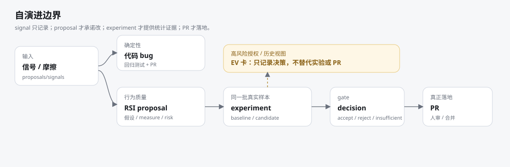
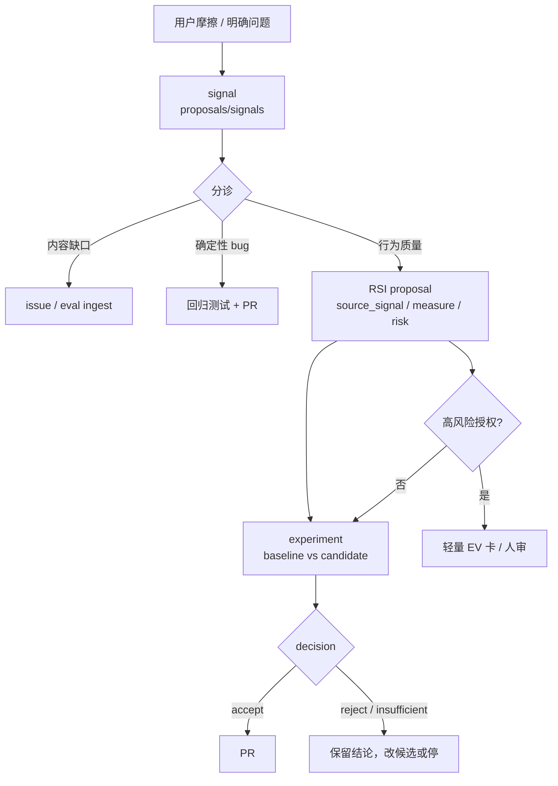

# 演进配置：一份 sleuth.config.yaml

这篇说明自演进相关的部署配置、角色边界和流水线组合。只维护仓库根的 `sleuth.config.yaml`；不存在旧格式兼容迁移。

## 1 为什么是一份

自演进配置只在仓库根 `sleuth.config.yaml`。角色、评估策略、成本 profile、RSI store、同步模式、流水线声明都从这里进入；流水线预设本身放独立的 `config/rsi/pipelines.yaml`，避免主配置被 stage 组合膨胀。

`sleuth.config.yaml` 是唯一入口：

```yaml
schema: sleuth-config-v1

deployment:
  name: ascend-sleuth

evolution:
  role: maintainer          # maintainer | signal-only | off

  store:
    backend: local
    path: .s2-replay/evolve/rsi-events.jsonl

  policy:
    decision: { alpha: 0.10 }
    samples: { field_evaluation: 9 }
    cost: { primary_cost_metric: tokens }

  profiles:
    latency:
      cost: { primary_cost_metric: elapsed_time }

sync:
  mode: auto                # auto | offline
```

`evolution.policy` 是评估策略的唯一入口；`profiles` 只覆盖差异，不再单独维护 `policy-latency.yaml`。

## 2 策略与选项

### 2.1 策略字段

| 配置键 | 允许值 | 默认 | 含义 |
|---|---|---|---|
| `objective.primary_metric` | `case_hit` / `root_cause` / `rubric` | `case_hit` | 主指标；决定质量路径 |
| `decision.alpha` | 0–1 | 0.10 | 显著性阈值，越小越严格 |
| `samples.field_evaluation` | 正整数 | 9 | 主评估最小样本数 |
| `samples.core_regression` | 正整数 | 30 | core 回归目标数 |
| `samples.test` | 正整数 | 4 | test 集目标数 |
| `samples.split` | `hash` / `group` | `hash` | 测试集切分方式 |
| `cost.primary_cost_metric` | `tokens` / `tool_calls` / `rounds` / `elapsed_time` | `tokens` | 主成本维度 |
| `cost.maximum_cost_increase_ratio` | ≥0 | 0.10 | 允许的成本上涨比例（公式里的 B） |
| `cost.minimum_cost_improvement` | ≥0 | 0.10 | 成本路径要求的最小下降比例（公式里的 ε） |
| `cost.max_quality_drop` | ≥0 | 0 | 允许的主指标非劣容差（公式里的 δ） |
| `autonomy.default` | `observe` / `propose` / `batch_review` / `supervised_auto` / `policy_auto` / `full_auto` | `batch_review` | 审批档位 |
| `autonomy.auto_merge.enabled` | true/false | false | `supervised_auto` 是否允许自动合并；false 时降为 `batch_review` |

审批档位与 RFC 的对应：

```text
observe          只观察、出报告
propose          提出改动，逐项人审
batch_review     批量实验，按批人审（默认）
supervised_auto  低风险自动合并，周审计
policy_auto      在预设边界内调整
full_auto        全自动（本期不做）
```

配置只写这些名称；不存在旧键读取路径。

### 2.2 流水线预设与消融

流水线预设不放主配置，单独放 `config/rsi/pipelines.yaml`；主配置只声明加载哪些文件和选哪个预设：

```yaml
# sleuth.config.yaml
evolution:
  pipeline: default
  pipeline_config:
    - config/rsi/pipelines.yaml
```

```yaml
# config/rsi/pipelines.yaml
pipelines:
  default:
    description: 六个环节全开
    stages: { attribute: attribute.trace_rule, ... }
  no_proposal:
    description: 消融“提案”环节
    extends: default
    stages: { propose: propose.none }
```

- `pipeline_config` 按顺序合并，后面的文件可覆盖或追加预设；
- `extends` 只覆盖差异，适合消融矩阵；
- 每个 stage 点由 `scripts/evolve/stages.py` registry 校验；
- 用户不写实现 id，只选预设名；内部 policy 由预设解析后注入。

## 3 信号、提案、实验、卡、PR





- **signal**：只记录现象、环境、证据、出现次数；不做预测，不承诺改。
- **proposal**：一条待验证改动；行为面 proposal 带 `source_signal`、`measure`、`risk`。
- **experiment**：同一批真实样本上的 baseline/candidate 对照；证据写进 RSIStore。
- **decision**：accept / reject / insufficient。
- **PR**：真正落地。
- **EV 卡**：不是实验结果的别名。新流程只在高风险或 RSI 覆盖不到时保留轻量授权记录；历史卡只读。

### 3.1 谁在什么时候做什么

| 阶段 | 触发 | 执行者 | 产物 |
|---|---|---|---|
| signal | 内容流程收尾 | `evolve-check` | `proposals/signals/` |
| 分诊 | 用户显式发起深度轮 | `self-evolve` | 分类后的候选队列 |
| 确定性 bug | 分诊或现场发现 | agent | 回归测试 + PR |
| 内容缺口 | 分诊 | 内容 skill | case / reference / ingest |
| 行为质量 | 用户选中候选后显式发起 | RSI | proposal → experiment → decision |
| 高风险授权 | 规范/协议/权限/自动合并边界 | 人审 + agent | 轻量 EV 卡 |
| 落地 | accept 或修复完成 | agent + 人审 | PR |

`evolve-check` 和 `self-evolve` 都不自动执行 RSI；`self-evolve` 只生产候选，不生产结论。

## 4 确定性 bug 不走 RSI

代码 bug 有确定 oracle：

```text
能复现 → 最小回归测试 → 修 → 测试通过 → PR
不能复现 → signal + 环境诊断/防御性报错，不写 validated
```

只有“没有确定 oracle、需要样本对照”的行为质量改动才走 RSI。

## 5 配置组合，不做迁移

没有旧配置读取分支。主配置只做三件事：

```text
声明角色与 store
选择策略 profile
声明 pipeline 文件与预设
```

策略 profile 只覆盖 `evolution.policy` 的差异；pipeline 文件只定义 stage 组合；两者分开，避免主配置膨胀。新增消融实验时：

1. 新建 `config/rsi/<experiment>.yaml`；
2. 在其中定义 `pipelines.<name>`，可用 `extends`；
3. 把文件加进 `evolution.pipeline_config`；
4. 把 `evolution.pipeline` 改成要跑的名字。

## 6 校验

```bash
python3 scripts/sleuth_config.py --check --root .
python3 scripts/evolve.py policy check --root .
python3 scripts/evolve_mode.py --json --root .
python3 scripts/doctor.py --json | grep evolution
```

## 7 已知边界

- 旧记录没有 `source_signal` / `sample_context`；面板显示已有字段，不补造。
- 角色是部署声明，不是单次运行开关；临时覆盖用环境变量，不写进配置。
- `signal-only` 下信号只进本部署台账，由上游分诊；不自动跑实验。
- EV 卡历史数据仍由 `verify_proposals.py` 校验，不再作为新行为改动的全量前置门。
