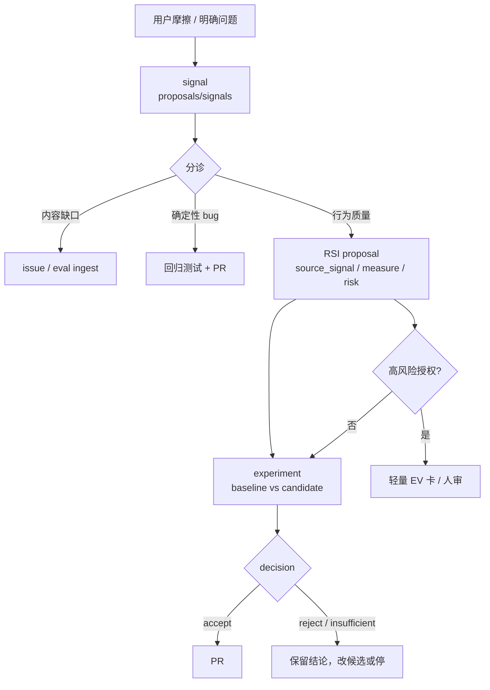

# 演进配置：一份 sleuth.yaml

这篇说明自演进相关的部署配置、角色边界和迁移。新用户只维护仓库根的 `sleuth.yaml`；旧文件只作兼容读取。

## 1 为什么合并

过去配置分散在四个地方：

```text
deployment.yaml             部署角色、同步模式
eval/policy.yaml            评估策略
eval/policy-latency.yaml    延迟 profile
.s2-replay/evolve/store.yaml RSI store
```

同一个部署要改一种行为，需要同时记住四个文件、四套校验和四处文档。`sleuth.yaml` 把这些收成一份：

```yaml
schema: sleuth-config-v1

deployment:
  name: ascend-sleuth

evolution:
  role: maintainer          # maintainer | signal-only | off

  store:
    backend: local
    path: .s2-replay/evolve/rsi-events.jsonl

  policy:
    decision: { alpha: 0.10 }
    samples: { field_eval: 9 }
    cost: { primary_dimension: tokens }
    # 其余策略键与旧 eval/policy.yaml 相同

  profiles:
    latency:
      cost: { primary_dimension: time }

sync:
  mode: auto                # auto | offline
```

`evolution.policy` 是评估策略的唯一入口；`profiles` 只覆盖差异，不再单独维护 `policy-latency.yaml`。

### 2.1 策略字段

| 配置键 | 允许值 | 默认 | 含义 |
|---|---|---|---|
| `objective.primary_metric` | `case_hit` / `root_cause` / `rubric` | `case_hit` | 主指标；决定质量路径 |
| `decision.alpha` | 0–1 | 0.10 | 显著性阈值，越小越严格 |
| `samples.field_evaluation` | 正整数 | 9 | 主评估最小样本数 |
| `samples.core_regression` | 正整数 | 30 | core 回归目标数 |
| `samples.test` | 正整数 | 4 | test 集目标数 |
| `samples.split` | `hash` / `group` | `hash` | 测试集切分方式 |
| `cost.primary_cost_metric` | `tokens` / `tool_calls` / `rounds` / `elapsed_time` | `tokens` | 主成本维度 |
| `cost.maximum_cost_increase_ratio` | ≥0 | 0.10 | 允许的成本上涨比例（公式里的 B） |
| `cost.minimum_cost_improvement` | ≥0 | 0.10 | 成本路径要求的最小下降比例（公式里的 ε） |
| `cost.max_quality_drop` | ≥0 | 0 | 允许的主指标非劣容差（公式里的 δ） |
| `autonomy.default` | `observe` / `propose` / `batch_review` / `supervised_auto` / `policy_auto` / `full_auto` | `batch_review` | 审批档位；内部映射 A0–A5 |
| `autonomy.auto_merge.enabled` | true/false | false | `supervised_auto` 是否允许自动合并；false 时降为 `batch_review` |

审批档位与 RFC 的对应：

```text
observe          A0  只观察、出报告
propose          A1  提出改动，逐项人审
batch_review     A2  批量实验，按批人审（默认）
supervised_auto  A3  低风险自动合并，周审计
policy_auto      A4  在预设边界内调整
full_auto        A5  全自动（本期不做）
```

旧键 `primary`、`field_eval`、`primary_dimension`、`B`、`epsilon`、`delta` 仍可被 legacy 读取，但新配置不再新增。

## 2 角色边界

| role | 本地产生 | 不产生 | 适用 |
|---|---|---|---|
| `maintainer` | 信号、RSI proposal、experiment、decision、PR | 不把所有行为改动自动变成 EV 卡 | 有真实样本、runner、judge 的维护者仓 |
| `signal-only` | 信号台账、本地执行记录 | EV 卡、RSI 实验、验证门 | 用户本地、内网 fork、只做内容沉淀的部署 |
| `off` | 一条跳过记录 | 其他演进记录 | 明确关闭演进的部署 |

`signal-only` 不阻止普通工程修复：确定性代码 bug 仍然用回归测试 + PR 修，模式只管演进记录。

## 3 信号、提案、实验、卡、PR




- **signal**：只记录现象、环境、证据、出现次数；不做预测，不承诺改。
- **proposal**：一条待验证改动；行为面 proposal 带 `source_signal`、`measure`、`risk`。
- **experiment**：同一批真实样本上的 baseline/candidate 对照；证据写进 RSIStore。
- **decision**：accept / reject / insufficient。
- **PR**：真正落地。
- **EV 卡**：不是实验结果的别名。新流程只在高风险或 RSI 覆盖不到时保留轻量授权记录；历史卡只读。

## 4 确定性 bug 不走 RSI

代码 bug 有确定 oracle：

```text
能复现 → 最小回归测试 → 修 → 测试通过 → PR
不能复现 → signal + 环境诊断/防御性报错，不写 validated
```

只有“没有确定 oracle、需要样本对照”的行为质量改动才走 RSI。

## 5 迁移

旧配置仍能被读取，但只作 fallback：

```text
deployment.yaml evolution.mode: full        -> role: maintainer
deployment.yaml evolution.mode: record-only -> role: signal-only
deployment.yaml evolution.mode: off         -> role: off
eval/policy.yaml                            -> evolution.policy
eval/policy-latency.yaml                    -> evolution.profiles.latency
.s2-replay/evolve/store.yaml                -> evolution.store
```

读取优先级：

```text
sleuth.yaml
  > deployment.yaml / eval/policy*.yaml / store.yaml（legacy）
  > 内置默认值
```

`deployment.yaml` 与 `eval/policy*.yaml` 已标记 deprecated；新部署不要再新增这些文件。

## 6 校验

```bash
python3 scripts/sleuth_config.py --check --root .
python3 scripts/evolve.py policy check --root .
python3 scripts/evolve_mode.py --json --root .
python3 scripts/doctor.py --json | grep evolution
```

## 7 已知边界

- 旧记录没有 `source_signal` / `sample_context`；面板显示已有字段，不补造。
- 角色是部署声明，不是单次运行开关；临时覆盖用环境变量，不写进配置。
- `signal-only` 下信号只进本部署台账，由上游分诊；不自动跑实验。
- EV 卡历史数据仍由 `verify_proposals.py` 校验，不再作为新行为改动的全量前置门。
