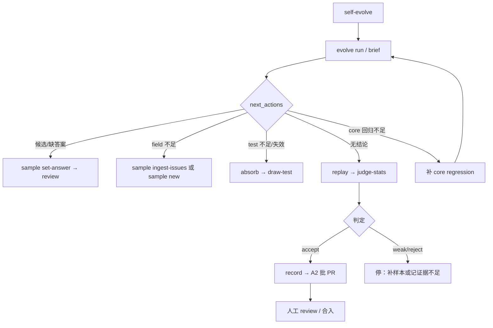

# 运行：节奏、预算与内容维护

演进不是一条单独的流水线，而是内容工作收尾时的伴随动作；需要全库观测时，人才显式跑一轮深度轮。本文说清什么时候跑、一轮的边界在哪、每周具体做什么、花多少预算，以及长期任务与视图怎么装配。

读者是要跑一轮、排一周的活、定停止条件或改进流程的人。前置是 [rsi-mechanism.md](rsi-mechanism.md)（机制入口）、[records.md](records.md)（记录与卡）、[evaluation.md](evaluation.md)（判定规则）。只想知道系统在做什么的人不必读本文。

范围：触发入口、运行模式与授权、一轮的边界与停止、每周流程、采样、内容维护、长期任务、工程形态。不含评估与判定规则（[evaluation.md](evaluation.md)）、记录字段（[records.md](records.md)）、groom 的内部协议（[agent-groom.md](agent-groom.md)）。

## 1 解决什么问题

自演进会持续运行，还会改自己。没有边界就审计不了，也停不下来。缺的是四样：入口协议、一轮的目标与停止条件、预算、固定的每周动作。本文补这四样。明确不解决：判定怎么算（[evaluation.md](evaluation.md)）、卡要记什么（[records.md](records.md)）、单个 skill 内部的执行规则（各 skill 正文）。

## 2 最小可执行模型

一条指令走完四步：

| 步 | 动作 | 位置 |
|---|---|---|
| 1 装载默认策略 | 观测什么信号、怎么评测、反馈回路、卡从提出到验证的流程、授权分级、停止条件与预算分层，全部自动带出 | 系统默认策略 |
| 2 确认目标 | 回显理解并澄清歧义：范围落在哪一层、数据前提够不够、目标之间是否冲突。没有确认就不执行 | 会话入口 |
| 3 开一个任务 | 任务是目标、范围、预算策略与每轮循环（拉取 → 评测 → 沉淀 → 候选 → 实验 → 合入 → 报告） | `proposals/tasks/<TASK-ID>.yaml` |
| 4 记录并观察 | 内容 skill 收尾落一条执行记录；任务、卡与指标渲染给人看 | [records.md](records.md) 与本文 3.6 |

反例是把机制写进指令：一段话里只有目标是有用的，其余都该由默认策略承接。要求用户说出实现细节，等于把机制变成用户负担。

## 3 完整机制

### 3.1 什么时候跑，谁发起

三个入口，前两个不需要人单独发起：

| 入口 | 谁发起 | 覆盖什么 |
|---|---|---|
| 内容流程收尾的伴随评估 | 系统自动 | 这一轮产生的数据：新沉淀、未命中、重复动作、流程摩擦 |
| 每周批审收尾的检查 | 系统自动 | 知识库的覆盖缺口与结构问题 |
| 深度轮（全库观测） | 人显式要求 | 跨轮聚合：归因聚类、容量、重跑未做的条目、指标漂移 |

内容流程收尾只执行 `evolve-check`，它只记录信号，不产 EV 卡、不跑 RSI、不跑验证门。只有用户显式发起深度全库体检时，才走 `/skill:self-evolve`；深度轮只分诊候选，不自动执行 RSI。

部署可以声明演进角色：`sleuth.config.yaml` 的 `evolution.role`，读端 `scripts/evolve_mode.py`。`maintainer` 先落信号，行为质量进 RSI、内容缺口进 ingest，不自动产 EV 卡；`signal-only` 只落信号、不跑实验；`off` 只留一条跳过记录。只做内容沉淀的下游部署用 `signal-only`：本地卡号会与上游号段重号，冲突无法机械解决。

### 3.2 运行模式、授权与停止

介入度由人选，不由系统替他定。会话启动时确认运行模式：

| 模式 | 用户语义 | 各授权级别怎么处理 | 人审时机 |
|---|---|---|---|
| `default`（默认） | 自动跑，关键改动攒批给我审 | `auto` 即时合入；`review` 与 `dual` 攒批 | 轮末或批边界，提一个批 PR |
| `hands-off` | 我信这个 scope 的判断，全自动跑，做完给我 PR 审 | 三个级别都按预授权连续执行，事中不打断 | 目标完成或批边界，提一个批 PR |

不指定时按 `default`。`hands-off` 需要明确要求，并且有三条硬前提：每个行为改动有 signal/RSI 证据（高风险另有授权卡）；每个改动独立 commit、可以逐条 revert；验证先于合入。

运行模式决定一轮里人审什么时候发生；授权级别决定这次改动要不要签字；人工介入等级（默认第 2 档）决定谁有权合入、人多久看一次结果。三者不是一回事。

授权按风险与证据定级，`auto / review / dual` 表示这次改动要不要人签字：

| 级别 | 适用 | 合入方式 | 补充 |
|---|---|---|---|
| `auto` | 低风险、可逆、可机械验证 | 自动合入，仍产生完整的 PR 与 commit，CI 是强制检查 | 月度抽审，发现错误就回滚并撤销该类授权 |
| `review` | 判断性、中风险 | 人审合入 | 审一条约 30 秒 |
| `dual` | 高风险、结构、不可逆 | 双签合入 | 改 active reference、triage 结构、skill 骨架、新 skill 立项走这一级 |

授权升级由数据触发：某类 `review` 变更连续 N 次回测通过且抽审零发现，可以申请降为 `auto`，记进判据文件、可随时撤销；`auto` 变更抽审发现一个错误，该类别立即退回 `review`，并在季度自评里复核。

批的边界在任一条件满足时成立：一轮结束；卡数达到上限（默认 10 张）；任务级批提交到达目标完成点。任务级批提交可以跨多轮，但必须配卡数与时间双上限。

一轮会话有固定的六步：目标 → 装载默认策略 → 确认目标 → 计划 → 确认 → 执行与报告。用户只给目标与必要边界，机制参数用文档默认值。

会话状态写 `proposals/sessions/<SESSION-ID>.yaml`，含会话号、参数、计划、每卡进度、已耗 token、停止原因与报告引用。它是运行时件，不进 git。中断后重新加载状态，未完成的卡继续，已完成的不重跑。

停止条件任一满足即停，停后出报告，状态保留可恢复：

| 条件 | 触发 | 含义 |
|---|---|---|
| 预算耗尽 | token 预算用尽 | 最常见的边界 |
| 产出达标 | `validated` 卡达到设定张数（默认 3） | 已产出足够 |
| 信号误报 | 连续多个候选被否决（默认 3） | 信号质量差，停止优于继续 |
| 收敛 | 本轮没有新候选，或全部卡进入终态 | 没有剩余可判的候选 |
| 人中断 | 人在任一步打断 | 优先级最高 |

预算分两层。会话级按阶段分层：观测 10%、起草 30%、实验 50%、报告 10%；占比是执行参数，由实测校准，不是定额。卡级成本写回卡的 `actual_cost`，缺了是审计缺口。

候选积压用可机械读的水位判断：`proposals/gates.yaml` 的 `backlog_over` 判据（默认 20 张），读数是 `python3 scripts/ev_proposal.py --waterline`。超限时先跑 `python3 scripts/ev_proposal.py --mark-merged --from-prs` 补齐合入点，再看剩余量；仍然超限就只记信号、不产卡。分子的统计只允许一处实现（`has_merge_pointer`），两处各写一份曾出现同一时刻读到 0 张与 8 张的偏差。

某个范围连续两轮满足四个条件时标记为 `steady`，进入降频（默认停 4 轮再复检）：没有新信号、没有不采纳、没有待结算的存疑卡、采纳的效果达标。降频是数据触发的暂停，新信号或新的存疑卡出现时自动解除。

### 3.3 每周流程

| 谁 | 什么时候 | 做什么 | 产出 |
|---|---|---|---|
| 工程师 | 每次诊断 | 诊断、应用建议、回报结果 | 本地记录、现场反馈 |
| 本地 agent | 每周或按需 | 回顾记录，产出脱敏的现场记录、候选样本或候选卡 | PR 或现场记录 |
| 维护者 | 每周 | 从新关闭 issue 补样本，审候选队列，抽检答案 | 新样本 |
| 维护者 | 累计三条不同的反馈失败 | 跑一轮归因、改动、评估 | 一个批 PR 与评估报告 |
| 维护者 | 每月 | 跑一次外部回放，产一张带外部证据的卡 | 外部证据 |
| 维护者 | 每周 15 分钟 | 看读数、内容体检、反馈结算 | 本周动作 |
| 维护者 | 每季度 | 审视六项：信号质量、授权合理性、产出质量、是否灌水、参数校准、流程自身 | 自评报告 |

15 分钟只指读数与体检。样本建设另计：诊断样本首次标注约 5–15 分钟一条，双标再加 10–15 分钟；case 与 reference 约 10–15 分钟一条。首次 bootstrap 约 8–12 人时；稳态约 1–2 小时一周。维护预算低于 1 小时一周时，这套循环会停，建议不建。

周界那一次的动作是固定的：批处理待审队列、升格、去重、结算与汇总记录、算分、退休，并组装本期读数。命令与产物：

| 动作 | 入口 |
|---|---|
| 批处理、升格、去重、结算、算分、退休 | `/skill:knowledge-groom` |
| 组装本期读数 | `python3 scripts/metrics_snapshot.py --kind live`，人复核后写 `metrics/timeline.d/` |
| 批量拉取上游 issue | `/skill:issue-ingest` |
| 补 issue 评测样本 | `/skill:eval-ingest`（底层 `sample ingest-issues`；补答案用 `sample set-answer`，审候选用 `sample review`） |
| 跑一次体检 | `python3 scripts/evolution_health.py` |
| 评审一项改进 | `python3 scripts/ev_measure.py <卡号> --run` |
| 查看算法适配器 | `python3 scripts/evolve.py experiment list`；按 target 解析用 `experiment resolve --target skill` |
| 看完整 metrics 体检 | `python3 scripts/evolve.py health --json`（只读；`--check` 有 fail 退出 1，broken 退出 2；不带 `--check` 的读数命令仍退出 0，与 `metrics_health.py` 一致） |
| 记录一个 baseline 提案 | `python3 scripts/evolve.py experiment propose --target skill --component <组件> --summary <一句话>`（只写本地实验记录，不跑模型、不合入） |
| 查看本地实验记录 | `python3 scripts/evolve.py experiment records --limit 10` |
| 记录 subagent 对照实验 | 显式进入 RSI：`experiment request` → `experiment flow` → `experiment show` |
| agent-native GEPA | 状态机 `scripts/agent_gepa.py`；不接官方 gepa 库，不依赖外部 endpoint |
| 增量 trace 归因 | `python3 scripts/evolve.py traces sync`；`traces status` 看 snapshot/状态 |
| 知识使用效率 | `python3 scripts/evolve.py knowledge-usage evaluate/compare`；只读 usage JSON，不改 case |
| 真实 pilot 编排 | `pilot prepare/collect`；创建隔离 candidate worktree、写 baseline/candidate 任务清单、收集 trace/输出 |
| candidate apply | `candidate validate/apply/rollback/diff`；在隔离 git worktree 应用单个 skill region Patch，不改主检出 |
| 源码访问效率 | `python3 scripts/evolve.py source-usage from-trace/evaluate/compare`；只读 trace/usage，不下载源码 |
| RSI 多源计划 | `python3 scripts/evolve.py rsi plan`（trace/metrics/replay → 归因/region/实验 spec）；`--replay .s2-replay` 读 issue 回放结果失败；`rsi status` 读回；agent 回写用 `rsi attribute/select --state <plan> --file <json>` |
| holdout 隔离 | issue/issue 回放导入与手工 sample 新建/复核/升格都按 `eval/holdout.yaml` 的 issue 号拒绝；不把封存样本吸进候选池 |
| 全库观测轮 | `/skill:self-evolve` |

只跑新增样本，不每周跑全量；判定那一次才跑全量。读数包含六项：可评样本数、最近一次全量回放的命中率、单次回放成本、距上次收尾检查的天数、未执行的检查命令数、内容体检的越界项。没测过的项写「未测」，不补零。

维护者每周只看一个入口：`python3 scripts/evolve.py run`（面板或脚本用 `--json`）。它不跑模型、不写库，只根据样本队列、结论、`sleuth.config.yaml 的 evolution.policy` 和 metrics 给出 `next_actions`：候选待审、field 评估样本不足、test 不足或未抽、尚无结论、core 回归不足；同时给出 candidate/field/test 计数、按 `stratum` 的分层计数与 warnings（例如候选缺答案、某层 test 不足）。`samples.strata` 配每层目标；`draw-test` 按目标层补齐。

trace 归因的幂等状态在 `.s2-replay/evolve/trace-state.json`：键是 `(source_id, trace_id, content_sha256, attribution_schema)`；同内容同 schema 跳过，trace 内容变化或 schema 升级才重算。`snapshot_id` 由当前活跃 trace 集合再哈希，用来判断状态是否对应当前 trace 集。`traces sync` 会把归因组件映射到 `regions.py` 的可变异区；没有匹配就空，不猜。未来 collector 实现 `TraceSource` 并换 `source_id`，不复制归因/状态机。

metrics 的消费分两跳：诊断只写本地 trace；`trace_entry_activity.py --apply` 把现场使用折成 `metrics/entry-activity.d/<周>.yaml` 并更新共享游标，`metrics_snapshot.py --kind live` 在周界组装 `metrics/timeline.d/<期号>.yaml`；groom/PR 提交这些 tracked 源和生成物，原始 trace 与 `metrics/entry-activity.local/` 不上仓。`evolve run/brief` 只读 `metrics/timeline.yaml`、`gates.yaml`、`skill-exec-log.yaml` 和 `entry-activity/<部署>.yaml`，缺文件标 unavailable，不补零，也不把本地明细当中心数据。读 `gates.yaml` 的 `freshness` 判 live/structural 是否过期；过期或不可用会进 `next_actions`，提醒先跑 `trace_entry_activity --apply`/`metrics_snapshot`，不把旧读数当现状。

维护者入口收敛到 `/skill:self-evolve`；skill 先调 `evolve run`，再按 `next_actions` 分支：

skill 所有人可调用；它只给流程与建议，`review/promote/record/merge` 仍由 policy、CODEOWNERS、分支保护和人工审批约束。阅读 `run`/`brief` 是只读入口。

`brief` 是同一份计划的读数版，另带最近结论。关注项按输出顺序处理：先审候选；还没有结论就补一条带版本的结论；再补 field 样本、抽 test；最后看 core 回归。`run` 不自动合并任何内容。

读数直接给出本周动作：命中率未测就跑一次全量；未执行的检查命令太多先清一批；样本不够补样本；外部验证停摆跑一次外部回放；内容越界修最重的一项。没有命中规则就写「本周无动作」。

指标按消费方的决策问题分四层，答不出决策问题的指标不采集：

| 层 | 指标 | 回答的决策问题 |
|---|---|---|
| 机制健康 | 候选到采纳率、实验到通过率、信号误报率、抽审发现率、回滚率 | 流水线是否在做对的事；信号是否误报；`auto` 授权是否过宽 |
| 知识质量 | 命中率、现场解决率、误诊率、路由准确率、判别力、覆盖缺口 | 知识库整体在变准吗；哪个格子弱 |
| 单次沉淀效果与组件质量 | `validation_record`、现场解决计数、归因事件簇、每次 skill 变更前后的差 | 每次沉淀是否有效；哪个组件反复出错；这次改动有效吗 |

评估按周预算，不按条数。预算用完先完成当前评估，不新开；报告里写「本周预算用完，哪几项没开始」。上游 issue 断流、没有评审、预算用完、测试集或协议刚变更时，循环停在「记录」这一步，不靠自动触发掩盖停摆；读数会显示停在哪。

### 3.4 采样与 issue 的三种用途

issue 的 resolution（fix PR 合入、维护者确认或 issue 内的用户反馈）本身就是反馈，不只是评测数据。它承担三种用途：

| 用途 | 说明 |
|---|---|
| 反馈源（内容验证） | issue 回放对照：命中且结论一致记 `validation_record.consistent`，命中但结论不符记 `inconsistent`（复审信号），由 `scripts/settle_s2_feedback.py` 结算 |
| 沉淀素材 | 评测完成后的 issue 才允许沉淀为 case 或 reference |
| 覆盖缺口信号 | open issue 没有答案，只作弱信号：把现象交给诊断，没有命中或置信度低就记该现象族未覆盖，不参与对照评分 |

「先评测后沉淀」的纪律持续执行：新关闭的 issue 先过 issue 回放评测，再允许沉淀。评测用的 issue 如果已经被沉淀成 case，重放命中的只是系统自己写下的答案，高分不构成外部验证。隔离有三条：

1. 先评测后沉淀。一批新关闭 issue 先全部过 S2，此时知识库还没有这批 issue 的 case，分数反映的是用旧知识解新题。
2. 结算隔离。结算时检查 replay 的 issue 是否正是该 case 的来源，以及该 case 正文是否引用过这个 issue（`#N`、`issues/N`、`pulls/N`）。命中任一条记 `self_consistent`，不计为外部验证。
3. 混入已沉淀源时标注。池子小的时候某一期可能混入已沉淀源，指标标「测试含已沉淀源」并降权。

S2 校准集的 selection 与 test 分离是规模条件：池子撑不起两半时单池运行，直到出现真实的留出需求（见 [evaluation.md](evaluation.md)）。

### 3.5 内容维护

内容维护指过期重核、重复合并、容量拆退与退休。它不产卡，走普通 PR；回放失败指向的内容改动可以产卡，但同样需要人审。

误诊归因的事件写进诊断记录（`case_error` 或 `execution_error`，可带组件 ID）；深度轮或季度自评需要时，用 `scripts/component_tally.py` 从记录里现聚合失败簇，没有常驻表。聚合出反复失败的组件才考虑修订该组件所在的 skill 步骤或 triage 分支。

一次知识整理内部的顺序固定为七步，每步的写点与入口：

| 步骤 | 做什么 | 入口 |
|---|---|---|
| 1 处理 inbox | 草稿升格为 case | `knowledge-groom` 的 intake 步骤 |
| 2 结算现场回报 | 把反馈事件折成计数，只写记录，不改案例文件 | `scripts/settle_trace_feedback.py --apply` |
| 2b 外部对照结算 | 把回放结果折成外部验证记录 | `scripts/settle_s2_feedback.py --apply` |
| 3 汇总本机记录 | 按 id 折算本次增量与工具分布 | `scripts/trace_entry_activity.py` |
| 4 算分 | 记录计数加冷启动先验，算出每个条目的分数 | `scripts/score_entries.py` |
| 5 复审与退休 | 按记录与分数改内容或存续 | `knowledge-groom` 的复审步骤 |
| 6 索引重建 | 合入后由主干 job 重建；PR 不提交生成物 | `scripts/rebuild_generated.py`、`scripts/index_read_cost.py` |
| 7 组装本期读数 | 只在周界那一次 | `scripts/metrics_snapshot.py` |

「降置信」不是单独一步：分数由第 4 步算出来，低分就是降置信的结果；第 5 步做内容层的事。

只改有信号的条目，不每周重写全库。groom 的同步快照、语义比对、证据绑定与合入前复核在 [agent-groom.md](agent-groom.md)；本节的顺序只说明它在每周流程里的位置。

### 3.6 长期任务与视图

长期任务把多轮会话装成一条线。任务由目标、范围、issue 源配置、预算策略、停止条件与运行模式六个字段定义。每轮是一次会话，顺序为：拉新批次 → issue 回放评测与沉淀评估 → 候选 → 授权 → 实验 → 批提交 → 报告。

轮间调度按上一轮的产出决定下一轮范围：

| 上一轮的产出 | 下一轮 |
|---|---|
| 新关闭 issue | 评测与沉淀轮 |
| 待观察窗结算的采纳卡 | 回测轮 |
| open issue 转为 closed | 自动评测 |
| 指标漂移 | 诊断式候选轮 |

任务状态有四个取值：`active`（在跑，默认）、`paused`（预算耗尽或人中断）、`steady`（收敛后降频）、`stopped`（人终止）。状态写 `proposals/tasks/<TASK-ID>.yaml`，含目标、范围、来源配置、每轮引用、预算记录与停止原因；它是运行时件。任务记得目标与历史，会话记得本轮进度。

视图分四层，数据都已存在，缺的是渲染：任务总览（`proposals/tasks/`）、会话直播（会话状态与执行记录）、卡流转（`proposals/ideas/`）、指标（timeline 与归因聚合）。视图按数据来源标注〔中心全量〕或〔本地视角〕，两种读数不得混用。

### 3.7 工程形态

仓库的载体分工是：`skills/` 放流程定义，`scripts/` 放确定性逻辑，`proposals/` 放领域状态，`dsh-plugins/` 放运行时渲染。自演进横跨四类载体：

| 层 | 载体 | 对应内容 |
|---|---|---|
| 流程协议 | `skills/self-evolve/SKILL.md` | 一轮的会话协议：目标 → 默认策略 → 确认 → 计划 → 执行 → 报告；由人显式触发，防自发批量改库 |
| 确定性逻辑 | `scripts/` | issue 回放评测、结算、归因事件按需聚合、执行记录；机械可判的环节脚本化，agent 只读聚合输出 |
| 领域状态 | `proposals/` | 卡是资产，会话、任务、季度自评、实验是运行时件 |
| 可视化 | `dsh-plugins/` | 任务总览、卡流转、指标等视图；不是多 agent 协作状态视图 |

只做成一个 skill 会把校验、状态与渲染塞进提示词协议，违反设计原则二（不变量写进结构）。先做哪一层按落地方案排：确定性逻辑与领域状态 → 流程协议 → 可视化。

## 4 边界与失败模式

| 情形 | 行为 | 细则 |
|---|---|---|
| 预算耗尽 | 完成当前评估，不新开；任务转 `paused`，等下一个周期 | 3.2、3.6 |
| 人中断 | 本轮停止，出中间报告，保留状态 | 3.2 |
| 收敛到稳态、候选积压超水位 | 稳态转 `steady` 降频（待实现设计）；积压先回写合入点再判剩余量，仍超限只记信号、不产卡 | 3.2 |
| 观察窗到期没有反馈 | 标存疑加提醒人，人可以补反馈或回滚；正式降级状态是待实现设计 | 3.2、[records.md](records.md) |
| 数据前提不满足、没有 DSH 环境 | 先澄清：建池或改用现有数据；冷启动明说数据基础与预计轮次；没有 DSH 时任务状态文件加手动或定时触发同样成立 | 3.1、3.6 |
| 执行记录并发写或文件缺失 | 写侧持 flock（无锁并发实测里 16 次写入只剩 3 条）；文件缺失或空表按正常退化处理 | [records.md](records.md) |
| 跨克隆或跨机 | 不聚合原文，跨机走聚合值进 timeline | 3.3、[records.md](records.md) |
| 批内卡数、时间上限或稳态收敛触顶 | 提前提批，不等目标完成 | 3.2 |
| 判据越界（`proposals/gates.yaml`） | 授权级别从 `auto` 降到 `review`，待处置项通知人 | 3.2 |
| 无 token 记账环境 | 成本用估算并标 `source: estimate` | 3.2 |
| S2 池子小，测试集撑不起来 | 降级为单池运行，直到出现真实留出需求 | 3.4 |
| 某一期混入已沉淀源、或视图数据范围混用 | 指标标「测试含已沉淀源」并降权；视图标〔中心全量〕或〔本地视角〕 | 3.4、3.6 |

## 5 现状

### 5.1 已落地

- 三个入口：`skills/evolve-check/SKILL.md`（只记信号）、`skills/self-evolve/SKILL.md`（深度分诊）、`skills/knowledge-groom/SKILL.md`（每周批审）；重型 RSI 只由显式选择候选后进入。
- 部署级演进模式：`sleuth.config.yaml` 的 `evolution.role` 与 `scripts/evolve_mode.py`。
- 积压水位、合入点回写与单一分子实现：`scripts/ev_proposal.py --waterline`、`--mark-merged --from-prs`。
- 内容流程执行记录与聚合进 timeline。
- 季度自评的载体目录：`proposals/reviews/`（目录与放行规则已定，内容仍空）。

### 5.2 蓝图

- 会话协议与预算试点、长期任务层跨轮运行：前者排在 golden 验证与 S2 校准集之后，后者先有真实数据再手动试点一轮。
- 稳态降频 `steady`、任务级批提交跨轮：前者在某个范围真实收敛后启用，后者在用户真实要求「跨多轮攒批」后启用。
- 策略记忆独立文件 `proposals/strategy-memory.yaml`：季度自评跑通至少一轮后启用。
- 冲突检测的机械检查：`affected_paths` 进卡 schema 之后；此前靠读卡判断改动范围的交集。
- 可视化面板与 HTML 报告：任务层跑通一轮以上。
- 回滚率与抽审发现率接入判据、多 agent 载体：两项读数已可用、判据未落；后者等真实的多 agent 并行场景。

### 5.3 已否决

- 无人全自动：`hands-off` 指事中不打断，最终仍有一个批 PR 人审、指标定义红线、每卡验证与可回滚。
- 采集 KPI、身份与使用观测：观测对象是系统自身行为，不涉及人。
- 把系统内部机制写进用户指令：要求用户复述观测信号、评测流程与修改计划，等于把机制变成用户负担。
- 每次 skill 调用都落全量执行记录：diagnose 已有记录，信息更全。
- 用多 agent 活动面板替代领域视图：它可视化协作运行状态，不含卡状态机、指标与跨轮任务历史。
- 靠无限扩池消化候选：积压率高说明产卡速度超过消化能力，动作是下调信号权重。
- 不为预测的问题预建机制：待实现的设计保留，触发条件出现才激活。

## 6 代码与文档入口

| 用途 | 入口 |
|---|---|
| 收尾伴随评估 | `skills/evolve-check/SKILL.md` |
| 深度观测轮 | `skills/self-evolve/SKILL.md` |
| 每周批审 | `skills/knowledge-groom/SKILL.md` |
| 演进模式 | `scripts/evolve_mode.py`、`sleuth.config.yaml` 的 `evolution.role` |
| 积压水位与合入点 | `scripts/ev_proposal.py --waterline`、`--mark-merged --from-prs` |
| 周读数 | `scripts/metrics_snapshot.py --kind live`、`scripts/build_timeline.py` |
| 体检 | `scripts/evolution_health.py`、`proposals/gates.yaml` |
| 评审把手 | `scripts/ev_measure.py --run`、`--audit` |
| 执行记录 | `scripts/log_skill_exec.py`、`scripts/tail_exec_log.py` |
| 归因聚合 | `scripts/component_tally.py` |
| 会话与任务状态 | `proposals/sessions/`、`proposals/tasks/`（运行时件） |
| 长期任务与视图 | 本文 3.6；载体见 [status.md](status.md) |

## 7 外部参考

- [NanmiCoder/dsh-agent-teams](https://github.com/NanmiCoder/dsh-agent-teams)：多 agent 协作的运行时与活动面板，提供成员树、任务图、实时状态与历史归档，数据源是 `<workspace>/.agent-teams/<teamId>/`。它只覆盖会话直播里的 agent 执行部分；卡流转、指标与任务总览仍需自建。它属于执行载体，不是自演进工程本身。
- [SkillOpt](https://github.com/microsoft/SkillOpt)：把优化对象从模型参数换成文本，并保留一份跨轮累积的 meta-skill。策略记忆与它同源，本设计不引入它的代码或运行时。外部工作的完整对照在 [evaluation.md](evaluation.md) 与设计附录 H。
