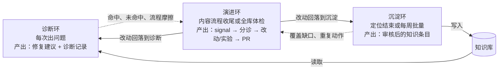

# 自演进机制

系统在做内容工作的过程中改自己，改出来的东西在下一轮工作中生效。本文是这套机制的技术入口：目标、三条环路、一轮演进怎么走、哪一步需要人，以及其余七篇各管什么。

为什么值得读：要改这套机制本身，先要分清三条环路与改动落在哪一层。不分清，一处改动会挡到另一处。

范围：机制怎么运转、数据落在哪、哪一步需要人、八篇怎么分工。不含单个流程内部的执行规则（`skills/<name>/SKILL.md`）、评估与判定规则（[evaluation.md](evaluation.md)）、记录字段与存储（[records.md](records.md)）、运行节奏与预算（[operations.md](operations.md)）。

读者是要改演进、评估、记录或流程的人。第一次接触这套系统的人先读 [demo-walkthrough.md](../demo-walkthrough.md)；只跑日常诊断与沉淀的人不必读本文。

本文不写会过期的数字，需要时现算：知识库条数 `python3 scripts/index_counts.py`；改进项状态 `python3 scripts/ev_measure.py --audit`；指标读 `metrics/timeline.yaml`；判据阈值读 `proposals/gates.yaml` 与 `metrics/gates.yaml`。

## 1 这是什么

自演进是一套可复核的评估循环：真实问题进来，经过回放、评估、归因与一次小的策略改动，再回到评估。人可以少看过程，但能看到结果与回退。

可复核指三件事。每条信号有出处；行为质量改动用同一批真实样本做改前、改后对照，评估结论与版本一起写进记录，任何人照命令可以复现；高风险授权有轻量 EV 记录，普通改动不做仪式卡。合入由授权等级决定，改动可以整体撤回。

这套机制只改自己的机制层：不改客户现场，不改诊断与沉淀两个环内部的执行规则，也不自动改知识内容。

## 2 它解决什么问题

改动与验证没有连起来时会出现四种现象，每一种都能在本机复算：改进项自己说自己有用（大多数卡片只有代码对比或自审）；评估用的样本与写改动用的材料混在一起（等于拿答案改答案）；本地记录里的真实失败没有进入评估（诊断侧的记录停在本地）；没有一条记录能让人事后复核一次改动凭什么被接受（卡状态、评估数据、合入点三者对不上）。

明确不解决的问题：诊断与沉淀两个环内部的执行规则在各自的 skill 正文里，本文不改；业务上现在该关心什么由人判断，全库体检的发起因此留在人手里；高风险改动、指标定义与评分规则不由 agent 单独决定。

## 3 由哪几块组成

### 3.1 三条环路

三条环路各有入口与产出，混起来读是理解这套机制最大的障碍。

**图 1　三条环路（类型：流程图；范围：诊断、沉淀与演进之间交换的数据）**

图例：虚线是交给演进的数据，实线是写入与回落。

这张图里值得注意的地方：演进环不直接写知识库。它读两个环交来的数据、改机制，再把改动送回两个环；知识库由沉淀环写入、被诊断环读取。

### 3.2 一轮演进

一轮演进先分诊，再决定走哪条路：

1. 收尾记录。内容流程收尾时，`evolve-check` 只对照信号表写 `proposals/signals/`；没有信号只留一行记录。不产卡、不跑 RSI。
2. 深度分诊。用户显式发起 `self-evolve` 后，聚合信号并归入五类：确定性 bug、内容缺口、行为质量、高风险授权、观察。深度轮只输出候选队列，不执行实验。
3. 确定性 bug。能复现、有确定 oracle 的，写最小回归测试并直接进 PR；不走 RSI。
4. 内容缺口。交给内容 skill（case / reference / ingest），不走 RSI。
5. 行为质量。用户选中候选后，显式进入 RSI：proposal → 真实样本 experiment → decision。没有真实样本、runner、judge 不进入。
6. 高风险授权。规范文档、评估协议、权限、自动合并边界等改动，用轻量 EV 卡记录授权与回滚；卡不替代实验，也不替代 PR。
7. 合入。接受的改动进 PR，由人审合入；reject / insufficient 保留结论，不补仪式记录。

演进能改的对象只有五类，每类都配了护栏：

| 动作 | 作用对象 | 什么时候发生 | 护栏 |
|---|---|---|---|
| 排序分数校准 | 单条知识的排序分数 | 每次收到现场反馈 | 只按已回报的结果计；同一条连续两次未解决就转人工，防误诊级联 |
| 知识注入 | 知识库条目 | 定位结束，或每周批审 | 人审队列、语义校验、高风险双签，防错误知识入库 |
| 误诊归因 | 知识库或流程 | 每次误诊 | 先读诊断记录判断错在哪一侧，防止在执行出错时误改正确的知识 |
| 结构演化 | 目录、路由、容量 | 数据触发，例如容量到上限 | 由数据触发而不是预先安排；改动走高风险双签 |
| 退休与复活 | 活跃索引的成员 | 每周 | 只退休版本过期或长期无效的条目；从没被选中的罕见条目不退休 |

另有三条护栏适用于全部五类动作：自动化只产出建议与证据、采纳由人执行；升级由数据触发、不按日历排期；对照标准不能由被检查的一方修改。

误诊归因的事件写进诊断记录（`case_error` 或 `execution_error`，可带组件 ID）；深度轮或季度自评需要时，用 `scripts/component_tally.py` 现聚合失败簇，没有常驻表。

### 3.3 角色

角色按权限分，不按谁在执行。答案可见性写在接口层，不靠提示词约定。

| 角色 | 能做什么 | 不能做什么 |
|---|---|---|
| 执行器 | 准备诊断回放、跑诊断、收集结果、成本与轨迹 | 不能看评估集的答案；不能写结论 |
| 评分器 | 按答案或 rubric 给诊断、case、reference、trace 打分 | 不能改知识库；不能写结论 |
| 归因器 | 在反馈集上指出失败步骤与原文行 | 不能看评估集答案；不能决定留不留 |
| 改动起草 | 根据信号写 RSI proposal、检查命令、回退路径 | 不能看评估集答案；不能决定留不留 |
| 评估器 | 比较基线与候选，给出结论 | 不能改内容；不能决定合入 |
| 周读数 | 汇总评估记录与指标，给出本周动作 | 不能写评估记录 |
| 人 | 标答案、定协议与策略、决定合入、处理高风险 | 不替 agent 跑实验 |

评估集的答案对改动起草与归因器隐藏；反馈集的答案开放；测试集的答案只在最终判定时使用。这条权限边界比任何提示词纪律都重要。

### 3.4 人工介入

介入等级回答三个问题：谁有权合入、能在多大风险范围内合入、人多久看一次结果。

| 模式 | agent 能做什么 | 人做什么 | 适用 |
|---|---|---|---|
| `observe` | 读记录、跑评估、出报告 | 看报告 | 冷启动、协议未定 |
| `propose` | 提出改动和评估 | 逐个决定 | 高风险、协议变更 |
| `batch_review` | 批量跑实验、汇总一次评估 | 审一个批次的评估报告 | 当前默认 |
| `supervised_auto` | 自动合并低风险改动 | 每周审计、看异常 | 预留，当前不启用 |
| `policy_auto` | 在预设边界内调整阈值与节奏 | 定边界、审计 | 后续可选 |
| `full_auto` | 全部 | 不做 | 这期不做 |

默认 `batch_review`。`supervised_auto` 没有自动合并机制时按 `batch_review` 执行；只有部署侧具备自动合并、分支保护也允许时才打开。`authorization: auto / review / dual` 是另一个维度：它表示这次改动要不要人签字，与这六档不同。

有五步现在必须有人，退出条件各不相同：

| 步骤 | 为什么现在由人做 | 可退出条件 |
|---|---|---|
| 发起全库体检 | 系统不知道业务上现在该关心什么 | 需要不依赖人的触发源；判据越界已经能机械读出来，缺的是固定去读它的动作 |
| 审查合并 | 一项改动的验证出自自定规则时，评审是仅有的外部约束 | 这个面有能报错的强制检查，并且预期由外部来源判定 |
| 结构性改动：骨架、路由、新 skill 立项 | 影响面无法局部验证 | 无；设计上不由 agent 单独决定 |
| 指标定义与评分规则 | 系统不改自己的评分标准 | 无 |
| 现场反馈回报 | 只有工程师知道修复在自己的环境里是否生效 | 没有机械替代 |

## 4 从哪读起

八篇各有权威范围，一件事只有一篇说了算。

| 文档 | 回答什么 | 什么时候读 |
|---|---|---|
| 本文 | 目标、三条环路、一轮演进、角色、人工介入、文档地图 | 第一次读，或只想知道机制长什么样 |
| [evaluation.md](evaluation.md) | 评估对象、评估集、rubric、判定、成本、版本、评估台 | 要改判据、扩样本、改 rubric，或查一次判定怎么出来 |
| [records.md](records.md) | 信号、RSI 实验、结论、高风险 EV 授权、存储与版本 | 要改字段或 schema、写记录，或查某条数据进不进 git |
| [operations.md](operations.md) | 运行模式、每周流程、预算、采样、内容维护、失败处理 | 要跑一轮、排一周的活、定停止条件 |
| [status.md](status.md) | 机制状态表、未建与空转、代码与文件入口 | 要查某条机制落地没有、代码在哪 |
| [diagnosis-observability.md](diagnosis-observability.md) | 一次诊断记什么、怎么汇总上仓、面板 | 要改 trace 字段、汇总脚本或面板 |
| [agent-groom.md](agent-groom.md) | 内容维护用的知识快照、语义比对、合入前复核 | 要改 groom 流程或审这类 PR |
| [ixn-replay.md](ixn-replay.md) | 交互面评测：追问、信息充分性、过早结论 | 要改交互面评测（延后项） |

旧路径已删除，不再保留指路页；内容按下表并入：

| 旧路径 | 现在读 |
|---|---|
| `pipeline.md` | [rsi-mechanism.md](rsi-mechanism.md)、[evaluation.md](evaluation.md)、[records.md](records.md)、[operations.md](operations.md) |
| `execution.md` | [records.md](records.md)、[evaluation.md](evaluation.md) |
| `orchestration.md` | [operations.md](operations.md) |
| `run.md` | [operations.md](operations.md)、[records.md](records.md) |
| `eval-arena.md` | [evaluation.md](evaluation.md) |

## 5 不覆盖什么

- 诊断与沉淀两个环内部的执行规则：在 `skills/diagnose/`、`skills/to-postmortem/`、`skills/to-reference/`、`skills/knowledge-groom/` 的正文里。
- 知识库内容本身（`knowledge/`、`references/`、`postmortems/`）：入口见各自的说明。
- 设计与取舍的完整论证：在 `proposals/2026-11-17-self-evolution-design.md` 与附录里；那两份是档案，不作为执行依据。
- 每一面的行文规则：[writing-norms.md](../spec/writing-norms.md)，内部术语见 [terminology.md](../spec/terminology.md)。
