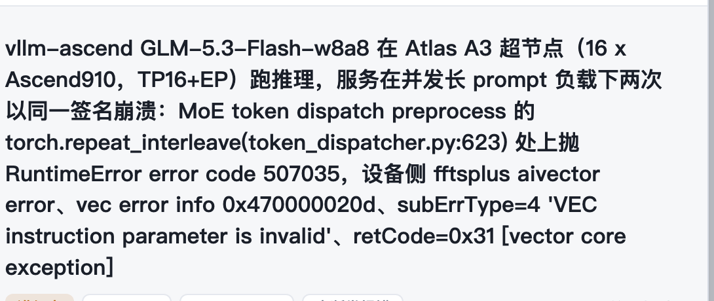
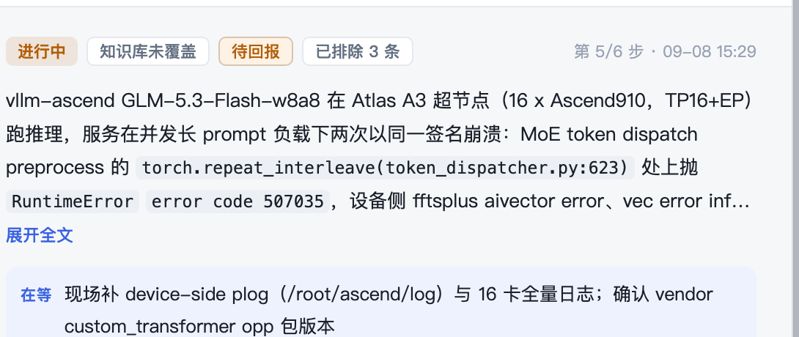
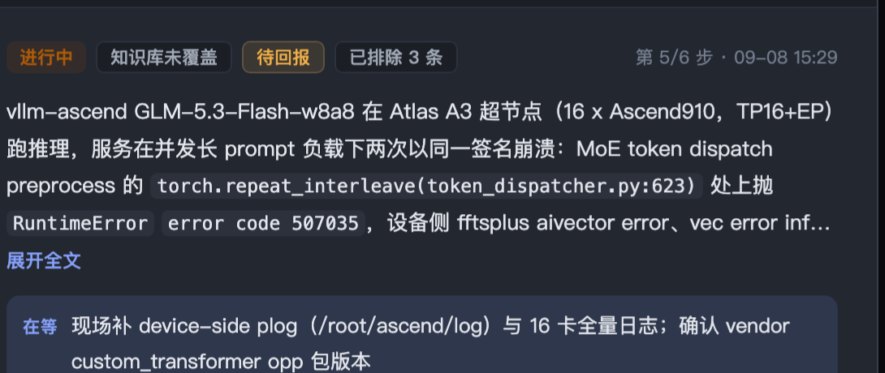

# 诊断总览详情抬头：从放大标题改到识别行 + 正文层背景

状态：已实现（插件包 0.16.1，PR #433 待合入），待评审
范围：`dsh-plugins/dsh-sleuth-copilot` 诊断总览浮层的右列顶部、行内文字渲染与区块层级。不改状态判据、不改写入路径、不改沉淀视图。
读者：评审这次界面改动的人、后续维护诊断总览的人。

## 1 要解决什么问题

真机打开诊断总览，右列顶部是七八行 16.5px / 650 的粗体。源头是 `caseTitle()` 取 `summary` 第一个句号前的整段：本机 4 条 trace 的 `summary` 是 198–817 字（中位 603），首句就是其中大半；按 512px 的列宽、16.5px 中文约 31 字一行，渲染出来 5 到 20 多行。

同一段文字在底部「问题背景」块里又出现一次（4 行截断）。读者打开总览的第一屏因此被一段背景文字占满，「这是哪一单、做到哪一步、现在在等什么」都被推到折叠线以下。

三处一起造成「粗糙」的观感：标题层级被背景文字占用；身份标签、进度、时间与摘要挤在同一块；区块标题是 12px / 600 的深色，与正文抢层级。

## 2 选哪条路

三条候选：

- 甲：只收排版。字号 16.5 降到 14.5、字重 650 降到 600、标题截三行、区块标题降权。改动约 10 行 CSS，但顶部仍是三行粗体，底部仍重复同一段。
- 乙：重排抬头。一行识别信息承担「这是哪一单」，摘要降到正文层级排四行、超出给展开；路径、错误码、函数调用走等宽；删掉底部重复块。选它。
- 丙：拆事实条目。把 `summary` 拆成现象 / 环境 / 根因 / 处置。摘要本身没有结构，只能靠模型或正则硬猜，不选。

选乙放弃的是「顶部有一句显眼的标题」：确认「看的是哪一单」要靠左列选中行与识别行里的身份标签。可能坏在哪：展开入口的阈值是近似判断；行内等宽会把不该标的英文标成代码。

具体改动：

- 识别行：状态徽标、身份标签（`identityChips` 最多 3 个）、第 N/6 步与更新时间，字号 11px、高 20px。
- 问题背景：整段 `summary`，13px / 行高 1.75，四行截断；超出时给「展开全文」。展开与否先比较 `scrollHeight` 与 `clientHeight`，替身渲染拿不到布局尺寸时退回 110 字近似。展开状态按单号记，切回原单仍是展开。
- 行内等宽（`inlineTokens`）：带括号的调用、已知扩展名的文件（可带行号，扩展名后要求词边界）、十六进制、五位以上数字、以 `Error` / `Exception` 结尾的类名，五类包成 `<code>`；文本一字不改，React 文本节点渲染。
- 「现在在等」从色块标题加正文两行收成一条「在等」窄行。
- 区块标题从 12px / 600 深色降到 11.5px / 600 次要色；卡片边框透明度降到 72%、圆角 12 收成 10；字段标签 11px 次要色。
- 沉淀视图的抬头不动：它的标题是 case 号或草稿名，本身很短，仍用 `.scp-hero`。

视觉对照（从 `lib/client.js` 提取的 CSS + 同一份示例内容离线渲染，不是真机截图）：

改前：

改后：

深色：

## 3 怎么算完成

- `node dsh-plugins/dsh-sleuth-copilot/test/render-smoke.mjs`：基线 `origin/main` 235 条断言，改后 245 条，0 失败。
- `node dsh-plugins/dsh-sleuth-copilot/test/host-smoke.mjs`：79 条，0 失败（Host 半未改）。
- 回退反例：把 `lib/client.js` 换回 `origin/main` 版再跑，6 条断言先红（版本一致性 + 抬头），随后在找「展开全文」时中断——旧版没有可展开入口。
- 行内等宽探针：`API (see log)`、`v1.2 (beta)` 不标；`foo(bar)`、`x.py:12`、`0x470000020d`、`507035`、`RuntimeError` 会标；`data.jsonl`、`x.pyc`、`notes.txt.bak` 不拆；文本 round-trip 为真；含 `<script>` 的文本按文本节点渲染。
- 真机：装 0.16.1 后打开诊断总览，顶部不超过一行识别信息、摘要默认四行、超出有「展开全文」。

## 4 不做会怎样

每次打开总览先读 5–20 行粗体，同一段背景读两遍，状态与「在等」要在折叠线以下找。界面的第一屏不回答「这是哪一单、做到哪一步」，读者只能靠左列与滚动补上这一步。
