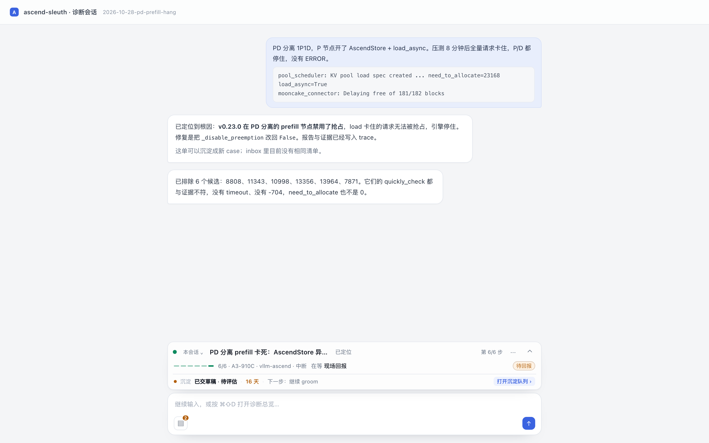
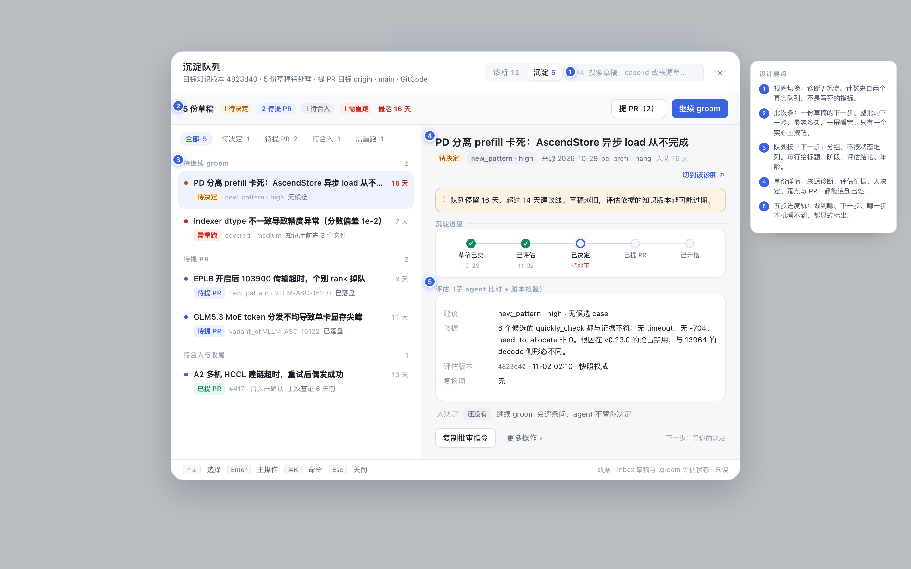
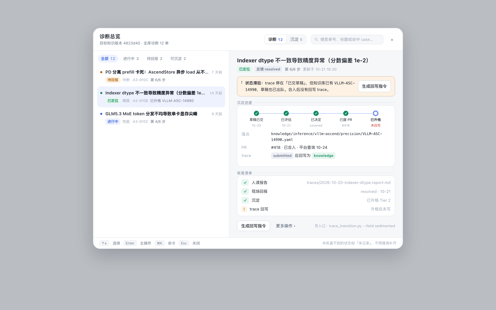
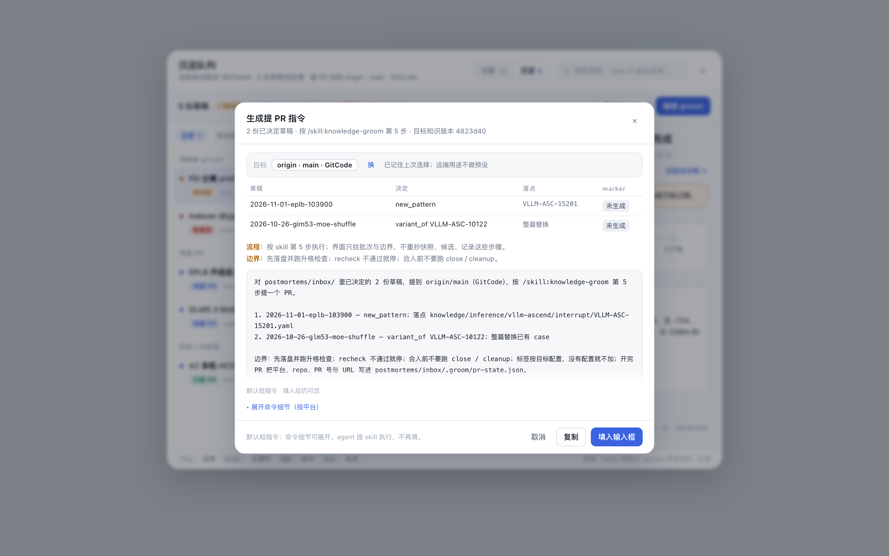
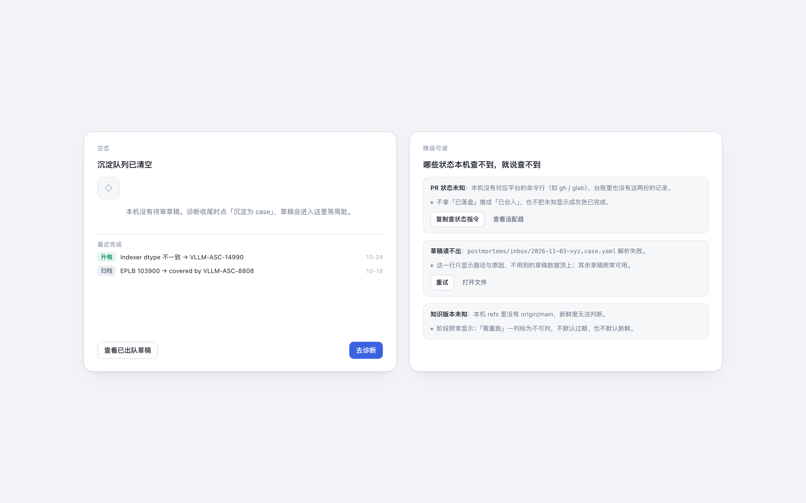
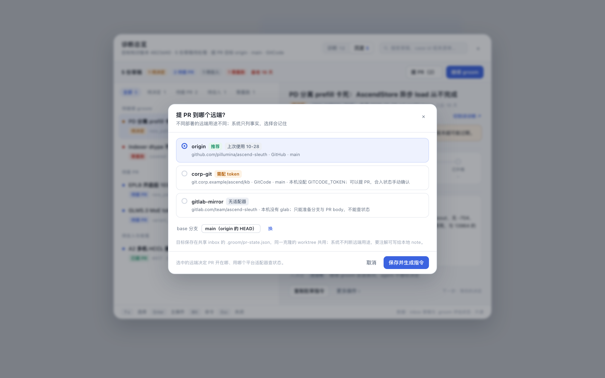

# 沉淀队列进入诊断交互层：可看的进度、可点的下一步

本文给出 `dsh-sleuth-copilot` 插件里沉淀流程的界面方案：inbox 待审队列、单条诊断的升格进度、提 PR 指令的生成。范围覆盖现有三个注册面（状态条、输入区工具条、总览）与一个新弹层，不含 groom 流程本身，也不改知识库写入脚本。读者是评审这个交互的人；评审前先读第 2 节的现状与第 6 节的替代方案。只做单次诊断、不参与每周批处理的人不必读。

## 1 状态

已批准（2026-11-04；实现随本 PR 提交，合入后改为已落地）。交互设计稿在 `proposals/assets/copilot-sediment-ux/mockup.html`；实现后的确认方式：`node dsh-plugins/dsh-sleuth-copilot/test/render-smoke.mjs && node dsh-plugins/dsh-sleuth-copilot/test/host-smoke.mjs` 通过，`python3 dsh-plugins/dsh-sleuth-copilot/lib/sediment_state.py --root . --json` 返回 `ok: true`。

## 2 动机

沉淀的真实状态分在三处，每处只回答一半。

`traces/<session>.yaml` 的 `sedimented` 是写入那一刻的断言，不是派生值。`to-postmortem` 写 `submitted`，`groom_close_draft` 写 `knowledge` 或 `archived`。

合入后漏跑收尾，它就停在 `submitted`。`skills/knowledge-groom/SKILL.md` 记了这个例子：面板的沉淀漏斗显示 4 沉淀 → 0 转正，数据滞后于实际入库。

`postmortems/inbox/` 是本地队列，`.groom/assessments/<key>.yaml` 记评估与人决定，两者都在 gitignore 里。今天只有 `groom_status.py` 的一屏文本能看全，面板与插件都读不到。

`knowledge/` 与 `postmortems/<YYYY-QN>/` 是合入结果。PR 的 open / merged 全仓没有落盘；提 PR 是人的动作，脚本只产出 marker 与复核结论。

于是人要做三件事，每件都靠记命令：

1. 诊断收尾后确认结论有没有入库：翻 trace、翻 inbox、翻 `knowledge/`，或跑 `python3 scripts/groom_status.py`。
2. 每周一次的批处理（下称周批）时在对话里按顺序走十个动作：快照、候选、比对、记录、决定、marker、recheck、PR、close、cleanup。漏 marker 或漏 recheck 会被 CI 拦；漏 close 会让 trace 停在 `submitted`。
3. 决定提 PR 时带什么：每份草稿的 key、决定、最终 case id、PR 模板、base 分支，以及该仓约定的标签。这些都在脚本输出里，拼成一条能发出去的指令今天靠人。

提 PR 的目标也没有承载。本地可能同时有多个远端（GitHub 与内网平台、主仓与镜像），哪个远端接收这批改动因部署而异；`groom_snapshot.py --list-remotes` 在同步时问一次，提 PR 时没有对应动作。目标记在人脑里，选错要关 PR 重来。

代价落在具体动作上。现场工程师不知道自己的结论进库没有；知识库维护者（owner）每周先花时间确认「哪些草稿、停在哪、最老多久」，再开始真正的工作。

## 3 目标

做完之后，下面七件事可以直接看到或点到。

| 变化 | 怎么确认 |
|---|---|
| 总览里一眼看到 inbox 草稿数、阶段与最老年龄 | 打开「沉淀」视图，计数与 `python3 scripts/groom_status.py --json` 的 `drafts` 一致 |
| 单条诊断显示结论到入库的五步进度，并指出 trace 与实际的差异 | 选一条已升格的诊断，差异行给出回写指令 |
| 已决定的草稿一键生成带目标、marker、recheck 与边界的提 PR 指令 | 点「生成提 PR 指令」，预览出现目标、批次表与完整命令；填入输入框后可直接发送 |
| 空队列、缺平台命令行、草稿读不出时给原因与下一步 | 三个降级场景分别有文案，不把未知显示成完成 |
| PR 合入状态带来源与时间，查不到时标「未确认」 | 详情显示「平台查询 10-24」或「上次查证 6 天前」；不因分支存在推断已合入 |
| 提 PR 前显式确认远端与分支，且只问一次 | 副标题与弹层显示 `origin · main · GitCode`；改远端后下一批复用 |
| 不新增第四个面 | 仍只有状态条、输入区工具条、总览三个注册面，新增内容挂在现有面上 |

怎么算完成：跑 `cd dsh-plugins/dsh-sleuth-copilot && node test/render-smoke.mjs && node test/host-smoke.mjs`，两条都通过。新增渲染断言覆盖空队列、过期、待决定、待提 PR、差异回写五种场景。默认短指令只含目标、每份草稿一行与边界；份数多时行数随之增长，命令细节要展开才出现。设计阶段的确认方式是本文附的交互设计稿与第 9 节的未决问题。

## 4 非目标

下面六件本来可以是目标，这次明确不做，每条写理由。

1. **不做新的知识写入者**。界面不写 case、不提 PR、不替人决定草稿。写入仍走 `trace_transition.py`、`groom_decide.py`，或由 agent 执行生成的指令。
2. **不替代 groom**。不做候选检索、不做语义比对；只读 `groom_status.py` 与 sidecar 的产物。理由：判断必须在子 agent 与脚本那一侧，界面复制一份就会漂移。
3. **不做常驻联网**。PR 状态按需查，缺平台命令行时降级。理由：10 秒轮询里放网络请求会让状态条变慢，离线部署也会坏。
4. **第一版不做界面内的决定表单**。accept / adjust / reject 要读候选与证据，仍走 agent 问答。理由：把决定压成三个按钮会鼓励跳过证据。
5. **不改主面板与生成物**。沉淀面只进 `dsh-sleuth-copilot`。理由：主面板是另一套代码，两个入口会分叉。
6. **不引入数据库或向量检索**。队列规模是每周几份到十几份，现有文件与脚本足够。理由：为一个本地小队列买基础设施，维护成本大于收益。

## 5 方案

**什么叫好。** 四条按优先级排，后面每个决定都回到这里：

1. **不用记状态**：打开队列就知道每份草稿卡在哪、下一步轮谁；诊断详情不用回翻 trace 与 inbox。
2. **不用记命令**：下一步是一次点击；生成的指令只带界面才知道的事实（批次、决定、落点、边界），不重讲流程。
3. **不用猜**：查不到的 PR、版本、草稿，标「未记录」并给下一步，不画成已完成。
4. **不打断**：常驻面只加一行；周批的列表进浮层，收起态不变。

这四条决定了两处取舍：队列放进总览而不是新开页面（少一个入口）；提 PR 指令默认短、命令细节折叠（流程在 skill 里，界面不抄第二份）。

### 5.1 放在哪：三个触点加一个弹层

方案把「现在」与「整批」分开，沿用插件现有的两个节奏。

- **状态条**回答单条诊断：结论走到知识库的哪一格、还差谁动手。新增一条沉淀行，只在展开态出现（图 1）。
- **总览**回答整批：inbox 里几份草稿、各自停在哪、下一步做什么。新增「诊断 / 沉淀」视图切换，沉淀视图是队列的主场（图 2）。
- **单诊断详情**回答这一单的升格状态：五步进度、每一步的证据、trace 与实际的差异（图 3）。
- **提 PR 指令弹层**回答「怎么把已决定的草稿交出去」：先预览短指令，需要时展开命令细节（图 4）。



图 1 是状态条。前两行保持现状；第三行是新增的沉淀行：阶段、年龄、下一步，右侧一个「打开沉淀队列」入口。收起态不加内容，避免常驻噪声。



图 2 是总览的沉淀视图。左列是队列，按「下一步」分组；右列是选中草稿的详情。顶部的批次条给整批的下一步，只有一个实心按钮。



图 3 是诊断视图里的沉淀进度。黄色提示行指出 trace 停在「已交草稿」、知识库已有 case，并给回写入口。



图 4 是提 PR 指令弹层。顶部是目标（remote · base · platform）；下面是批次表与边界提示；默认给短指令，命令细节折叠，确认后填入输入框。

交互稿是单个自包含 HTML，直接打开 `proposals/assets/copilot-sediment-ux/mockup.html`。`?scene=bar|queue|diag|pr|target|empty` 切场景，`?theme=dark` 切深色，`?notes=1` 显示编号标注。

### 5.2 沉淀视图：队列按下一步分组

队列的对象是草稿，不是诊断。诊断视图里的「可沉淀」是 trace 侧待办；沉淀视图里的行来自 `postmortems/inbox/`，包括没有来源诊断的草稿（`issue-ingest` 的产出就属这类）。两个计数可以不等，界面用视图名区分，不合并成一个数。

**顶栏**：标题随视图切换（「诊断总览」/「沉淀队列」），副标题给目标知识版本、草稿数与提 PR 目标，右侧是「诊断 N / 沉淀 M」切换、搜索、关闭。

**批次条**：整批的下一步放这里。左侧是 `4 份草稿` 与各阶段计数，最老超过 14 天时标红。右侧一个实心主按钮，按最早未完成的阶段取值：

- 有未评估、待决定或过期的草稿 → 「继续 groom」；
- 全部已决定、没有 PR 记录 → 「生成提 PR 指令」；
- 全部已提 PR → 「查合入状态」或「生成收尾指令」。

已决定的草稿可以单独提 PR，这时批次条给一个描边次按钮「提 PR（N）」。它不抢实心按钮的位置。

**左列**：三段分组，组内按年龄降序。

1. 待继续 groom：未评估、待决定、需重跑、批准失效。
2. 待提 PR：已决定，落点可能已存在也可能还没有。
3. 待合入与收尾：已有 PR 记录，等合入或等回写。

每行给标题、阶段徽标、评估结论（分类、置信度、候选）、来源单号、年龄。超过 14 天的年龄用红色；行里不放长文本，详情在右列。

**右列**：选中草稿的详情。

- 标题与元信息：阶段、分类与置信度、来源诊断、入队天数。
- 五步进度：草稿已交 → 已评估 → 已决定 → 已提 PR → 已升格。每步下面给日期或一句证据。
- 评估块：建议分类、候选 case、理由、评估所用知识版本、复核项。
- 人决定块：决定、决定人、时间、备注；没有决定时给一句「继续 groom 会逐条问，agent 不替你决定」。
- 落点与 PR 块：将写入或已存在的 case 路径、postmortem 路径、PR 号与状态；没有记录就写「未记录」。
- 动作行：主按钮跟批次条同一优先级但作用在这一份；其余进「更多操作」。

**筛选**：全部、待决定、待提 PR、待合入、需重跑。计数来自投影，不在前端重算。

**键盘**：沿用总览：`↑↓` 选择，`Enter` 执行主操作，`/` 聚焦搜索，`Esc` 分层关闭，`⌘K` 打开命令面板。

**空态与降级**：队列为空时给「队列已清空」与最近一次升格；缺平台命令行、草稿读不出、知识版本未知时各给原因与下一步（图 5）。



### 5.3 单条诊断的沉淀进度

右列新增一个「沉淀进度」块，替换现在只有一行的「沉淀」字段。五步与证据来源如下：

| 步 | 显示 | 证据来自 |
|---|---|---|
| 草稿已交 | 日期与草稿路径 | trace 顶层 `sedimented.inbox_path`，以及队列里按 key 找到的草稿 |
| 已评估 | 分类、置信度、评估所用 commit | `.groom/assessments/<key>.yaml` 的 `assessment` 与 `provenance` |
| 已决定 | 决定与决定人 | 同文件的 `human_decision` |
| 已提 PR | PR 号与状态 | 本地台账；没有台账时显示「未记录」 |
| 已升格 | case id 与路径，或 postmortem 路径 | `knowledge/` 的 case 文件、`postmortems/<季>/` 的 postmortem |

界面把 trace、队列、知识库与 PR 台账放在一起做交叉核对，有三种差异要显示，并各给一个动作：

1. **trace 滞后**：trace 写 `submitted`，但队列里没有这份草稿、知识库已有 case。动作是「生成回写指令」，命令为 `trace_transition.py --field sedimented`。
2. **草稿丢失**：trace 写 `submitted`，队列与 `.done/` 都找不到，知识库也没有 case。动作是「查看 inbox 与 .done」，不猜它去了哪。
3. **落点缺失**：trace 写 `knowledge`，但知识库里没有这条 case。动作是「核对 case id」，不把 trace 的写法当事实。
4. **升格未出队**：trace 已升格、case 在库，草稿仍在 inbox。动作是生成收尾指令（`groom_close_draft --all --apply`），不重复回写。

没有证据的步骤显示「未记录」或「本机查不到」，不画成已完成。

### 5.4 状态条的沉淀行

展开态加第三行，高度约 20 像素；收起态不变。一行放四段：阶段、年龄、下一步、入口。

- 阶段用队列里的真实状态，不用 trace 的 `sedimented` 原值：`已交草稿 · 待评估`、`已评估 · 待决定`、`已决定 · 待提 PR`、`已提 PR #418 · 待合入`、`已升格 VLLM-ASC-14990`、`已归档（Tier 3）`、`需重跑`。
- 年龄超过 14 天用 warn 色；点击整行打开队列并选中这份草稿。
- 差异存在时，阶段后面加一句「trace 未回写」，点击进详情看差异行。
- 现有「草稿待升格」标签改名「来源单未收尾」。它现在的含义是「草稿已交但来源诊断还没收尾」，与队列里的「已决定待提 PR」不是一件事；两个都用「升格」会让人以为是同一个阶段。

动作不在这里堆：状态条只给「打开沉淀队列」；生成指令统一在队列里做。这样同一条指令只有一处措辞。

### 5.5 提 PR 指令：短指令默认，命令细节折叠

点「生成提 PR 指令」打开弹层，内容顺序固定：

1. 目标：远端 · base 分支 · 平台，右侧「换」。没有目标时先选，不默认猜。
2. 批次表：每份草稿的 key、决定、落点；标签只在目标配置了映射时显示。
3. 边界：三到四条容易漏的约束。
4. 指令预览：默认短指令，只写目标、批次与边界；「展开命令细节」才显示落盘、marker、recheck 与提 PR 的具体命令。
5. 底部：取消、复制、填入输入框（实心）。

**为什么不把 groom 流程展开。** 流程在 `/skill:knowledge-groom` 里，已经写了快照、候选、比对、记录、决定、marker、recheck、close、cleanup 的顺序与判断依据。界面再抄一遍会变成第二份口径：skill 改了、指令没改，agent 按哪份执行都说不清。界面只补 agent 从数据里看不到的东西：这一批是哪几份、决定是什么、落点在哪、哪些约束容易漏。

短指令样例（默认填入）：

```text
对 postmortems/inbox/ 里已决定的 2 份草稿，提到 origin/main（GitCode），按 /skill:knowledge-groom 第 5 步提一个 PR。

1. 2026-11-01-eplb-103900 — new_pattern；落点 knowledge/inference/vllm-ascend/interrupt/VLLM-ASC-15201.yaml
2. 2026-10-26-glm53-moe-shuffle — variant_of VLLM-ASC-10122；整篇替换已有 case

边界：先落盘并跑升格检查；recheck 不通过就停；合入前不要跑 close / cleanup；标签按目标配置，没有配置就不加；开完 PR 把平台、repo、PR 号与 URL 写进 postmortems/inbox/.groom/pr-state.json。
```

展开后的命令细节（给不加载 skill 的会话，或排查时用）：

```text
python3 scripts/verify_case_draft.py --gate <草稿路径>
python3 scripts/groom_record.py --pr-marker --draft-key <key> --submitted-case-id <final-id>
python3 scripts/groom_recheck.py --pr-body-file <body> --base origin/main --head <head>
GitHub：gh pr create --body-file <body> [--label <目标配置的标签>]
GitLab：glab mr create --description <body> [--label <目标配置的标签>]
```

平台命令按台账里的 `platform` 选；没有适配器的平台由 agent 按平台文档自己开 PR，指令里不猜命令。

同一套机制生成另外三条指令：

- 继续 groom：带草稿清单与「逐条问我，不替我决定」。
- 查合入状态：带 PR URL 与平台适配器给出的查询命令；没有适配器时说明并给手动更新入口。
- 合入后收尾：先 close 再 cleanup，证据不在就停。

### 5.6 状态怎么来：数据契约

界面不解析 YAML、不判状态。新增一条按需读取的 Host 端点 `copilot-sediment`。它调用一个新的只读脚本（暂定 `dsh-plugins/dsh-sleuth-copilot/lib/sediment_state.py`）。

新脚本复用 `scripts/groom_common.py`、`scripts/groom_status.py` 与 `scripts/_trace_state.py` 的函数，不复制判断依据。

**落点**：

- Host 半在 `lib/index.js` 的端点白名单与处理链加一支，现有 `copilot-state|transition|report|timeline` 旁。
- 浏览器半在 `lib/client.js` 的 `Palette` 组件加视图切换与队列右列块；状态条沉淀行加在 `makeDock` 的展开分支。
- 三个注册面（`conversation.input.dock`、`conversation.input.right`、`shell.overlay`）不变；文案同时进 `ZH` / `EN` 两本字典。
- 目标选择另加一个端点 `copilot-pr-target`：列远端、识别平台、写 `target`（写走 `pr_status.py --set-target`，带 CAS）。

端点按需调用，不放进 10 秒轮询；`groom_status` 要读 git 与 inbox，本机实测空队列 70 毫秒，有草稿时预计 1 到 3 秒（未在真实队列上实测），界面先显示占位，再填内容。

返回结构（节选）：

```json
{
  "ok": true,
  "targetCommit": "4823d40",
  "counts": { "total": 4, "unassessed": 1, "needDecision": 1, "needRerun": 1, "decided": 2, "prPending": 0, "overdue": 1 },
  "primary": { "kind": "groom", "label": "继续 groom", "prompt": "..." },
  "drafts": [
    {
      "key": "2026-10-28-pd-prefill-hang",
      "title": "PD 分离 prefill 卡死：AscendStore 异步 load 从不完成",
      "state": "need_decision",
      "stage": "已评估 · 待决定",
      "ageDays": 16,
      "ageSource": "created_at",
      "novelty": "new_pattern",
      "confidence": "high",
      "stale": false,
      "staleReasons": [],
      "decision": null,
      "source": { "sessionId": "2026-10-28-pd-prefill-hang", "mismatch": null },
      "promotion": { "caseId": null, "casePath": null, "postmortemPath": null, "pr": null },
      "next": { "kind": "groom", "label": "继续 groom", "prompt": "..." }
    }
  ],
  "history": []
}
```

各事实的写点不变，只在读侧合并：

| 事实 | 谁写 | 落在哪 |
|---|---|---|
| 草稿 | `to-postmortem`、`issue-ingest` | `postmortems/inbox/<key>.case.yaml` |
| 评估 | `groom_record.py` | `postmortems/inbox/.groom/assessments/<key>.yaml` |
| 人决定 | `groom_decide.py` | 同上 |
| trace 沉淀状态 | `to-postmortem`、`groom_close_draft.py` | `traces/<session>.yaml` 的 `sedimented` |
| 升格结果 | 升格动作（人 / agent） | `knowledge/<ns>/<cat>/<id>.yaml`、`postmortems/<季>/` |
| PR 记录 | 提 PR 的 agent | `.groom/pr-state.json`（target + 每单平台、repo、号、URL；本方案新增） |

**平台适配：两层扩展，加平台不改界面、不改核心脚本。**

- **声明式适配**（标准 REST + token）：一个 `scripts/platforms/<id>.yaml`，声明 host、认证环境变量、查询请求、字段映射与创建提示。核心 `pr_status.py` 读它，统一成 `{state, checked_at, source}`。GitCode 用这一层就够。
- **可执行适配**（要 CLI 或非标准认证）：一个 `scripts/platforms/<id>.py`，实现 `detect(url)` / `check(pr)` / `create_hint()`，输出同一份 JSON。核心发现它就用，不改别的。
- **没有适配**：显示「本机没有对应工具」，给手动确认入口，不阻断提 PR。

`scripts/platforms/gitcode.yaml` 的字段（节选）：

```yaml
id: gitcode
name: GitCode
hosts: [gitcode.com]
auth_env: GITCODE_TOKEN
requires: []          # 要的 CLI 命令名；REST 适配器为空
install_hint: ""      # 缺依赖时 doctor 显示这条，不执行
check:
  method: GET
  url: https://api.gitcode.com/api/v5/repos/{owner}/{repo}/pulls/{number}
  query: {access_token: "{GITCODE_TOKEN}"}
  map: {state: "$.state", merged: "$.merged"}
  normalize:
    - {when: {merged: true}, state: merged}
    - {when: {state: closed}, state: closed}
    - {state: open}
create_hint: "curl -X POST https://api.gitcode.com/api/v5/repos/{owner}/{repo}/pulls ..."
```

GitHub 与 GitLab 用可执行适配器，命令行分别是 `gh pr view <n> --json state,mergedAt,url` 与 `glab mr view <n> --json state`。新增一个平台要做的事：

| 平台形态 | 加什么 | 核心与 UI 改动 |
|---|---|---|
| 标准 REST（如 GitCode） | `scripts/platforms/<id>.yaml` | 无 |
| 要 CLI 或特殊认证（如 GitHub、GitLab） | `scripts/platforms/<id>.py` | 无 |
| 平台不支持 | 不加 | 无，走手动 |

**GitCode 有没有 CLI。** 官方的 `atomgit` CLI 面向登录、模型/数据集下载与建仓，不提供 PR 状态查询（[GitCode CLI 使用指南](https://docs.gitcode.com/docs/help/home/general-reference/cli/)）。社区有 `gc` 一类 `gh` 风格 CLI，但维护与版本不稳定，只作为可选的可执行适配器。GitCode 的 PR 状态走 REST API，默认实现不依赖 CLI；GitHub 与 GitLab 同理，也可以用 API 写声明式适配器，CLI 只是省掉鉴权配置的便利。这样「装不装 CLI」不在主路径上。

**doctor 怎么检查。** doctor 只读不装（`scripts/doctor.py` 的「只报不修」）。它按适配器声明通用地查两件事：清单是否完整、`auth_env` 与 `requires` 声明的 token/命令在不在。缺项 → degraded，把适配器的 `install_hint` 当作修法显示，但不执行；网络可达性不在 doctor 里查，放到用户点「查状态」时，避免每次体检都发请求。代安装不在 doctor 里：内网机器通常用离线包，装什么是人的决定；真需要装，由 agent 在用户明确要求后执行。

适配器清单要能被检查：`python3 scripts/pr_status.py --list-platforms` 打印可用、缺 token、清单损坏三类。PR 落在哪个平台由 PR URL 判断，不由本地远端判断；fork 场景下 PR 开在上游仓，远端与 URL 的 host 可能不同，两者都记。

**PR 状态怎么读。** 队列只有五步；合入状态不是第六步，是「已提 PR」上的一个属性。它带三样东西：`state`（`open` / `merged` / `closed` / `unknown`）、`checked_at`、`source`（`platform` / `manual` / `ledger`）。界面显示来源与时间，超过 7 天标「上次查证 N 天前」。

`state` 只由平台查询或人手确认更新，不由分支是否存在、commit 是否在 main、PR 是否可合并来推断。PR 关闭但没合入是一个显式状态，动作是「继续 groom」重新评估；是否放弃草稿由人在 groom 里决定，不自动重开。

四个数据缺口要在实现前补，缺一个就少一格显示：

1. **标题与路径**：`groom_status.py --json` 没有投影。读草稿 frontmatter 补齐，或在 `groom_status` 的投影里加 `draft_file` 与 `title`。
2. **年龄**：草稿没有 `created_at`，现在的「超过 2 周标红」只写在 README 与 skill 里。在 `to-postmortem` / `issue-ingest` 写草稿时加 `created_at`；旧草稿退回文件修改时间，并在界面标「文件时间」，因为它复制后会变。
3. **升格检查结果**：`verify_case_draft.py --gate` 的结论不落盘。第一版显示「未检查」，并把这条命令放进提 PR 指令；第二版再把结果写进 sidecar。
4. **PR 状态**：新增 `.groom/pr-state.json`，由提 PR 的 agent 在开完 PR 后写。每条记 `draft`、`platform`、`repo`、`number`、`url`、`state`、`source`、`checked_at`。只有台账能回答「哪一份 PR」；`state` 由平台查询或人确认写回，两条路都写 `checked_at` 与 `source`。两者都查不到就写「未确认」，不推成「已合入」。台账另有 `target` 段（见 5.7）。

台账的读写走一个小脚本 `pr_status.py`（`--json` / `--set` / `--mark` / `--check`），带文件指纹做 CAS；agent 不手编 JSON。

### 5.7 PR 目标：先定提到哪，再生成指令

提 PR 前要定目标 `{remote, base, platform, url}`，可选 `note` 与 `labels`。`platform` 由远端 URL 的 host 匹配适配器得到；`base` 取远端 HEAD 指向的分支，不写死 `main`。`note` 是用户写的一句备注；`labels` 是该仓的标签映射，没配就不加标签。

**什么时候问。** 只在第一次生成提 PR 指令时问一次，不在诊断收尾或 groom 阶段问。目标写进 `.groom/pr-state.json` 的 `target` 段，之后每批复用；远端列表变化时失效重问。

**默认值按顺序取第一个可用项**，界面显示理由，用户可改：

1. 已保存的 target，且远端还在、平台仍可识别。
2. 当前分支的上游远端：`git rev-parse --abbrev-ref '@{u}'` 的 remote 部分。
3. 只有一个远端。
4. 都没有 → 必须选，不猜。

**界面**：

- 队列副标题显示当前目标：`提 PR 目标 origin · main · GitCode`，点击打开选择器。
- 提 PR 弹层顶部一行「目标」：remote · base · platform，右侧「换」。
- 选择器列每个远端：名字、host、平台、远端 HEAD 分支、上次使用、适配器状态。系统不判断远端的用途；用户写过备注就显示成「备注」，不显示成系统结论。
- 推荐只给理由（上次使用 / 当前分支上游 / 只有一个远端），不贴团队仓、上游仓这类标签。
- 没有适配器的远端标「只能准备分支与 PR body，不能查状态」。
- 选择写回 `pr-state.json` 的 `target`，`source` 记 `user` 或 `default`。列表来自 Host 端 `copilot-pr-target`（`git remote` 加适配器识别），写入走 `pr_status.py --set-target`。



图 6 是第一次提 PR 时的目标选择器。`origin` 带「上次使用」与推荐理由；内网 GitCode 远端标「需配 token」；没有 `glab` 的 GitLab 远端标「无适配器」。远端用途不由界面判断。

**边界**：

- 远端用 SSH 还是 HTTPS 都能识别 host。
- 远端被删或改名：已提的 PR 按台账里的 URL 查状态；下一批重新选。
- 远端不是平台仓（纯镜像、本地路径）：没有适配器，走手动。
- PR URL 的 host 与远端 host 不一致（代理、镜像）：提 PR 用远端，查状态用 URL，两者都记；不一致时在详情标一行。
- `target` 存在共享 inbox 的 `.groom/` 下，同一克隆的 worktree 共用；插件化后换到状态目录，字段不变。
- 场景收敛前不预设远端用途：不要求 `origin` 是团队仓，也不要求另一个是上游。

### 5.8 新增一个平台：要做什么

**平台侧（部署负责人）**：确认 PR 状态有可调用的 API，token 只读即可；确认内网可达与代理/CA；给一个固定 host。GitLab 自建、GitHub Enterprise 都按这条走。

**仓库侧（维护者）**：

1. 加适配器：REST 写 `scripts/platforms/<id>.yaml`；CLI 或特殊认证写 `scripts/platforms/<id>.py`。在 `auth_env` / `requires` / `install_hint` 里声明依赖，字段与示例见 5.6。
2. 加一组 fixture：`open` / `merged` / `closed` / 401 / 超时五种返回；现在内置在 `tests/test_pr_status.py`，跨平台复用时再落 `tests/fixtures/pr-platforms/<id>/`。跑 `python3 scripts/pr_status.py --root . --selftest <id>`。
3. 确认 `pr_status.py --list-platforms` 里出现该平台且校验通过；清单坏时 doctor 显示 degraded。
4. 在插件 README 的平台清单加一行，写清 token 环境变量名。

**使用者侧**：设 token 环境变量；在目标选择器里选一次远端；没有 token 时界面显示「未配置」，状态手动确认。

**不需要改的**：界面、队列状态机、prompt 拼装、目标选择器、doctor 核心、已有适配器。改动面只有 `scripts/platforms/` 下一个文件和它的测试。

**验收**：`pr_status.py --list-platforms` 出现新平台；对一条真实 PR 跑 `--check` 返回 `open` / `merged`；断网或缺 token 返回 `unknown`，不抛错退出；doctor 对应行从 degraded 变 ok。

### 5.9 分三期落地

- **第一期（本轮已确认先做）**：队列视图、五步进度、目标选择与记忆、四条指令生成、空态与降级。只读，不改任何写入链路。提 PR 后写台账，队列停在「已提 PR · 合入未确认」；「标记已合入」生成一句 prompt，由 agent 写台账。不做平台查询。这一期需要第 5.6 节的前两个数据缺口（标题路径、年龄）。
- **第二期**：加 `pr_status.py` 适配器（GitCode、GitHub；GitLab 有 `glab` 就接），用户点「查合入状态」才跑。`merged` 后队列出现「已合入 · 待收尾」，收尾指令才有意义。
- **第三期（可选）**：打开总览时自动刷新一次（仍不轮询），或允许界面内直接写人决定。

## 6 替代方案

**甲：在诊断视图加一个「待沉淀」筛选，不做队列。** 成本最低，但解决不了队列：草稿可能没有来源诊断（`issue-ingest`），groom 的评估、决定、过期状态都不在诊断记录里。选了它，人还是得跑命令看队列。

**乙：做一个独立的「沉淀」插件或整页。** 好处是与诊断彻底分开；代价是多一个要记的入口，从诊断跳到草稿、从草稿跳回诊断都要切页面。本仓评估过顶栏胶囊，结论是同一个入口放三处会增加记忆成本，没有做；这里不重复。

**丙：把队列塞进状态条，展开成列表。** 状态条是单会话的，「现在」的位置；周批是全局任务，列表最多十几行，会挡住输入区与消息。队列需要横向比较与批量动作，状态条不承担。

**丁：扩展现有主面板（`ascend-panel`）。** 它已经读 inbox 的文件名，也有「已交草稿」筛选。代价是主面板与 copilot 是两套代码、两套视觉，沉淀面落在旧的那套上，诊断侧的新交互仍看不到；两处各维护一份队列，状态会漂移。

**戊：让 agent 自动 groom、自动提 PR、自动收尾。** 省掉所有界面，但与两条既有约束冲突：人的决定与 PR 的人审。知识库是私有资产，自动合入不可接受。

**己：只显示 trace 的 `sedimented`，像现在这样。** 这是现状。它的问题是断言不等于事实，合入后漏回写就显示错；也不提供队列与提 PR 帮助。

**庚：把 groom 的十个步骤全写进提 PR 指令。** 看着更省事，实际是第二份流程说明：skill 一改，指令就旧；agent 也要在两份说明之间判断哪份算数。选甲：短指令引用 skill，只补批次与边界。

**辛：固定 `origin`，或者每次提 PR 都弹窗问。** 固定 `origin` 在多远端场景可能提到镜像或不是接收改动的仓；每次都问在周批里多一次打断，也容易点错。选记住一次、可改、远端变化时重问。

## 7 代价与缺点

1. **新增一条读路径，维护面变大。** 新脚本要跟随 `groom_status.py` 的字段变化；字段改名时界面会少一块而不报错。缓解方式是把状态推导集中在 Python 一处，界面只渲染；再加一条 host-smoke 覆盖字段缺失时的降级。
2. **有草稿时首次打开预计慢 1 到 3 秒。** `groom_status` 要读 git 与 inbox。缓解方式是先显示占位、按需调用、打开期间不轮询；代价是首次打开不如列表即时。
3. **两个缺口要改别的 skill。** `created_at` 要改 `to-postmortem` 与 `issue-ingest`；PR 台账要改提 PR 的指令与 `knowledge-groom` 的写点。不做这两项，年龄与 PR 状态只能显示「未记录」。
4. **PR 状态仍可能滞后，且依赖平台工具有没有装。** 人不写台账、不跑查询，界面就停在「已提 PR · 待合入」；平台没有适配器时只能手动更新。这是事实，不靠推断补。
5. **总览从单对象变成双对象。** 标题「诊断总览」与视图切换的语义要重新审；测试里现有的中文精确匹配断言会因文案改动变红，需要同步更新。
6. **沉淀是低频任务。** 队列可能长期为空，界面投入的收益要等周批真实使用后再判断；第一版先做最小范围，验证「打开队列→生成指令」这条路径。
7. **PR 查询要 token 与网络。** GitCode 用 `GITCODE_TOKEN`，GitHub/GitLab 要装对应命令行；没有时只能手动确认。每个平台多一条适配器，多一处要跟着平台 API 变化维护。缓解方式是把适配器收在一个脚本里，界面只读统一结构；首版只做 GitCode 与 GitHub。

## 8 依赖与新增的运维工作

**依赖别人先做**：

1. `to-postmortem` 与 `issue-ingest` 在草稿里写 `created_at`（本轮已确认）；`groom_status.py` 的投影加 `title` 与 `draft_file`，或由新脚本补读。
2. 提 PR 的指令要求 agent 写 `.groom/pr-state.json`，至少带平台、repo、PR 号与 URL。写点应在 `skills/knowledge-groom/SKILL.md` 第 5 步，跟 marker 一起落；台账读写用 `pr_status.py`，不手编 JSON。
3. `verify_case_draft.py --gate` 的结果若要显示，需要先有落盘位置（第二期）。
4. 平台适配器清单：`scripts/platforms/*.yaml|py`，首版 GitCode 与 GitHub；GitLab 有 `glab` 就接。GitCode 需要 `GITCODE_TOKEN`，只在环境里，不进仓库。新增平台只加一个适配器文件，核心与界面不改。
5. PR 目标：`.groom/pr-state.json` 的 `target` 段，含 remote、base、platform、url；选择器写回，远端列表变化时失效。

**上线后新增的运维**：

1. 合入后更新 PR 台账，或用适配器查一次；不更新就一直是「待合入」。
2. 队列超过 14 天的草稿要人处理，界面只提醒，不自动关。
3. 新端点与新脚本要进 `render-smoke` / `host-smoke`；视觉部分仍靠人审（本包的样式没有机械门）。

## 9 未决问题

本节不构成实现依据，只列评审要回答的问题。

1. 总览标题要不要从「诊断总览」改成「记录总览」？队列放在总览已定，剩下的是命名。
2. 合入状态多久算过期？本方案建议 7 天，超过就标「上次查证 N 天前」；要不要在打开总览时自动刷新一次，仍不轮询。
3. PR 被关闭但没合入时，队列给「重新提 PR」还是「放弃草稿」两类动作？本方案两个都给，默认不自动重开。
4. 目标默认值优先「当前分支上游」还是「上次使用」？两者冲突时本方案选上次使用，因为它是人的显式选择。
5. base 分支从远端 HEAD 自动取，还是每次让人确认？远端 HEAD 可能不是知识库要合的分支。
6. 标签映射放目标配置还是仓库配置？场景收敛前不预设平台与标签名；没有配置时本方案选择不加标签，并在 PR body 说明。
7. 短指令默认值是否合适？agent 所在的会话没有加载 skill 时，短指令够不够；兜底是展开命令细节。
8. 队列要不要显示已出队的历史？本方案只在空态给「最近完成」，列表里不混已完成项；如果 owner 想每周回看，需要另说。

## 10 先例

无外部先例可移植。内部相关的既有做法是主面板的「已交草稿」筛选（`dsh-plugins/ascend-panel/panel-host.js` 的 `listInboxDrafts`）与「沉淀漏斗」指标；前者只读文件名，后者只读 trace 的 `sedimented` 计数。本方案把两者推进到队列状态与动作，不复用它们的实现。
