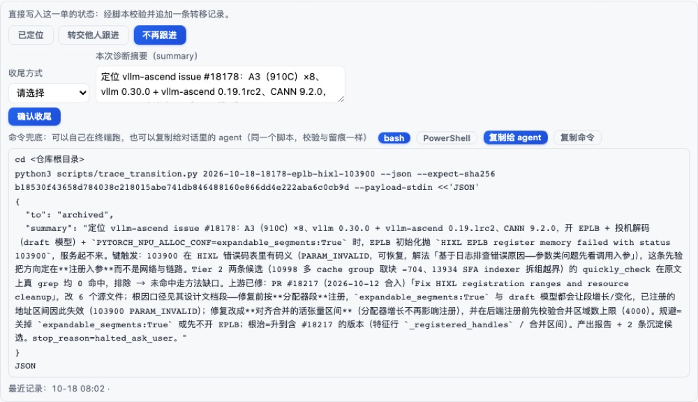
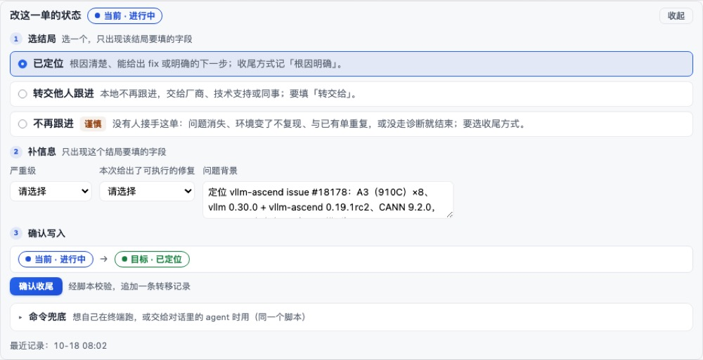
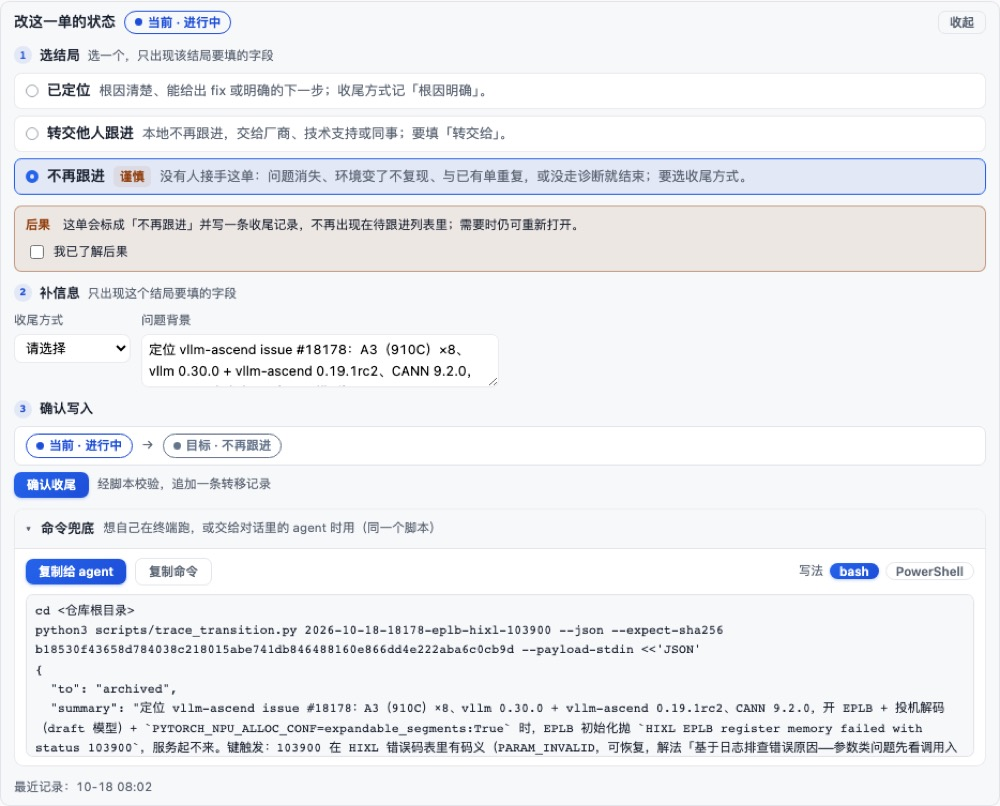
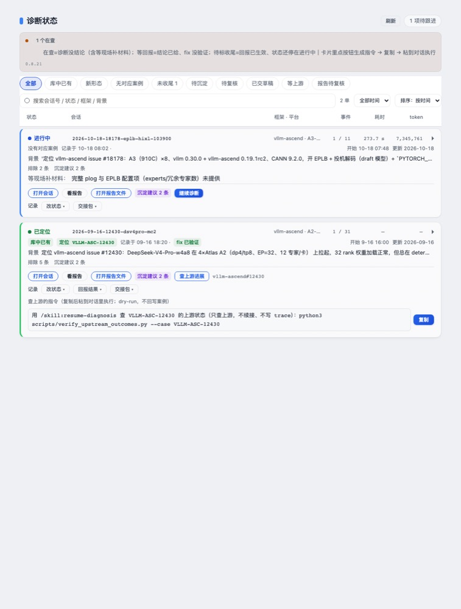

# 诊断面板「改状态」的交互设计：单主线三步，查上游入口按锚点常驻

状态：已实现（面板包 0.8.21），待评审
范围：诊断面板会话卡片里的「改状态」展开区；卡片动作行的「查上游进展」入口。不改状态判据、不改写入口脚本。
读者：评审这次交互改动的人、后续维护面板的人。

## 1 要解决什么问题

用户原话：「展开『已定位』的按钮，下面列出一堆『确认收尾』+ 一坨『命令兜底』，右侧还有命令兜底相关的一堆按钮」。这句话描述的是三件事挤在同一块里：选动作、填字段、复制命令。

实测旧编辑器高 513px，其中「命令兜底」占一半以上。三个动作按钮外观相同，点完都出现同一个「确认收尾」；摘要、严重级、是否给出修复三个字段不管所选动作需不需要都同屏铺开；兜底块常驻，带 bash / PowerShell 两个切换、两个复制按钮与一整段 JSON 背景（截见图 1）。

第二个问题不在编辑器里：查上游的入口只在「等上游」四个条件同时成立时出现。存量诊断记录基本没记是否给出修复（`fix_emitted`），于是入口一直不出现；现行 20 单里有 4 单带上游锚点、0 单满足那四条，读者因此找不到可复制的查上游指令。

## 2 选哪条路

三条候选：

- 甲：只改文案。成本最低，但按钮仍然同名、字段仍然与所选动作无关、兜底仍然占半屏；用户描述的三个现象一个都不消。
- 乙：把兜底块折叠，其余不动。消掉「一坨命令」，但动作选择与字段的关系仍然靠读者自己推断。
- 丙：按一条主线重排——选结局 → 补信息 → 确认写入，兜底降为折叠的旁路。选它。

选丙放弃的是「一屏看到所有字段」：切换结局时字段会换一次，需要重新看。换来的是每一步只出现与该步有关的内容；代价是读者来回切换结局时可能要看两遍字段，编辑器的纵向高度随动作变化。

可能坏在哪：动作清单、必填项与收尾方式由 host 投影给，界面只排版；如果投影里某个动作缺少 `targets` 或 `endingChoices`，界面会少一块而不会报错。这一点由「三种形态逐动作点开」的渲染断言兜住。

## 3 交互规格

**入口**：卡片动作行分两行。上行是这一单的主操作（打开会话、看报告、打开报告文件、沉淀建议、继续诊断、查上游进展），下行标「记录」，放改状态、回报结果、交接包。两行都在收起态与展开态常驻。

**编辑器**：标题「改这一单的状态」+ 当前状态标签 + 收起；下面三步。

1. 选结局。每个动作一张卡：可点的动作名与一句「什么时候选它」；要填的信息在第 2 步出现。「不再跟进」「重新打开」打「谨慎」标记。选中态用边框与底色区分，圆点只作指示，不承担点击。
2. 补信息。只渲染所选结局要填的字段；短选项在前（严重级、是否给出修复），长文本框在后（问题背景）。收尾方式、转交给、已有单按所选结局出现。
3. 确认写入。「当前 · 进行中 → 目标 · 已定位」预览，一个按钮，名字按动作区分：确认收尾 / 确认改收尾 / 确认补记 / 确认重新打开。按钮旁一行说明写入方式（经脚本校验，追加一条转移记录）。

**高危动作**：不再跟进、重新打开、把收尾方式改成不再跟进，三种都在选结局下方给一行后果说明，并要勾选「我已了解后果」才允许写入；未勾选时点确认只在原地给提示，不发请求。常规收尾不加第二次确认。

**命令兜底**：收进折叠块，默认收起；当前会话没有写权限时默认展开，此时确认按钮改为「复制命令」。展开后主复制动作是「复制给 agent」，bash / PowerShell 切换与命令块在次级位置，命令块限高滚动。

**查上游进展**：命中案例带上游锚点就出现入口，旁边以小字列出锚点。点开后在按钮下方给提示语、可复制的完整指令与「复制」按钮；指令仍是 `/skill:resume-diagnosis` 只查上游加 `verify_upstream_outcomes.py --case <id>`，dry-run，不回写案例。「等上游」徽标与筛选的判据不变。

**状态与错误**：写入中按钮禁用并显示「写入中…」；成功显示「已记录：<原状态> → <目标状态>，正在刷新列表…」；内容版本冲突（按 trace 的内容指纹比对，人改过就拒绝写入）提示这一单刚被改过、点刷新重看；字段校验失败标红并聚焦到对应字段。无写权限时编辑器仍可收集内容，确认按钮复制命令。

**可访问性与响应式**：动作名是可聚焦按钮，说明文字在按钮外，读屏可以分别读出；折叠区用原生 `details` 与 `summary`；状态提示用 `aria-live`；窄容器下两行按钮与字段自动换行，不出现横向滚动。颜色只取面板既有角色色板，字号只取既有档位。

## 4 怎么算完成

- `node scripts/panel_render_check.js`：778 项全过（本机有 `traces/` 时是这个数；新检出没有该目录会少一条依赖真实 trace 的断言，为 777）。其中与本设计直接相关的有：三种状态形态的动作逐个点开不崩、确认按钮名按动作区分、兜底命令随所选动作与 shell 变化、高危判据的 11 条行为矩阵（补记与同状态改收尾不要求勾选，改到归档/重开要求勾选，文案按目标状态选，谨慎标记同源）、高危动作未勾选时确认被拦下且不发起写入、带锚点的单有入口而无锚点的没有、参数正文不拼进命令行。
- `node scripts/build_panel_bundle.js --check`：面板包产物与源文件一致。
- `node scripts/check_panel_bundle.js`：面板包冒烟测试通过（本机没有已安装的 DSH 时，五条接口契约的探针如实跳过）。
- `python3 scripts/check_panel_tokens.py`：两面板角色集合一致。
- `python3 scripts/build_docs_index.py --check`：文档登记一致。
- 视觉效果用离线渲染核对：加载真实面板客户端与真实诊断记录，在 Chromium 里渲染常规收尾、高危、兜底展开、查上游指令、窄容器、深色、无写权限七种状态；正文只放前四种，另三种在第 7 节说明验证范围。

## 5 不做会怎样

状态修改是诊断收尾的唯一入口。动作同名、字段无关、兜底抢注意力，会让工程师在收尾时选错结局，而结局决定这条诊断算不算解决、能不能升格。查上游入口看不见，等于外部对照闭环对存量单停摆：读者不知道面板支持查上游，也不会去对话里手动跑查证脚本。

## 6 截图

图 1 改前：动作按钮、表单、确认按钮与常驻的命令兜底挤在一块。

图 2 改后：三步主线，字段只出现所选结局要填的。

图 3 高危动作：先给后果说明，勾选后才允许写入。

图 4 查上游进展：入口旁边列出锚点，点开给可复制指令。

## 7 未做与后续

- 截图来自离线渲染（真实面板源码 + 真实诊断记录），不是安装包里的运行界面；安装包升到 0.8.21 并重启后才在 DSH 里可见。
- 深色主题只做了离线核对，没有在安装包里实机看。
- 高危动作的二次确认用的是勾选；若要「再点一次确认」需要另加一个状态，本次没做。
- 查上游仍是生成指令（面板不联网）；若要面板直接显示上游状态，需要新增联网读取与缓存，不在本次范围。
