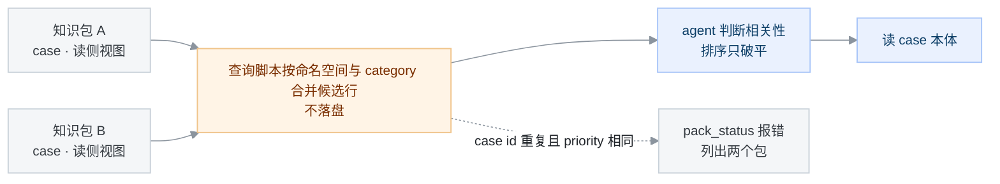

# 提案：把 ascend-sleuth 改成插件组合形态

状态：提议（2026-11-03 按评审修订，取代 2026-10-22 初稿；批准后在此补决议链接）

本文提出把 ascend-sleuth 的代码与知识改成以 DSH（DeepSeek Harness）插件包分发，会话工作区只承载工程师当天手头的资料。范围覆盖目标形态、包划分、安装与升级、多包叠加、状态目录、发布流水线、回流与迁移。

诊断流程与 case 字段语义不在本文范围内。读者是要评审这项改动的人；动手前先读[设计原则](../docs/spec/design-principles.md)与 [git 工作流](../docs/guide/git-workflow.md) 的部署形态一节。只跑单次诊断、不关心分发形态的使用者不必读。

本文用到的自定术语，首次出现处定义一次，后文只用这些词：

- **完全插件化**：代码与知识全部以插件包分发，工作区不承载系统结构。
- **四个面**：按「谁写、谁管版本、放在哪」把材料分成代码面、知识面、状态面、源面，见 5.1。
- **代码包、知识包、先验包、能力包、面板包**：五类插件包，见 5.1。
- **包清单**：每个包自己的 `package.json` 字段（版本、`data_format` 等）。**打包清单**：仓库根新增的 `packages.yaml`，记录目录到包的映射，见 5.7。
- **叠加**：多个知识包贡献同一个命名空间，查询时按包并集读取，见 5.3。
- **读侧视图**：`knowledge/_index/<ns>__<category>.list`，一行一条 case，供候选筛选使用。
- **profile**：DSH 的插件安装与设置目录，插件包装在其 `node_modules` 下。
- **主机工具**：随插件包注册、在 DSH 主进程里执行的工具（host tool）。

## 动机

现在每次使用都从一次 `git clone` 开始。工程师把整仓拉到本地，`.dsh/skills` 指向 `skills/`，agent 从检出里发现技能，脚本按检出内的相对路径读写。这个形态带来五项代价。

1. 只用诊断也要拉整仓。诊断用到的是技能与知识的一部分，拉下来的是全部技能、全部脚本、面板与 CI。要拉多少用命令现算：`find skills -name SKILL.md | wc -l`、`find scripts -name '*.py' | wc -l`；诊断实际用到的只是其中一部分。
2. 私有知识没有分发粒度。`knowledge/` 与 `postmortems/` 含客户数据；要私有只能 fork 整仓。团队想只给同事装一份私有知识库，没有可给的单位。
3. 运行时产物与检出绑定。`traces/`、inbox 草稿、指标流水都靠 `scripts/exec_log_path.py` 解析到「主检出」；脚本头注释记录了 worktree 清理时 gitignore 件静默消失的路径。换机器或清理 worktree 后，面板与周批读不到旧记录。
4. 升级与保住本地知识挤在同一条 pull 上。方法论要跟上游，而知识目录、阈值与词表在 fork 两边都改，合并要人工处理；多数人选择不升级。
5. Windows 多一层成本。`.dsh/skills` 是 git 跟踪的相对符号链接，clone 后可能落成 9 字节文本文件，agent 发现不了技能，见[windows-setup](../docs/guide/windows-setup.md)。

## 目标

做完之后（也就是完全插件化），下面五件事成立。每条给一条命令和一个可观察的结果；包状态查询工具（`pack_status`，下文用原名）与 `doctor` 的扩展是本方案新增的工具，见 5.3、5.6、5.10。

| 变化 | 确认方式 |
|---|---|
| 不 clone 也能诊断 | 在空目录开会话，装代码包与一个知识包；`python3 "$DSH_SLEUTH_SCRIPTS_DIR/pack_status.py"` 输出两个包名与版本；`python3 "$DSH_SLEUTH_SCRIPTS_DIR/shared_dir.py" --list` 的 `traces` 行落在状态目录；完成一次诊断后该目录出现 `<session>.yaml` |
| 知识按包拆装 | 装两个知识包后跑 `pack_status.py`：输出两个包与各自条数；同一命名空间在输出里合并显示；只有同 case id 且 `priority` 相同才报错 |
| 运行时产物与工作区解耦 | 在另一个目录开会话再跑 `pack_status.py`：输出与上一行相同；面板仍列出上次的 trace |
| 升级与回滚是版本操作 | 装回旧版本后 `python3 "$DSH_SLEUTH_SCRIPTS_DIR/pack_status.py" --json` 的 `version` 字段回退；`data_format` 越界的包带 `skipped` 计数，诊断仍完成 |
| 团队私有知识留在自己仓 | 跑 `python3 "$DSH_SLEUTH_SCRIPTS_DIR/pack_status.py" --json`：知识包的 `source` 指到 fork 提交，公开的代码包与先验包指到上游；公开出口的 case 条数为 0 |

## 非目标

下面七件本来可以是目标，这次明确不做，每条写理由。

1. 不把知识库的 git 仓插件化。知识产出仍是 PR，评审门（两名评审人签署，即双签；CODEOWNERS 目录归属；按内容哈希钉住的回归样本集，即封存对照集）只存在于仓上。包是分发单位，仓是评审单位。
2. 不做多机共享的状态目录。状态目录放网络盘或对象存储时，同机文件锁的语义不再可靠。当前只保证单机单用户正确。
3. 不改检索方式。三层检索与词法候选排序保持不变（[ADR-0002](../docs/adr/0002-retrieval-no-rag-lightweight-index.md) 的结论仍然有效），只改索引由谁生成、放在哪。
4. 不改 case 字段语义与诊断流程。技能正文的步骤、判据、输出格式不动；改动只限路径写法、trace 顶层版本字段与相关读端，清单见 5.10。
5. 不为别的 agent 宿主出插件版。Codex、Claude Code 继续按目录形态用 `skills/`；插件形态只服务 DSH。
6. 本次不做 DSH 预设收窄。代码包装在 profile 后，该 profile 的所有会话都能看到代码包里的技能描述；需要隔离的部署自行用 DSH 预设，本提案不维护预设内容。
7. 本次不改「知识内容不回流」的规则。公开出口的知识内容只有先验词条；脱敏构造示例回流上游仓，不随本版包分发；case 外壳回流另行决策，理由见 5.8。

## 方案

### 5.1 四个面与包划分

先把材料按「谁写、谁管版本、放在哪」分成四个面，后面所有决定都落在这四个面上。

| 面 | 放什么 | 版本由谁定 | 物理位置 | 谁写 |
|---|---|---|---|---|
| 代码面 | 技能、脚本、主机工具、设置卡片、路由表、结构性数据（`trace-status.yaml`、[metrics/gates.yaml](../metrics/gates.yaml)、`diagnosis_state.yaml.example`） | 代码包版本 | profile 的 `node_modules` | 发布流水线 |
| 知识面 | `knowledge/` 的 case 与读侧视图；`references/` 的先验词条与索引 | 知识包、先验包版本 | 同上，安装后按只读使用 | PR 合入后发布 |
| 状态面 | `traces/`（含 evidence）、inbox 草稿、指标流水、`src-code/`、`ref-docs/`、`proposals/{sessions,tasks,reviews,experiments}/`、结算游标 | 不版本化 | 设置里指定的状态目录 | 运行期 |
| 源面 | 知识库的 git 克隆（升格与回流的出口） | git 提交 | 使用者自己的克隆 | 知识整理流程 |

一次诊断里四个面的调用顺序固定：代码包提供技能与工具；模型按技能正文执行；查询时从已装知识包读候选；状态面接住过程记录与草稿；升格与回流只碰源面。发布与安装不进这条顺序，见 5.4 与 5.7。

包分五类。

| 包 | 内容 | 装给谁 |
|---|---|---|
| 代码包（一个） | 技能、脚本、主机工具、设置卡片、路由表、结构性数据、受管环境变量声明 | 所有人 |
| 知识包（每个私有边界一个） | 某个团队或部署的 case 与读侧视图；不带技能，不带路由 | 按需 |
| 先验包（每个私有边界一个） | `references/` 的平台事实、错误码家族、工具词条、方法论与读侧索引 | 按需 |
| 能力包（每个外部服务一个） | 检索、源码查询、截图转文字这类外部能力的工具与设置 | 需要它的人 |
| 面板包（可选） | 诊断、指标、自演进三个视图与整页入口 | 想看界面的人 |

五条切分规则：

1. 代码包与知识包分开，理由只有一条：知识有私有面，代码没有。装在一个包里，私有化就没有粒度。
2. 知识包与先验包按私有边界切，不按负载或框架切。命名空间是包贡献出来的，不是包独占的，见 5.3。
3. 包是构建产物。每个包的包清单记来源提交、包版本、`data_format` 与内容哈希，见 5.4。
4. 面板包独立于代码包。界面只对 DSH Web 生效，装不装是「要不要看界面」的选择；代码包不依赖面板包。
5. 知识包只装数据，不带技能，也不带路由。于是会话开始时进入上下文的技能描述（下称首屏技能数）只由代码包决定；路由留在代码包，理由见 5.3 规则 3。

代码包、先验包与知识包各自携带自己那部分读侧数据。不进运行时包的内容：`docs/`、`eval/`、`tests/`、`postmortems/`、知识库 git 仓本身。它们在仓上参与评审与发布门，不随包发给使用者。

### 5.2 DSH 能力边界

本方案只依赖 DSH 已提供的接口。下表把「DSH 提供的接口」与「本仓约定」分开，避免把自定字段说成 DSH 的能力。

| 能力 | 真实机制 | 本方案怎么用 |
|---|---|---|
| 技能提供方 | `ctx.skills.registerProvider(create)`，工厂返回 `{name, list, get}`；每个技能由提供方给 `resourceBase`，正文里的相对路径按这个基址解析（`@deepseek-ai/dsh-skill` 与 `dsh-skill-office`） | 代码包内一个 cordis 插件实现 provider，扫描包内 `skills/`。DSH 不会自动发现包内 `skills/`，必须自带 provider 或在 patch 里把目录配成自定义根 |
| 受管环境变量 | `ctx.shellEnv.register({name, variables, resolve})`，键名必须以 `DSH_` 开头，每次 shell 执行前重算（`@deepseek-ai/dsh-shell-env`） | 代码包注册 5.5 的四个变量 |
| 装包 | `plugin_manager install_bundle` 接受 registry 包名、git 地址、tarball、绝对路径；失败恢复 `package.json` 与 `pnpm-lock.yaml`；换版本是移除、安装、发布三步，没有 HMR 时需要重启（`@deepseek-ai/dsh-plugin-manager`） | 插件页安装与逐行启停；升级后按提示重启 |
| 权限预设 | `ctx.permissionPresets` 把沙箱模式与审批策略成组；切换按会话生效，分别写入该会话的模式与审批事件（`@deepseek-ai/dsh-permission-presets`） | 诊断会话选完全访问，见 5.6 |
| 文件沙箱 | `workspace-write` 只允许写会话工作区加临时目录；没有注册额外可写根的接口；主机插件工具在进程内可以用 `node:fs` 写任意路径，走 `ctx.fs` 的仍受栅栏；读不受限（`@deepseek-ai/dsh-sandbox-policy`、`dsh-fs-sandbox`、`dsh-bash-sandbox`） | 状态目录在工作区外，诊断会话必须切完全访问；不依赖「插件注册可写根」这种不存在的接口 |
| 包清单自定义字段 | `package.json` 允许放自定义字段；除 `dsh.bundle.patch`、`dsh.client`、`dsh.manifestVersion` 与 `engines.*` 外，DSH 不读这些字段（`@deepseek-ai/dsh-package-manifest`） | `data_format`、`capability_api`、`priority`、`namespaces` 由本仓的 `pack_status` 读取与校验 |
| 主机工具 | `ctx.tools.register(defineTool(...))`，工具在 DSH 主进程执行，有进程自身权限（`@deepseek-ai/dsh-tools`） | 现有 `ascend_trace_status` 一类工具随代码包；面板包只带界面 |
| 预设 | `dsh-agent-preset-registry` 用声明式插件清单组装会话；失败定义可见，已有会话保留创建时的组合 | 本方案不用它收窄范围（非目标 6） |

最低 DSH 版本按 `0.2.x` 代写：上面用到的 `plugin_manager`、`ctx.shellEnv`、`ctx.skills.registerProvider` 都属这一代；预设注册表不在本方案的依赖里（非目标 6）。

撰写时本机存在 `0.1.0` 与 `0.2.1` 两代包，预设机制不同，不能混用说法。实现前用一次真实安装验证后把下限写进 `engines.dsh`（未决 3）。

阈值、词表与路由在 fork 会改（[git-workflow](../docs/guide/git-workflow.md) 把 `metrics/gates.yaml`、`trace-status.yaml`、`triage-tree.d/` 列在「两边都写」）。所以代码包不是纯只接收（fork 不写）的面。

fork 用同一个包名发布自己的代码包版本，内容以 fork 的仓为准；公开代码包由上游发布。

### 5.3 知识包叠加与读取

装第二个知识包之前必须先定叠加规则，否则第二个包装上就会报错。规则七条。

1. 命名空间（`knowledge/` 下的目录前缀，如 `training/verl`）是贡献，不是独占。知识包的包清单用 `namespaces: [training/verl, common]` 声明自己贡献哪些命名空间。多个包可以贡献同一个命名空间；读侧视图按 `(命名空间, category)` 合并后使用。
2. case id 全局唯一。同一个 case id 出现在两个包时，包清单 `priority` 高者生效，低者在 `pack_status` 里列出；`priority` 相同即报错并列出两个包。安装时无法预知将来会装哪个包，所以冲突检查放在 `pack_status` 与诊断加载时，不静默取一个。
3. 路由只留代码包。`triage-tree.yaml` 与 `triage-tree.d/` 是公开方法论（[git-workflow](../docs/guide/git-workflow.md) 把 `triage-tree.d/` 列在「两边都写」；fork 的改动随自己的代码包版本发布），知识包不带路由片段。新增框架或新词走上游 PR，随代码包版本发布。
   私有团队确有不可公开的路由时，另立提案，本方案不覆盖。
4. 读侧视图随包分发。主干 job 从源数据生成每个包自己的 `knowledge/_index/<ns>__<category>.list` 与总表子集并提交，发布流水线只打包（见 5.7）。总表子集用于跨命名空间比对，读取时按 case id 去重。
   查询脚本读 `DSH_SLEUTH_KB_DIRS` 列出的所有包，在内存里按 `(命名空间, category)` 合并候选行，不写合并产物。候选相关性仍由 agent 判断；`scripts/rank_candidates.py` 扩展为接受多个包目录，排序只破平。
5. 容量按合并后的视图算。`metrics/gates.yaml` 现有的两条线（`capacity_cell_read_tok` 与 `capacity_fallback_read_tok`，软 8000、硬 20000）仍按 `(命名空间, category)` 与命名空间兜底视图各算一条，不按包求和。
   要加「跨包合计」这类新判据，先加 dimension 再使用，不把它写成本方案的默认门。
6. `data_format` 是包级字段。代码包声明支持区间，知识包声明自己的版本。超出区间的包照装，但代码包计算 `DSH_SLEUTH_KB_DIRS` 时排除它。
   `pack_status` 报「N 个包被跳过（M 条数据）」，M 从包内读侧视图行数现算；诊断照常跑。
7. 卸载或停用知识包后，trace 仍引用该包的 case 时，面板按缺件显示条数，不显示 0，不拿别的包顶替。

图 1　多包叠加：两个知识包怎么变成一份候选行（类型：数据流图；范围：一次候选查询；省略了包版本与缓存细节）

图例：灰色是已装包，橙色是合并后的候选，蓝色是 agent 的判断与使用。合并在内存里完成，状态目录里没有合并产物。

### 5.4 装包、升级与回滚

装包走 DSH 插件页或 `plugin_manager install_bundle`，来源有 registry 包名、绝对路径、git 地址、tarball 四种，私有源与公共源分开询问，不回落公共源。安装走 pnpm，包内容与依赖落进 profile 的 `node_modules`；本地路径只是来源之一。安装期不做计算：不生成索引，不要求 Python 与 PyYAML。

升级与回滚都按包操作：用插件页或 `plugin_manager` 移除与安装。回滚时按一组包回，不是单个包，理由见下表。

| 操作 | 行为 |
|---|---|
| 升级 | 插件页选新版本；移除旧版、安装新版、发布运行时组合，按提示重启后生效。换版本期间旧版本停止运行。 |
| 失败恢复 | 安装失败或取消时，DSH 恢复 `package.json` 与 `pnpm-lock.yaml`；安装成功但激活失败时，已保存的依赖与选择可能保留。 |
| 回滚 | 回滚单位是一组包，不是单个包。只回滚代码包、不回滚知识包时，知识包的 `data_format` 可能高于旧代码包支持的区间，数据会被跳过并计数，行为不等于回到旧版本。操作说明要写清回滚整组。 |
| 停用 | 插件页逐行开关只改启用状态，不卸载；再次开启不需要重装。 |
| 卸载知识包 | 引用它的 trace 按缺件显示，见 5.3 规则 7。 |

版本记录。包的包清单记来源提交与包内文件哈希（清单自身除外）。trace 顶层新增 `core_pack_version` 与 `kb_pack_versions`（逐包版本）。

`kb_rev` 仍由 `scripts/trace_begin.py` 写；插件模式下取不到 git，写 `unknown`。读 `kb_rev` 的脚本与面板共十余处（`grep -rl 'kb_rev' scripts/ dsh-plugins/`），要一起改成两种字段名都认，历史 trace 不回填。

漂移与交接比对改用 `kb_pack_versions`，没有版本时判不可比。不记版本，面板与周批会把不同版本的数据混在一起算。

分叉。`doctor` 对比包清单里的来源提交与上游最新版本，报分叉程度。默认不锁版本，理由见未决 2。

### 5.5 技能、环境变量与路径解析

技能。代码包的技能提供方接口见 5.2，这里写落地要求：插件导出 `apply` 并 `inject: ['skills']`，调用 `ctx.skills.registerProvider` 注册包内 `skills/`，每个技能给 `resourceBase` 指向包内目录。

首屏技能数等于代码包技能数，在仓上用 `find skills -name SKILL.md | wc -l` 现算。工作区里若存在同名技能，DSH 按技能根优先级选中工作区那份，包内版本被遮盖；`doctor` 报同名技能冲突，迁移期结束时应删除旧检出里的 `.dsh/skills` 链接。

环境变量。代码包注册四个受管变量，值在每次 shell 执行前重算：

| 变量 | 值 | 用途 |
|---|---|---|
| `DSH_SLEUTH_STATE_DIR` | 设置页里的状态目录 | 运行时件的根 |
| `DSH_SLEUTH_KB_DIRS` | 已装且 `data_format` 合格的知识包与先验包目录，逗号分隔，按包清单顺序 | 候选与先验读取 |
| `DSH_SLEUTH_SCRIPTS_DIR` | 代码包 `scripts/` | 脚本调用 |
| `DSH_SLEUTH_CORE_DIR` | 代码包根 | 路由表与结构性数据 |

第四个变量存在的理由：路由只留代码包（5.3 规则 3），技能需要它的路径；不把代码包数据混进知识包目录。

技能正文里的路径分三类，各自的写法不同：

- **脚本调用**写 `python3 "$DSH_SLEUTH_SCRIPTS_DIR/<脚本名>"`，例如 `python3 "$DSH_SLEUTH_SCRIPTS_DIR/trace_begin.py"`。
- **技能资源**（`references/*.md`、模板）由技能提供方的 `resourceBase` 解析，不在正文里拼仓库路径。
- **状态目录的读写**先跑一次 `python3 "$DSH_SLEUTH_SCRIPTS_DIR/shared_dir.py" traces` 取绝对路径，再把路径交给 read/write 工具。环境变量只对 shell 生效，read/write 工具不展开 `$…`，正文不能把裸变量当路径。

路径解析。`scripts/exec_log_path.py` 的 `resolve_rel` 只加一个来源：受管环境变量。设置值由代码包在 shellEnv 的 `resolve` 里读取，脚本侧只认环境变量。

取不到环境变量且无 git 时直接报错，不再退化为脚本所在包目录，避免把运行时件写进 `node_modules`。`scripts/shared_dir.py` 输出解析来源，供 agent 与人核对。

主机工具与面板不走 shellEnv。它们读同一份设置，经一个 JS 侧的共享解析函数；Python 脚本不读设置文件，只认环境变量。两边的取值都来自同一个设置键，`doctor` 比对两处结果，不一致就报。

路径改动范围用命令现算，不写死数字。取仓库根的写法有两种：`grep -rl 'Path(__file__)\.resolve()\.parent\.parent' scripts/` 与 `grep -rl 'parents\[1\]' scripts/`，命中文件都要改（撰写时两种合计 53 个）。

`grep -rl 'exec_log_path' scripts/` 给出 import 它的脚本，其余脚本要逐个处理。

两个面板源文件（`dsh-plugins/ascend-panel/panel-host.js`、`dsh-plugins/ev-panel/panel-host.js`）都按会话 cwd 找检出与脚本目录。

改成读设置里的状态目录与代码包脚本目录，再跑 `node scripts/build_panel_bundle.js` 重建 `dsh-plugins/dsh-sleuth-panels/lib/`。

技能里的脚本调用点用 `grep -rn 'python3 scripts/' skills/` 与 `grep -rn 'node scripts/' skills/` 找，按 Python 与 Node 分开处理。改这些，不改步骤与判据。

### 5.6 状态目录与权限

状态目录收两类运行时件。第一类由 `python3 "$DSH_SLEUTH_SCRIPTS_DIR/shared_dir.py" --list` 枚举，包括 `traces/`（含 evidence）、`postmortems/inbox`、`ref-docs/`。

还包括 `proposals/{sessions,tasks,reviews,experiments}/`、`.settle-state.json`、`metrics/entry-activity.local/`。

第二类由 `scripts/exec_log_path.py` 单独解析：`metrics/skill-exec-log.yaml`、`metrics/ev-measure-log.yaml`、`src-code/`。

每部署一份且进 git 的文件留在源面克隆，不进状态目录：`deployment.yaml`、`metrics/timeline.d/`、`metrics/timeline.yaml`、`metrics/entry-activity/<部署>.yaml`。

还包括 `ingest-state.json`、`reference-ingest-state.json`、`eval/scorecard.yaml`。`metrics/entry-activity.d/` 是追加型共享源，进 git，也不进状态目录。

`.github/CODEOWNERS` 部署时创建，仓里只有 `CODEOWNERS.example`。

并发：同机多会话仍用文件锁，锁对象从主检出里的文件换成状态目录里的文件；跨机不共享，也不做合并。

权限。DSH 的 `workspace-write` 只允许写会话工作区与临时目录，状态目录在工作区外时会被拦。本方案要求诊断会话使用 DSH 的完全访问权限预设（沙箱模式为 `danger-full-access`，审批策略为 `never`）。

这是会话级选择：首次安装说明里写这一步，`doctor` 用写测试判定状态目录当前能不能写；不能写时给出切换指令，不静默改道。不把完全访问改成部署全局默认，也不由内容包静默修改。

这个选择有代价：会话内模型能写任意路径，诊断读到的客户日志若含注入指令，风险面比 `workspace-write` 大。缓解只有三条：权限按会话选、`doctor` 与设置页显示当前档、安装说明写清。见「代价与缺点」第 4 条。

面板与主机工具。面板包只带界面；现有面板的白名单写（状态转移、沉淀进度、交接包导出、本机明细重建，见 [dsh-plugins README](../dsh-plugins/README.md) 的只读边界）保留，仍经脚本，新增写路径要同时改那份契约。

面板数据源从主检出切到状态目录。两个面板源文件去掉检出探测与按 cwd 找脚本目录的逻辑，改读设置里的状态目录与代码包脚本目录，再重建 `dsh-plugins/dsh-sleuth-panels/lib/`。

面板现有的白名单写路径硬编码为检出内的 `traces/exports/` 与 `metrics/entry-activity.local/`，一并改到状态目录；完全访问权限下这些写才不会被拦。

自检。`doctor` 报：状态目录可写、当前权限档（用写测试判定）、已装包与版本、`data_format`、`capability_api` 契约、包内容哈希与发布是否一致、分叉程度，以及「DSH 版本 × 代码包版本 × 知识包组合」的完整组合信息。报障先贴这一段。

### 5.7 发布流水线

生成物归主干。索引、路由聚合、reference 索引、timeline、条目使用记录（`metrics/entry-activity/`）由合入后的主干 job 重建并提交（[ADR-0012](../docs/adr/0012-generated-views-main-owned.md)）。

发布流水线不产出第二份生成物：它在临时副本里重建一次用于比对，与 tag 所指提交的生成物逐文件比对，有 diff 说明包内视图与源不一致；仓库里已提交的那份进入打包。

比对之后还要跑各 builder 的 `--check` 覆盖检查。面板包的 `dsh-plugins/dsh-sleuth-panels/lib/` 也是仓内生成物，发布前跑 `node scripts/build_panel_bundle.js --check`。

发版只在主干重建提交之后。发布流水线在 tag 上触发，第一步就是上面的校验，不一致就失败；通过的生成物才进入打包。

打包清单 `packages.yaml`（新增，仓库根）。每个包一段，字段包括：包名、内容映射（哪些目录与文件进这个包）、生成物声明、版本推导（tag 前缀加 semver）、`data_format`、`capability_api` 区间、依赖的包与版本。发布流水线只按这份清单打包；清单变更走 PR 评审。

四道发布门，只在发布时跑，不进每个 PR：

1. **构建**：按 `packages.yaml` 产出各包，记录内容哈希与来源提交。
2. **生成物一致性**：重建后生成物路径没有 diff；包内读侧视图与源数据互相覆盖，覆盖检查与 `rebuild_generated.py` 同源。
3. **可加载性**：装进临时 profile，技能目录、工具、环境变量与设置卡片均注册成功。
4. **跨包格式**：包清单（`package.json`）字段合法；同一发布批次内 case id 无重复（私有一侧由安装后的 `pack_status` 检查）；`data_format` 与 `capability_api` 在代码包声明区间内；依赖版本可解析。

发布出口。私有 registry 发知识包与团队定制的代码包；公开 registry 发代码包与先验包。公开出口不含 case，除非将来开了 case 回流（未决 4）。DSH 插件市场可选，只做浏览与搜索，装包仍走 registry，不阻塞发版。

内容一致性。包清单记每个文件的哈希；`doctor` 对比安装内容与清单，本地路径安装也能比对。没有 registry 校验时，这条强度只能到约定。

仓库目前没有发布流水线（`.github/workflows/` 里没有 release 相关工作流）。发布流水线、`packages.yaml` 与四道门都是新增工作，需要维护者兼任 owner，见「依赖与新增的运维工作」。

### 5.8 回流与脱敏

现有规则是「知识内容不回流，脱敏后的构造示例除外」（[git-workflow](../docs/guide/git-workflow.md) 的部署形态一节）；先验词条本来就回流。本方案不改变这条规则：本版公开出口的知识内容只有先验词条；脱敏构造示例回流上游仓，不随本版包分发。知识包只走私有出口。

| 内容 | 含不含客户现场 | 本次怎么处理 |
|---|---|---|
| 先验词条 | 不含 | 全量回流，直接 PR；`references/` 本来就是公开面 |
| 脱敏构造示例 | 不含 | 按现有规则回流到上游仓，不随本版包分发 |
| case 外壳（症状、签名、root_cause、fix、platforms、compat、severity） | 不含，只要不抄现场 | 本次不回流。要开这条通道，单独立决策记录，写清白名单、脱敏脚本、机器检查（扫内网域名、主机名、绝对路径、客户名表）、双签、去重门槛与来源同意 |
| 原始现场（trace、postmortem 原文、日志、路径、客户名） | 含 | 不回流，只在状态面与私有知识包 |

知识包只留在私有仓；代码包与先验包按公开、私有分别发布。三条规则不放松：封存对照集的重封只认维护者；版本必须进读数（按同一口径从记录算出的指标值）；本地分叉超过阈值必须提示收敛（阈值待定）。

### 5.9 用户态体验

三档需求，装什么由档位决定。

| 档 | 机器上要有 | 能做什么 |
|---|---|---|
| 只诊断 | DSH、python3、PyYAML | 装代码包与一个知识包，跑诊断，产物落状态目录 |
| 沉淀 | 再加 git | 升格草稿、提 PR |
| 演进 | 再加私有 registry 的发布权 | 改源码、本地装预发布包、发团队版本 |

PyYAML 在只诊断档里：诊断路径上的 `scripts/rank_candidates.py`、`scripts/trace_transition.py`、`scripts/log_skill_exec.py` 都 import yaml。安装本身不依赖 Python 与 PyYAML，检查放到第一次 `doctor` 与第一次诊断脚本调用时。

首次安装约 5 分钟（估算），四步：

1. 在侧栏「插件」页装代码包与需要的知识包；装完按提示重启。
2. 在设置页的 sleuth 节填状态目录与知识库克隆路径；沉淀档再填上游仓地址。设置卡片随代码包发布。
3. 给诊断会话选完全访问权限预设，见 5.6。
4. 跑一次 `doctor`，按输出补齐 python3、PyYAML、git 等缺件。

日常：在任意目录开会话说问题。技能从代码包发现，知识从已装知识包读，产物落状态目录；工作区里只出现工程师自己放的文件。triage、候选、结论的每一步照旧写 trace，只是落点从主检出换成状态目录。

没有源面克隆时，指标页只显示本机状态目录里的 trace 派生数据，部署级的 `metrics/timeline.yaml` 与 `metrics/entry-activity/<部署>.yaml` 都不出现；面板按缺件显示，不显示 0。

升级、回滚、卸载时界面的显示：

| 情形 | 呈现 |
|---|---|
| 状态目录被删或不可写 | `doctor` 报出并给默认路径；写失败时报具体路径，不静默改道 |
| 换机器（状态目录没跟过来） | 面板显示「本次没记」，不显示 0 |
| 同一个包被手动改过内容 | 下次装包覆盖；`doctor` 报「包内容与发布版本不一致」 |
| 装回旧版本后 `data_format` 越界 | 数据跳过并计数；面板显示缺件数，诊断不失败 |
| 升级后未重启 | 插件页显示 `restart-required`；`doctor` 提示重启后新版本才会加载 |

界面三处：

| 界面 | 内容 |
|---|---|
| 侧栏「插件」页 | 装包、逐行开关、版本与回滚、`pack_status` 摘要 |
| 设置页 sleuth 节 | 状态目录、知识库克隆路径、上游仓地址；自检只读，不装包不改文件 |
| 会话页 tab | 诊断轨迹、指标读数、自演进看板；全部只读状态目录；面板白名单内的写仍经脚本 |

图 2　安装与配置界面（类型：界面设计稿；范围：侧栏插件页与设置页的 sleuth 节；新增项以蓝框标出）

图 3　会话页面板（类型：界面设计稿；范围：三个 tab 的初始画面；省略了空状态与错误状态）

### 5.10 开发态体验

仓库形态不变：仍是一个仓、一套目录、一套评审门。`skills/` 写流程，`scripts/` 写确定性逻辑，`knowledge/` 与 `references/` 写知识，`dsh-plugins/` 写 DSH 运行时。case 照写、skill 照改，双签、CODEOWNERS、封存对照集、`generated-guard` 照跑。

新增的只有发版这一步与它依赖的 `packages.yaml` 与发布流水线。

知识开发：写 case 与 reference 的流程不变，合入后主干 job 重建生成物，发布流水线校验并打包。

本地验收命令不变：`python3 scripts/rebuild_generated.py --check`（会写生成物，看完用 `git checkout -- <生成物>` 还原）、`python3 scripts/index_counts.py`、`python3 scripts/index_read_cost.py`。

私有知识在同一个仓或 fork 上维护，`packages.yaml` 按包标记私有与公开，发布流水线只发对应包。

代码开发分三段，每段的单位与出口不同。

| 段 | 谁受益 | 做什么 | 出口 |
|---|---|---|---|
| 影子期（只有本机受益的阶段） | 只有本机 | 改源码克隆，构建本地预发布包，装上跑真实诊断 | 本地包 |
| 收敛期 | 本团队 | 推分支到团队仓，跑门，发团队 registry 版本 | 团队包版本 |
| 回流期 | 所有人 | 把可公开部分攒批成一个 PR | 上游合入 |

本版需要改的代码位置，按「读什么、写什么」列：

- 路径解析：`scripts/exec_log_path.py` 的 `resolve_rel` 加环境变量来源；`scripts/shared_dir.py` 输出来源；`scripts/pack_status.py` 新增，读 `DSH_PROFILE_DIR` 与包清单算已装包、条数与冲突。
- 知识读取：`scripts/rank_candidates.py` 接受多个包目录并在内存合并候选行；其余读 `knowledge/`、`references/`、`triage-tree.yaml`、`metrics/gates.yaml`、`trace-status.yaml` 的脚本按 5.1 的归属改用代码包根或 `DSH_SLEUTH_KB_DIRS`。
- 技能正文：把 `python3 scripts/…` 换成 `python3 "$DSH_SLEUTH_SCRIPTS_DIR/…"`；状态目录先经 `shared_dir.py` 解析；其余步骤、判据、输出不动。
- trace：`scripts/trace_begin.py` 的 header 增加 `core_pack_version` 与 `kb_pack_versions`，`kb_rev` 在无克隆时写 `unknown`；面板、跨机接手、结算脚本按两种字段名都认。
- 面板：两个面板源文件改用设置里的状态目录与代码包脚本目录，去掉检出探测；重建 `dsh-plugins/dsh-sleuth-panels/lib/`（`node scripts/build_panel_bundle.js`）。`ascend_trace_status` 工具从面板包迁到代码包。
- doctor：`scripts/doctor.py` 增加包与版本、权限档、状态目录可写、包内容一致性、分叉程度五项检查，复用 `pack_status.py` 的读数。
- 设置卡片：代码包补客户端半边，注册 `settings.section`，字段见 5.9。

发布流水线见 5.7。调试工具：`pack_status` 输出已装包、条数、版本、`data_format`、`capability_api` 契约与冲突；`doctor` 输出缺件、权限档、状态目录可写、包内容一致性与分叉程度。

### 5.11 迁移

按五步走，每步可独立验收。

1. **双轨期**：代码包与现有检出并存。检测到环境里有可用检出且未装包时按旧行为跑；装了包则用设置。验收：同一份材料在两种形态下诊断结果一致，trace 都读得到；双轨期工作区的 `.dsh/skills` 会遮盖包内同名技能，验收前按 `doctor` 提示移除链接或换一个工作区。
2. **路径切换**：`resolve_rel` 加环境变量来源，`shared_dir.py` 输出来源。这一步不改任何默认值。验收：不装包的老机器行为与改动前相同。
3. **装包验证**：内部先装代码包与一个知识包，跑通一次诊断与一次升格，记录缺件。验收：`pack_status` 列出两个包，`doctor` 无阻断项。
4. **试点团队**：一个团队用内部包与私有知识包跑两周，收集报障与分叉。验收：两周内无阻断问题，case id 冲突与 `data_format` 越界都按 5.3 报出过。
5. **剥离检出**：检出模式降为兼容路径，下一版删除。验收判据：试点两周无阻断、一个版本周期无缺件报告；之后删 `.dsh/skills` 链接与检出探测代码。

## 替代方案

**甲：保持检出式，只把运行时件的路径做成可配置。** 好处是改动最小，一周内能上。坏处是私有知识的粒度问题与升级覆盖本地知识的问题都不解决，Windows 的符号链接问题也还在。不选的理由：它只解决第 3 项动机。它可以作为迁移的第一个阶段，不作为目标形态。

**乙：每个插件一个独立 git 仓。** 好处是权限与私有性天然隔离，一个仓可以只给一个团队。坏处是跨仓对账变成日常：技能正文与脚本、索引与路由分居不同的仓，每次改动要同步两三个 PR。

还有一条更硬的限制：pnpm 不支持安装 git 仓的子目录（[pnpm issue #7483](https://github.com/pnpm/pnpm/issues/7483)），单仓多包因此无法直装。不选的理由：当前这批内容由同一批人同步维护，拆仓把合并成本换成版本成本，净亏。

**丙：用会话内动态插件承载全部功能，不装包。** 好处是不需要安装与版本管理，改完立刻生效。坏处是会话结束就消失，无法持久化。不选的理由：它适合试验，不适合分发；影子期可以用它做小实验。

**丁：安装时重建索引（初稿的选择）。** 知识包只带源数据，代码包在装包与版本变化时用 Python 重建索引，写进状态目录。好处是包更小、索引格式不跨包。坏处是安装依赖 Python 与 PyYAML、状态目录出现派生数据、包升级或停用要失效重建。

不选的理由：主干 job 生成读侧视图、发布只校验打包，把计算放在有生成物纪律的一端，包内视图与源数据有发布门校验；安装期计算省下的体积换不来可靠性。

**戊：读时生成索引。** [ADR-0012](../docs/adr/0012-generated-views-main-owned.md) 已否决：每次读取会改工作区，需要并发写保护与额外依赖，代价高于合入后重建。本方案不采用。

## 代价与缺点

1. **支持面变大。** 报障要同时确认 DSH 版本、代码包版本与知识包组合三项。缓解是写进 `doctor` 输出，报障先贴那一行；沟通成本仍会上升。
2. **发布流水线是新增运维。** 四道门、registry 权限、包内容哈希都要有人维护。缓解是只在发布时跑；代价是发版失败会挡住团队出包。
3. **多包叠加增加读路径与冲突面。** 同一命名空间按包并集读取，case id 去重、候选合并、冲突报错都要实现并测试。读成本随包数线性增长，容量只看合并后视图。缓解是冲突在 `pack_status` 与诊断加载时报，不让它落到「查不到候选」才暴露。
4. **诊断会话需要完全访问权限。** 状态目录在工作区外时，`workspace-write` 写不了；本方案改用会话级完全访问，模型因此能写任意路径。诊断读的是工程师粘贴的日志，日志里若含注入指令，风险面比默认沙箱大。缓解只有三条：权限按会话选、`doctor` 与设置页显示当前档、安装说明写清。这是本方案为写状态目录付出的权限代价。
5. **代码包给所有会话增加固定首屏成本。** 代码包装在 profile 后，该 profile 的每个会话都带技能描述。需要隔离的部署用 DSH 预设自行收窄；本提案不维护预设内容。
6. **升级要重启。** DSH 插件换版本没有 HMR，`restart-required` 是常态；升级窗口影响运行中的会话。插件页要显式提示，不能假装热更新。
7. **回滚单位是一组包。** 只回滚代码包会因 `data_format` 越界丢数据。回滚说明必须写清「代码包与知识包一起回」。
8. **过渡期两套根并存。** 脚本要同时支持检出内相对路径与设置里的绝对路径，面板两套都要能读。剥离时容易留半套。缓解是迁移五步各自独立验收，剥离一步切完。

### 不做会怎样

- 对新工程师：装机仍从 `git clone` 开始，Windows 上还要先处理符号链接；试用成本不降，多数人停在第一步。
- 对私有知识：仍只能整仓 fork，给同事的只有「整仓权限」这一种粒度。
- 对读数：换机器或清理 worktree 后旧 trace 读不到，周批与自演进继续在缺数据的情况下算。
- 对维护者：每次支持仍以「把整仓拉下来」为前提，报障收集与复现成本不降。

## 依赖与新增的运维工作

| 依赖 | 谁要 | 何时要 |
|---|---|---|
| DSH 版本下限（`plugin_manager`、技能提供方、`ctx.shellEnv`、权限预设） | 所有人 | 装包时，由 `engines.dsh` 拦 |
| 私有 registry | 演进档 | 发团队版本时；没有时退路是 git 直装或本地路径 |
| python3 | 所有人 | 跑诊断脚本时；安装本身不依赖 |
| PyYAML | 所有人 | 诊断与知识脚本 import yaml 时 |
| git 与 PR 工具 | 沉淀、演进档 | 升格与回流时 |
| pnpm | 不用单独准备 | 由 DSH 插件管理器调用 |
| 面板包 | 想看界面的人 | 可选；代码包不依赖它 |

新增的运维工作五项：发布流水线与四道门的维护；私有 registry 的权限与审计；包内容哈希与版本一致性巡检；分叉程度提示；完全访问权限预设的安装说明与用户支持。若将来开 case 外壳回流，再加脱敏复核，按一周一批估算 30 到 60 分钟。

## 未决问题

本节不构成实现依据。

1. 私有 registry 的选型与命名空间（代码包、知识包、先验包是否同前缀）。定之前用 git 或本地路径直装不阻塞。
2. 团队要不要锁知识包版本。倾向先不锁；出现「两人读数不一致」再评估，锁早了会挡住回流。
3. DSH 版本下限的具体值。实现前用一次真实安装验证，把值写进 `engines.dsh` 与本文的依赖表。
4. case 外壳的公开回流规则。本次不做；要开的话单独立决策记录，写清白名单、脱敏脚本、机器检查、双签、去重门槛与来源同意。
5. 旧检出剥离的时点。判据在 5.11 第 5 步；通知方式与兼容路径保留几个版本周期未定。
6. 包内容一致性判定的强度。包清单里的哈希加 `doctor` 比对可以是硬门或提示；本地路径安装没有 registry 校验，强度只能到约定。
7. 完全访问权限预设的呈现。DSH 自带 `danger-full-access` 预设，是否另取名、首次安装是否强制提示切换，未定。
8. trace 写入是否改工具。当前不改：完全访问下模型继续写 YAML；将来若收紧权限，再评估结构化写入工具的参数形态。

## 先例

- DSH 自带的 `dsh-skill-office` 与 `dsh-skill-badge`：包内实现技能提供方，用 `resourceBase` 把技能正文与资源一起分发。本方案的技能分发与它们同一条路。
- 本仓的 [`dsh-plugins/dsh-sleuth-panels`](../dsh-plugins/dsh-sleuth-panels/) 与 [`dsh-plugins/dsh-sleuth-vllm-kb`](../dsh-plugins/dsh-sleuth-vllm-kb/)：前者是 bundle 形态的面板包，后者是能力包的现成例子（工具、设置节、契约版本）。
- [VS Code 扩展市场](https://code.visualstudio.com/docs/configure/extensions/extension-marketplace)：一个扩展一个包，能力由包声明，版本与 DSH 版本有兼容范围。知识包与代码包的分工与之类似。
- [npm workspaces](https://docs.npmjs.com/cli/using-npm/workspaces)：单仓多包，按包各自发布与各自版本。本方案的仓库形态取这一条。
- [Homebrew tap](https://docs.brew.sh/Taps)：私有源与公共源并存，装哪个源由用户决定。私有知识包与公开先验包的关系取这一条。
- [ADR-0012](../docs/adr/0012-generated-views-main-owned.md)：生成物归主干。本方案的发布流水线是它的下游，只校验与打包，不重新生成。
