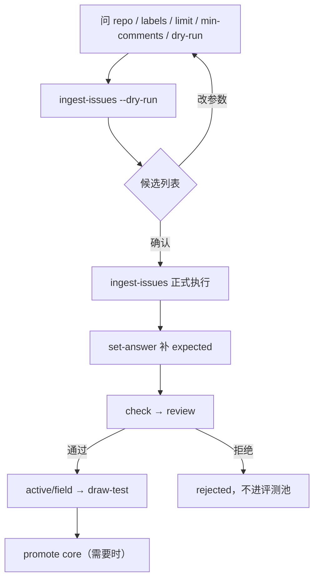

# Eval Ingest（评测集补充）

这是评测集的补充入口，不是 case 沉淀入口。`issue-ingest` 产出 case 草稿；本 skill 产出候选样本。两者可以消费同一条 issue，但 processed 分命名空间，互不吞并。

## 触发

- 用户说“补评测集”“从 issue 补些评估样本”“field 样本不够”“把已闭环的案例回流成样本”；
- `python3 scripts/evolve.py run` 的 `next_actions` 出现 `field_eval_short`；
- 已有样本被吸收、test 失效或目标族缺口，需要补 field/core。

不触发：用户要沉淀 case → `/skill:issue-ingest`；用户要跑一轮改进 → `/skill:self-evolve`。

## 交互顺序



只问四类事：哪个 repo、哪些 label、取多少条、先 dry-run 还是直接导。其余由脚本做：元数据拉取、PR/已处理/label/评论/标题过滤、按需取 body、查重、state 幂等。

## 已闭环 case 回流

两类来源，走同一个入口，不新开 skill：

| 来源 | 判断 | 入口 |
|---|---|---|
| 走过 sleuth | 有 `traces/<session>.yaml` 与报告 | `sample new --from trace --trace <path>` |
| 没走 sleuth | 有日志/定位文档，先有 case YAML | 先 `/skill:to-postmortem` 产 case，再 `sample new --from postmortem --case <path>` |

先跑 dry-run 看完整性与查重，不直接写队列：

```bash
python3 scripts/evolve.py sample new --from trace \
  --trace traces/<session>.yaml --dry-run --json
python3 scripts/evolve.py sample new --from postmortem \
  --case <case.yaml> --dry-run --json
```

确认后去掉 `--dry-run` 即写入本地队列。来源文件用主检出的路径（例如 `/Users/<you>/projects/ascend-sleuth/traces/<session>.yaml`），不要写相对当前 worktree 的路径。

状态有八种：`ready`（可提交）、`needs_answer`（缺根因与修复）、`needs_sanitize`（未脱敏）、`needs_source`（缺来源）、`non_diagnostic`（没有可判别现象）、`duplicate`（本地或评测集已有同来源）、`absorbed`（已进知识库）、`stale`（trace 已不在）。

补答案只问两个问题：**根因和修复，与现场一致吗？这条能共享吗？**

```bash
python3 scripts/evolve.py sample set-answer --id <id> \
  --resolution '<根因与修复>' --confidence maintainer-reviewed --sanitized true
python3 scripts/evolve.py sample status --id <id> --json
```

规则：

- 诊断结束只产 feedback 候选，不直接产 evaluation；`proposed` 里的 agent 结论不是答案。
- 没走 sleuth 的案例先用 `to-postmortem` 抽症状/根因/修复，本 skill 只补样本字段，不重抽。
- 已进知识库的标 `absorbed`，转 regression，不进 evaluation。
- `sanitized: false` 能留本地 feedback；转 evaluation 或升 core 会被 `review` / `promote --to core` 拒绝。`sample status` 的 `needs_sanitize` 是投稿门槛，不是禁止本地反馈复核。
- 查重同时看本地队列、`eval/s2`、`eval/holdout.yaml` 与 `knowledge/`；重复只提示，不静默丢弃。

## 步骤

1. **确认参数**：repo、labels、min-comments、limit、是否 dry-run；默认先 dry-run。
2. **dry-run**：

   ```bash
   python3 scripts/evolve.py sample ingest-issues \
     --repo <repo> --labels <labels> --limit <n> --dry-run
   ```

   给用户看候选编号/标题/跳过原因；参数不对回到第 1 步。

3. **正式导入**：去掉 `--dry-run`。默认 state 写当前检出的 `ingest-state.json` 的 `<source_id>/evaluation` 命名空间；样本库仍锚主检出。
4. **补答案**：逐条

   ```bash
   python3 scripts/evolve.py sample set-answer --id <id> --expected '<json>'
   ```

   答案来自维护者核过的 issue resolution/fix；不把评论里未确认的猜测当答案。

5. **复核**：`sample check --id <id>`，再 `sample review --id <id> --approve|--reject`。ingest 不自动 active。
6. **入池**：通过后是 active/field evaluation；需要 test 时 `sample draw-test`；需要 core 时 `sample promote --id <id> --to core`。
7. **停点**：达到 field/test 目标就停；候选拒绝、body 空、重复来源如实计数，不补假样本。

## 分支与失败

| 情形 | 行为 |
|---|---|
| gh 未安装/未登录 | 停下，给安装/`gh auth login` 修法；不写半份样本 |
| source 不可达/本地 cache 坏 | 退出 2；dry-run 也失败，不更新 state |
| PR 混入、已处理、label 不匹配、评论少、标题排除 | 跳过并计数；不创建样本 |
| body 空/太短/标题像 feature | 跳过；不进入候选 |
| 重复 source/id | 跳过；第二次运行幂等 |
| 候选没有答案 | 留 candidate；`review` 会拒绝，先 `set-answer` |
| review 拒绝 | 留 rejected；不进入评测池 |
| test 退休/失效 | 先 `absorb`，再 `draw-test` 按剩余槽位补齐 |
| 维护者拿不准答案 | 不猜；留 candidate 或拒绝，记原因 |

## 边界

- 只建 candidate；不自动 active、不自动 promote core、不自动合并。
- 不改 `knowledge/`、`references/`、case 草稿；case 沉淀走 `/skill:issue-ingest`。
- 评论、关联 PR、resolution 不进入样本 `input`，防止泄题。
- 类型来自 `expected.namespace/category`，不拿 issue label 猜；`samples.strata` 配每层 test 目标。
- 所有人都能调用本 skill；写权限仍由 policy、CODEOWNERS、分支保护和人工 review 约束。
- 完整来源协议、过滤规则和 state 语义见 [evaluation.md](../../docs/mechanism/evaluation.md)。
